# 2.1 信息存储

[返回章节目录](./%E7%AC%AC2%E7%AB%A0%20%E4%BF%A1%E6%81%AF%E7%9A%84%E8%A1%A8%E7%A4%BA%E5%92%8C%E5%A4%84%E7%90%86.md)

大多数计算机使用 8 位的块，或者字节（byte），作为最小的可寻址的内存单位，而不是访问内存中单独的位。机器级程序将内存视为一个非常大的字节数组，称为虚拟内存（virtual memory）。内存的每个字节都由一个唯一的数字来标识，称为它的地址（address），所有可能地址的集合就称为虚拟地址空间（virtual address space）。顾名思义，这个虚拟地址空间只是一个展现给机器级程序的概念性映像。实际的实现（见[第 9 章](../../03%20%E7%AC%AC%202%20%E9%83%A8%E5%88%86%20%E5%9C%A8%E7%B3%BB%E7%BB%9F%E4%B8%8A%E8%BF%90%E8%A1%8C%E7%A8%8B%E5%BA%8F/%E7%AC%AC%209%20%E7%AB%A0%20%E8%99%9A%E6%8B%9F%E5%86%85%E5%AD%98/%E7%AC%AC9%E7%AB%A0%20%E8%99%9A%E6%8B%9F%E5%86%85%E5%AD%98.md)）是将动态随机访问存储器（DRAM）、闪存、磁盘存储器、特殊硬件和操作系统软件结合起来，为程序提供一个看上去统一的字节数组。

在接下来的几章中，我们将讲述编译器和运行时系统是如何将存储器空间划分为更可管理的单元，来存放不同的程序对象（program object），即程序数据、指令和控制信息。可以用各种机制来分配和管理程序不同部分的存储。这种管理完全是在虚拟地址空间里完成的。例如，C 语言中一个指针的值（无论它指向一个整数、一个结构或是某个其他程序对象）都是某个存储块的第一个字节的虚拟地址。C 编译器还把每个指针和类型信息联系起来，这样就可以根据指针值的类型，生成不同的机器级代码来访问存储在指针所指向位置处的值。尽管 C 编译器维护着这个类型信息，但是它生成的实际机器级程序并不包含关于数据类型的信息。每个程序对象可以简单地视为一个字节块，而程序本身就是一个字节序列。

> [!NOTE] 给 C 语言初学者 C 语言中指针的作用
>
> 指针是 C 语言的一个重要特性。它提供了引用数据结构（包括数组）的元素的机制。与变量类似，指针也有两个方面：值和类型。它的值表示某个对象的位置，而它的类型表示那个位置上所存储对象的类型（比如整数或者浮点数）。
>
> 真正理解指针需要查看它们在机器级上的表示以及实现。这将是[第 3 章](../%E7%AC%AC%203%20%E7%AB%A0%20%E7%A8%8B%E5%BA%8F%E7%9A%84%E6%9C%BA%E5%99%A8%E7%BA%A7%E8%A1%A8%E7%A4%BA/%E7%AC%AC%203%20%E7%AB%A0%20%E7%A8%8B%E5%BA%8F%E7%9A%84%E6%9C%BA%E5%99%A8%E7%BA%A7%E8%A1%A8%E7%A4%BA.md)的重点之一，[3.10.1 节](../%E7%AC%AC%203%20%E7%AB%A0%20%E7%A8%8B%E5%BA%8F%E7%9A%84%E6%9C%BA%E5%99%A8%E7%BA%A7%E8%A1%A8%E7%A4%BA/3.10%20%E5%9C%A8%E6%9C%BA%E5%99%A8%E7%BA%A7%E7%A8%8B%E5%BA%8F%E4%B8%AD%E5%B0%86%E6%8E%A7%E5%88%B6%E4%B8%8E%E6%95%B0%E6%8D%AE%E7%BB%93%E5%90%88%E8%B5%B7%E6%9D%A5.md#3.10.1%20%E7%90%86%E8%A7%A3%E6%8C%87%E9%92%88)将对其进行深入介绍。

## 2.1.1 十六进制表示法

一个字节由 8 位组成。在二进制表示法中，它的值域是 $00000000_{2} \sim 11111111_{2}$。如果看成十进制整数，它的值域就是 $0_{10} \sim 255_{10}$。两种符号表示法对于描述位模式来说都不是非常方便。二进制表示法太冗长，而十进制表示法与位模式的互相转化很麻烦。替代的方法是，以 16 为基数，或者叫做十六进制（hexadecimal）数，来表示位模式。十六进制（简写为“hex”）使用数字‘0’～‘9’以及字符‘A’～‘F’来表示 16 个可能的值。[图 2-2](#%E5%9B%BE%202-2) 展示了 16 个十六进制数字对应的十进制值和二进制值。用十六进制书写，一个字节的值域为 $00_{16} \sim \mathrm{FF}_{16}$。

### 图 2-2

| 十六进制数字 | 0    | 1    | 2    | 3    | 4    | 5    | 6    | 7    |
| ------------ | ---- | ---- | ---- | ---- | ---- | ---- | ---- | ---- |
| 十进制值     | 0    | 1    | 2    | 3    | 4    | 5    | 6    | 7    |
| 二进制值     | 0000 | 0001 | 0010 | 0011 | 0100 | 0101 | 0110 | 0111 |
| **十六进制数字** | **8** | **9** | **A** | **B** | **C** | **D** | **E** | **F** |
| 十进制值     | 8    | 9    | 10   | 11   | 12   | 13   | 14   | 15   |
| 二进制值     | 1000 | 1001 | 1010 | 1011 | 1100 | 1101 | 1110 | 1111 |

图 2-2 十六进制表示法。每个十六进制数字都对 16 个值中的一个进行了编码

在 C 语言中，以 `0x` 或 `0X` 开头的数字常量被认为是十六进制的值。字符‘A’～‘F’既可以是大写，也可以是小写。例如，我们可以将数字 $FA1D37B_{16}$ 写作 `0xFA1D37B`，或者 `0xfa1d37b`，甚至是大小写混合，比如，`0xFa1D37b`。在本书中，我们将使用 C 表示法来表示十六进制值。

编写机器级程序的一个常见任务就是在位模式的十进制、二进制和十六进制表示之间人工转换。二进制和十六进制之间的转换比较简单直接，因为可以一次执行一个十六进制数字的转换。数字的转换可以参考如[图 2-2](#%E5%9B%BE%202-2) 所示的表。一个简单的窍门是，记住十六进制数字 A、C 和 F 相应的十进制值。而对于把十六进制值 B、D 和 E 转换成十进制值，则可以通过计算它们与前三个值的相对关系来完成。

比如，假设给你一个数字 `0x173A4C`。可以通过展开每个十六进制数字，将它转换为二进制格式，如下所示：

| 十六进制 | 1    | 7    | 3    | A    | 4    | C    |
| -------- | ---- | ---- | ---- | ---- | ---- | ---- |
| 二进制   | 0001 | 0111 | 0011 | 1010 | 0100 | 1100 |

这样就得到了二进制表示 000101110011101001001100。

反过来，如果给定一个二进制数字 1111001010110110110011，可以通过首先把它分为每 4 位一组来转换为十六进制。不过要注意，如果位总数不是 4 的倍数，最左边的一组可以少于 4 位，前面用 0 补足。然后将每个 4 位组转换为相应的十六进制数字：

| 二进制   | 11  | 1100 | 1010 | 1101 | 1011 | 0011 |
| -------- | --- | ---- | ---- | ---- | ---- | ---- |
| 十六进制 | 3   | C    | A    | D    | B    | 3    |

### 练习题 2.1

> [!TIP] ✎ 练习题
>
> [查看练习题答案](./%E7%BB%83%E4%B9%A0%E9%A2%98%E7%AD%94%E6%A1%88.md#%E7%AD%94%E6%A1%88%202.1)
>
> 完成下面的数字转换：
>
> - A. 将 `0x39A7F8` 转换为二进制。
> - B. 将二进制 `1100100101111011` 转换为十六进制。
> - C. 将 `0xD5E4C` 转换为二进制。
> - D. 将二进制 `1001101110011110110101` 转换为十六进制。

当值 $x$ 是 2 的非负整数 $n$ 次幂时，也就是 $x = 2^n$，我们可以很容易地将 $x$ 写成十六进制形式，只要记住 $x$ 的二进制表示就是 1 后面跟 $n$ 个 0。十六进制数字 0 代表 4 个二进制 0。所以，当 $n$ 表示成 $i + 4j$ 的形式，其中 $0 \leqslant i \leqslant 3$，我们可以把 $x$ 写成开头的十六进制数字为 $1(i = 0)$、$2(i = 1)$、$4(i = 2)$ 或者 $8(i = 3)$，后面跟随着 $j$ 个十六进制的 0。比如，$x = 2048 = 2^{11}$，我们有 $n = 11 = 3 + 4 \cdot 2$，从而得到十六进制表示 `0x800`。

### 练习题 2.2

> [!TIP] ✎ 练习题
>
> [查看练习题答案](./%E7%BB%83%E4%B9%A0%E9%A2%98%E7%AD%94%E6%A1%88.md#%E7%AD%94%E6%A1%88%202.2)
>
> 填写下表中的空白项，给出 2 的不同次幂的二进制和十六进制表示：
>
> | $n$ | $2^n$（十进制） | $2^n$（十六进制） |
> | --- | --------------- | ----------------- |
> | 9   | 512             | `0x200`           |
> | 19  |                 |                   |
> |     | 16 384          |                   |
> |     |                 | `0x10000`         |
> | 17  |                 |                   |
> |     | 32              |                   |
> |     |                 | `0x80`            |

十进制和十六进制表示之间的转换需要使用乘法或者除法来处理一般情况。将一个十进制数字 $x$ 转换为十六进制，可以反复地用 16 除 $x$，得到一个商 $q$ 和一个余数 $r$，也就是 $x = q\cdot 16 + r$。然后，我们用十六进制数字表示的 $r$ 作为最低位数字，并且通过对 $q$ 反复进行这个过程得到剩下的数字。例如，考虑十进制 314156 的转换：

$$
\begin{aligned}
314156 &= 19634 \cdot 16 + 12 \quad \text{(C)} \\
19634 &= 1227 \cdot 16 + 2 \quad \text{(2)} \\
1227 &= 76 \cdot 16 + 11 \quad \text{(B)} \\
76 &= 4 \cdot 16 + 12 \quad \text{(C)} \\
4 &= 0 \cdot 16 + 4 \quad \text{(4)}
\end{aligned}
$$

从这里，我们能读出十六进制表示为 `0x4CB2C`。

反过来，将一个十六进制数字转换为十进制数字，我们可以用相应的 16 的幂乘以每个十六进制数字。比如，给定数字 `0x7AF`，我们计算它对应的十进制值为 $7\cdot16^{2}+10\cdot16+15=7\cdot256+10\cdot16+15=1792+160+15=1967$。

### 练习题 2.3

> [!TIP] ✎ 练习题
>
> [查看练习题答案](./%E7%BB%83%E4%B9%A0%E9%A2%98%E7%AD%94%E6%A1%88.md#%E7%AD%94%E6%A1%88%202.3)
>
> 一个字节可以用两个十六进制数字来表示。填写下表中缺失的项，给出不同字节模式的十进制、二进制和十六进制值：
>
> | 十进制 | 二进制    | 十六进制 |
> | ------ | --------- | -------- |
> | 0      | 0000 0000 | `0x00`   |
> | 167    |           |          |
> | 62     |           |          |
> | 188    |           |          |
> |        | 0011 0111 |          |
> |        | 1000 1000 |          |
> |        | 1111 0011 |          |
> |        |           | `0x52`   |
> |        |           | `0xAC`   |
> |        |           | `0xE7`   |

> [!NOTE] 十进制和十六进制间的转换
>
> 较大数值的十进制和十六进制之间的转换，最好是让计算机或者计算器来完成。有大量的工具可以完成这个工作。一个简单的方法就是利用任何标准的搜索引擎，比如查询：
>
> 把 `0xabcd` 转换为十进制数
>
> 或
>
> 把 123 用十六进制表示。

### 练习题 2.4

> [!TIP] ✎ 练习题
>
> [查看练习题答案](./%E7%BB%83%E4%B9%A0%E9%A2%98%E7%AD%94%E6%A1%88.md#%E7%AD%94%E6%A1%88%202.4)
>
> 不将数字转换为十进制或者二进制，试着解答下面的算术题，答案要用十六进制表示。提示：只要将执行十进制加法和减法所使用的方法改成以 16 为基数。
>
> - A. `0x503c + 0x8 =`
> - B. `0x503c - 0x40 =`
> - C. `0x503c + 64 =`
> - D. `0x50ea - 0x503c =`

## 2.1.2 字数据大小

每台计算机都有一个字长（word size），指明指针数据的标称大小（nominal size）。因为虚拟地址是以这样的一个字来编码的，所以字长决定的最重要的系统参数就是虚拟地址空间的最大大小。也就是说，对于一个字长为 $w$ 位的机器而言，虚拟地址的范围为 $0 \sim 2^w - 1$，程序最多访问 $2^w$ 个字节。

最近这些年，出现了大规模的从 32 位字长机器到 64 位字长机器的迁移。这种情况首先出现在为大型科学和数据库应用设计的高端机器上，之后是台式机和笔记本电脑，最近则出现在智能手机的处理器上。32 位字长限制虚拟地址空间为 4 千兆字节（写作 4GB），也就是说，刚刚超过 $4 \times 10^{9}$ 字节。扩展到 64 位字长使得虚拟地址空间为 16EB，大约是 $1.84 \times 10^{19}$ 字节。

大多数 64 位机器也可以运行为 32 位机器编译的程序，这是一种向后兼容。因此，举例来说，当程序 `prog.c` 用如下伪指令编译后

```bash
gcc -m32 prog.c
```

该程序就可以在 32 位或 64 位机器上正确运行。另一方面，若程序用下述伪指令编译

```bash
gcc -m64 prog.c
```

那就只能在 64 位机器上运行。因此，我们将程序称为“32 位程序”或“64 位程序”时，区别在于该程序是如何编译的，而不是其运行的机器类型。

计算机和编译器支持多种不同方式编码的数字格式，如不同长度的整数和浮点数。比如，许多机器都有处理单个字节的指令，也有处理表示为 2 字节、4 字节或者 8 字节整数的指令，还有些指令支持表示为 4 字节和 8 字节的浮点数。

C 语言支持整数和浮点数的多种数据格式。[图 2-3](#%E5%9B%BE%202-3) 展示了为 C 语言各种数据类型分配的字节数。（我们在 [2.2 节](./2.2%20%E6%95%B4%E6%95%B0%E8%A1%A8%E7%A4%BA.md#2.2%20%E6%95%B4%E6%95%B0%E8%A1%A8%E7%A4%BA) 讨论 C 标准保证的字节数和典型的字节数之间的关系。）有些数据类型的确切字节数依赖于程序是如何被编译的。我们给出的是 32 位和 64 位程序的典型值。整数或者为有符号的，即可以表示负数、零和正数；或者为无符号的，即只能表示非负数。C 的数据类型 `char` 表示一个单独的字节。尽管“`char`”是由于它被用来存储文本串中的单个字符这一事实而得名，但它也能被用来存储整数值。数据类型 `short`、`int` 和 `long` 可以提供各种数据大小。即使是为 64 位系统编译，数据类型 `int` 通常也只有 4 个字节。数据类型 `long` 一般在 32 位程序中为 4 字节，在 64 位程序中则为 8 字节。

### 图 2-3

| C 声明          |                  | 字节数 |       |
| --------------- | ---------------- | ------ | ----- |
| 有符号          | 无符号           | 32 位  | 64 位 |
| `[signed] char` | `unsigned char`  | 1      | 1     |
| `short`         | `unsigned short` | 2      | 2     |
| `int`           | `unsigned`       | 4      | 4     |
| `long`          | `unsigned long`  | 4      | 8     |
| `int32_t`       | `uint32_t`       | 4      | 4     |
| `int64_t`       | `uint64_t`       | 8      | 8     |
| `char *`        |                  | 4      | 8     |
| `float`         |                  | 4      | 4     |
| `double`        |                  | 8      | 8     |

图 2-3 基本 C 数据类型的典型大小（以字节为单位）。分配的字节数受程序是如何编译的影响而变化。本图给出的是 32 位和 64 位程序的典型值

为了避免由于依赖“典型”大小和不同编译器设置带来的奇怪行为，ISO C99 引入了一类数据类型，其数据大小是固定的，不随编译器和机器设置而变化。其中就有数据类型 `int32_t` 和 `int64_t`，它们分别为 4 个字节和 8 个字节。使用确定大小的整数类型是程序员准确控制数据表示的最佳途径。

大部分数据类型都编码为有符号数值，除非有前缀关键字 `unsigned` 或对确定大小的数据类型使用了特定的无符号声明。数据类型 `char` 是一个例外。尽管大多数编译器和机器将它们视为有符号数，但 C 标准不保证这一点。相反，正如方括号指示的那样，程序员应该用有符号字符的声明来保证其为一个字节的有符号数值。不过，在很多情况下，程序行为对数据类型 `char` 是有符号的还是无符号的并不敏感。

对关键字的顺序以及包括还是省略可选关键字来说，C 语言允许存在多种形式。比如，下面所有的声明都是一个意思：

```c
unsigned long
unsigned long int
long unsigned
long unsigned int
```

我们将始终使用[图 2-3](#%E5%9B%BE%202-3) 给出的格式。

> [!NOTE] 给 C 语言初学者 声明指针
>
> 对于任何数据类型 `T`，声明
>
> ```c
> T *p;
> ```
>
> 表明 `p` 是一个指针变量，指向一个类型为 `T` 的对象。例如，
>
> ```c
> char *p;
> ```
>
> 就将一个指针声明为指向一个 `char` 类型的对象。

[图 2-3](#%E5%9B%BE%202-3) 还展示了指针（例如一个被声明为类型为 `char *` 的变量）使用程序的全字长。大多数机器还支持两种不同的浮点数格式：单精度（在 C 中声明为 `float`）和双精度（在 C 中声明为 `double`）。这些格式分别使用 4 字节和 8 字节。

程序员应该力图使他们的程序在不同的机器和编译器上可移植。可移植性的一个方面就是使程序对不同数据类型的确切大小不敏感。C 语言标准对不同数据类型的数字范围设置了下界（这点在后面还将讲到），但是却没有上界。因为从 1980 年左右到 2010 年左右，32 位机器和 32 位程序是主流的组合，许多程序的编写都假设为[图 2-3](#%E5%9B%BE%202-3) 中 32 位程序的字节分配。随着 64 位机器的日益普及，在将这些程序移植到新机器上时，许多隐藏的对字长的依赖性就会显现出来，成为错误。比如，许多程序员假设一个声明为 `int` 类型的程序对象能被用来存储一个指针。这在大多数 32 位的机器上能正常工作，但是在一台 64 位的机器上却会导致问题。

## 2.1.3 寻址和字节顺序

对于跨越多字节的程序对象，我们必须建立两个规则：这个对象的地址是什么，以及在内存中如何排列这些字节。在几乎所有的机器上，多字节对象都被存储为连续的字节序列，对象的地址为所使用字节中最小的地址。例如，假设一个类型为 `int` 的变量 `x` 的地址为 `0x100`，也就是说，地址表达式 `&x` 的值为 `0x100`。那么，（假设数据类型 `int` 为 32 位表示）`x` 的 4 个字节将被存储在内存的 `0x100`、`0x101`、`0x102` 和 `0x103` 位置。

排列表示一个对象的字节有两个通用的规则。考虑一个 $w$ 位的整数，其位表示为 $[x_{w-1}, x_{w-2}, \cdots, x_1, x_0]$，其中 $x_{w-1}$ 是最高有效位，而 $x_0$ 是最低有效位。假设 $w$ 是 8 的倍数，这些位就能被分组成为字节，其中最高有效字节包含位 $[x_{w-1}, x_{w-2}, \cdots, x_{w-8}]$，而最低有效字节包含位 $[x_7, x_6, \cdots, x_0]$，其他字节包含中间的位。某些机器选择在内存中按照从最低有效字节到最高有效字节的顺序存储对象，而另一些机器则按照从最高有效字节到最低有效字节的顺序存储。前一种规则——最低有效字节在最前面的方式，称为小端法（little endian）。后一种规则——最高有效字节在最前面的方式，称为大端法（big endian）。

假设变量 `x` 的类型为 `int`，位于地址 `0x100` 处，它的十六进制值为 `0x01234567`。地址范围 `0x100`～`0x103` 的字节顺序依赖于机器的类型：


注意，在字 `0x01234567` 中，高位字节的十六进制值为 `0x01`，而低位字节值为 `0x67`。

大多数 Intel 兼容机都只用小端模式。另一方面，IBM 和 Oracle（从其 2010 年收购 Sun Microsystems 开始）的大多数机器则是按大端模式操作。注意我们说的是“大多数”。这些规则并没有严格按照企业界限来划分。比如，IBM 和 Oracle 制造的个人计算机使用的是 Intel 兼容的处理器，因此使用小端法。许多比较新的微处理器是双端法（bi-endian），也就是说可以把它们配置成作为大端或者小端的机器运行。然而，实际情况是：一旦选择了特定操作系统，那么字节顺序也就固定下来。比如，用于许多移动电话的 ARM 微处理器，其硬件可以按小端或大端两种模式操作，但是这些芯片上最常见的两种操作系统——Android（来自 Google）和 iOS（来自 Apple）——却只能运行于小端模式。

令人吃惊的是，在哪种字节顺序是合适的这个问题上，人们表现得非常情绪化。实际上，术语“little endian（小端）”和“big endian（大端）”出自 Jonathan Swift 的《格利佛游记》（Gulliver's Travels）一书，其中交战的两个派别无法就应该从哪一端（小端还是大端）打开一个半熟的鸡蛋达成一致。就像鸡蛋的问题一样，选择何种字节顺序没有技术上的理由，因此争论沦为关于社会政治论题的争论。只要选择了一种规则并且始终如一地坚持，对于哪种字节排序的选择都是任意的。

> [!NOTE] “端”的起源
>
> 以下是 Jonathan Swift 在 1726 年关于大小端之争历史的描述：
>
> “……我下面要告诉你的是，Lilliput 和 Blefuscu 这两大强国在过去 36 个月里一直在苦战。战争开始是由于以下的原因：我们大家都认为，吃鸡蛋前，原始的方法是打破鸡蛋较大的一端，可是当今皇帝的祖父小时候吃鸡蛋，一次按古法打鸡蛋时碰巧将一个手指弄破了，因此他的父亲，当时的皇帝，就下了一道敕令，命令全体臣民吃鸡蛋时打破鸡蛋较小的一端，违令者重罚。老百姓们对这项命令极为反感。历史告诉我们，由此曾发生过六次叛乱，其中一个皇帝送了命，另一个丢了王位。这些叛乱大多都是由 Blefuscu 的国王大臣们煽动起来的。叛乱平息后，流亡的人总是逃到那个帝国去寻救避难。据估计，先后几次有 11 000 人情愿受死也不肯去打破鸡蛋较小的一端。关于这一争端，曾出版过几百本大部著作，不过大端派的书一直是受禁的，法律也规定该派的任何人不得做官。”（此段译文摘自网上蒋剑锋译的《格利佛游记》第一卷第 4 章。）
>
> 在他那个时代，Swift 是在讽刺英国（Lilliput）和法国（Blefuscu）之间持续的冲突。Danny Cohen，一位网络协议的早期开创者，第一次使用这两个术语来指代字节顺序[\[24\]](../../05%20%E9%99%84%E5%BD%95%E4%B8%8E%E5%8F%82%E8%80%83%E6%96%87%E7%8C%AE/%E5%8F%82%E8%80%83%E6%96%87%E7%8C%AE.md#%E6%96%87%E7%8C%AE%2024)，后来这个术语被广泛接纳了。

对于大多数应用程序员来说，其机器所使用的字节顺序是完全不可见的。无论为哪种类型的机器所编译的程序都会得到同样的结果。不过有时候，字节顺序会成为问题。首先是在不同类型的机器之间通过网络传送二进制数据时，一个常见的问题是当小端法机器产生的数据被发送到大端法机器或者反过来时，接收程序会发现，字里的字节成了反序的。为了避免这类问题，网络应用程序的代码编写必须遵守已建立的关于字节顺序的规则，以确保发送方机器将它的内部表示转换成网络标准，而接收方机器则将网络标准转换为它的内部表示。我们将在[第 11 章](../../04%20%E7%AC%AC%203%20%E9%83%A8%E5%88%86%20%E7%A8%8B%E5%BA%8F%E9%97%B4%E7%9A%84%E4%BA%A4%E4%BA%92%E5%92%8C%E9%80%9A%E4%BF%A1/%E7%AC%AC%2011%20%E7%AB%A0%20%E7%BD%91%E7%BB%9C%E7%BC%96%E7%A8%8B/%E7%AC%AC11%E7%AB%A0%20%E7%BD%91%E7%BB%9C%E7%BC%96%E7%A8%8B.md)中看到这种转换的例子。

第二种情况是，当阅读表示整数数据的字节序列时字节顺序也很重要。这通常发生在检查机器级程序时。作为一个示例，从某个文件中摘出了下面这行代码，该文件给出了一个针对 Intel x86-64 处理器的机器级代码的文本表示：

```asm
4004d3: 01 05 43 0b 20 00    add    %eax, 0x200b43(%rip)
```

这一行是由反汇编器（disassembler）生成的，反汇编器是一种确定可执行程序文件所表示的指令序列的工具。我们将在[第 3 章](../%E7%AC%AC%203%20%E7%AB%A0%20%E7%A8%8B%E5%BA%8F%E7%9A%84%E6%9C%BA%E5%99%A8%E7%BA%A7%E8%A1%A8%E7%A4%BA/%E7%AC%AC%203%20%E7%AB%A0%20%E7%A8%8B%E5%BA%8F%E7%9A%84%E6%9C%BA%E5%99%A8%E7%BA%A7%E8%A1%A8%E7%A4%BA.md)中学习有关这些工具的更多知识，以及怎样解释像这样的行。而现在，我们只是注意这行表述的意思是：十六进制字节串 `01 05 43 0b 20 00` 是一条指令的字节级表示，这条指令是把一个字长的数据加到一个值上，该值的存储地址由 `0x200b43` 加上当前程序计数器的值得到，当前程序计数器的值即为下一条将要执行指令的地址。如果取出这个序列的最后 4 个字节 `43 0b 20 00`，并且按照相反的顺序写出，我们得到 `00 20 0b 43`。去掉开头的 0，得到值 `0x200b43`，这就是右边的数值。当阅读像此类小端法机器生成的机器级程序表示时，经常会将字节按照相反的顺序显示。书写字节序列的自然方式是最低位字节在左边，而最高位字节在右边，这正好和通常书写数字时最高有效位在左边，最低有效位在右边的方式相反。

字节顺序变得重要的第三种情况是当编写规避正常的类型系统的程序时。在 C 语言中，可以通过使用强制类型转换（cast）或联合（`union`）来允许以一种数据类型引用一个对象，而这种数据类型与创建这个对象时定义的数据类型不同。大多数应用编程都强烈不推荐这种编码技巧，但是它们对系统级编程来说是非常有用，甚至是必需的。

[图 2-4](#%E5%9B%BE%202-4) 展示了一段 C 代码，它使用强制类型转换来访问和打印不同程序对象的字节表示。我们用 `typedef` 将数据类型 `byte_pointer` 定义为一个指向类型为 `unsigned char` 的对象的指针。这样一个字节指针引用一个字节序列，其中每个字节都被认为是一个非负整数。第一个例程 `show_bytes` 的输入是一个字节序列的地址，它用一个字节指针以及一个字节数来指示。该字节数指定为数据类型 `size_t`，表示数据结构大小的首选数据类型。`show_bytes` 打印出每个以十六进制表示的字节。C 格式化指令 `"%.2x"` 表明整数必须用至少两个数字的十六进制格式输出。

### 图 2-4

```c
#include <stdio.h>

typedef unsigned char* byte_pointer;

void show_bytes(byte_pointer start, size_t len) {
  size_t i;
  for (i = 0; i < len; i++)
    printf(" %.2x", start[i]);
  printf("\n");
}

void show_int(int x) {
  show_bytes((byte_pointer)&x, sizeof(int));
}

void show_float(float x) {
  show_bytes((byte_pointer)&x, sizeof(float));
}

void show_pointer(void* x) {
  show_bytes((byte_pointer)&x, sizeof(void*));
}
```

图 2-4 打印程序对象的字节表示。这段代码使用强制类型转换来规避类型系统。很容易定义针对其他数据类型的类似函数

过程 `show_int`、`show_float` 和 `show_pointer` 展示了如何使用程序 `show_bytes` 来分别输出类型为 `int`、`float` 和 `void *` 的 C 程序对象的字节表示。可以观察到它们仅仅传递给 `show_bytes` 一个指向它们参数 `x` 的指针 `&x`，且这个指针被强制类型转换为 `unsigned char *`。这种强制类型转换告诉编译器，程序应该把这个指针看成指向一个字节序列，而不是指向一个原始数据类型的对象。然后，这个指针会被看成是对象使用的最低字节地址。

这些过程使用 C 语言的运算符 `sizeof` 来确定对象使用的字节数。一般来说，表达式 `sizeof(T)` 返回存储一个类型为 `T` 的对象所需要的字节数。使用 `sizeof` 而不是一个固定的值，是向编写在不同机器类型上可移植的代码迈进了一步。

在几种不同的机器上运行如[图 2-5](#%E5%9B%BE%202-5) 所示的代码，得到如[图 2-6](#%E5%9B%BE%202-6) 所示的结果。我们使用了以下几种机器：

- **Linux 32：** 运行 Linux 的 Intel IA32 处理器。
- **Windows：** 运行 Windows 的 Intel IA32 处理器。
- **Sun：** 运行 Solaris 的 Sun Microsystems SPARC 处理器。（这些机器现在由 Oracle 生产。）
- **Linux 64：** 运行 Linux 的 Intel x86-64 处理器。

### 图 2-5

```c
void test_show_bytes(int val) {
  int ival = val;
  float fval = (float)ival;
  int* pval = &ival;
  show_int(ival);
  show_float(fval);
  show_pointer(pval);
}
```

图 2-5 字节表示的示例。这段代码打印示例数据对象的字节表示

### 图 2-6

| 机器     | 值       | 类型    | 字节（十六进制）        |
| -------- | -------- | ------- | ----------------------- |
| Linux 32 | 12 345   | `int`   | `39 30 00 00`             |
| Windows  | 12 345   | `int`   | `39 30 00 00`             |
| Sun      | 12 345   | `int`   | `00 00 30 39`             |
| Linux 64 | 12 345   | `int`   | `39 30 00 00`             |
| Linux 32 | 12 345.0 | `float` | `00 e4 40 46`             |
| Windows  | 12 345.0 | `float` | `00 e4 40 46`             |
| Sun      | 12 345.0 | `float` | `46 40 e4 00`             |
| Linux 64 | 12 345.0 | `float` | `00 e4 40 46`             |
| Linux 32 | `&ival`  | `int *` | `e4 f9 ff bf`             |
| Windows  | `&ival`  | `int *` | `b4 cc 22 00`             |
| Sun      | `&ival`  | `int *` | `ef ff fa 0c`             |
| Linux 64 | `&ival`  | `int *` | `b8 11 e5 ff ff 7f 00 00` |

图 2-6 不同数据值的字节表示。除了字节顺序以外，`int` 和 `float` 的结果是一样的。指针值与机器相关

参数 12345 的十六进制表示为 `0x00003039`。对于 `int` 类型的数据，除了字节顺序以外，我们在所有机器上都得到相同的结果。特别地，我们可以看到在 Linux 32、Windows 和 Linux 64 上，最低有效字节值 `0x39` 最先输出，这说明它们是小端法机器；而在 Sun 上最后输出，这说明 Sun 是大端法机器。同样地，`float` 数据的字节，除了字节顺序以外，也都是相同的。另一方面，指针值却是完全不同的。不同的机器/操作系统配置使用不同的存储分配规则。一个值得注意的特性是 Linux 32、Windows 和 Sun 的机器使用 4 字节地址，而 Linux 64 使用 8 字节地址。

> [!NOTE] 给 C 语言初学者 使用 `typedef` 来命名数据类型
>
> C 语言中的 `typedef` 声明提供了一种给数据类型命名的方式。这能够极大地改善代码的可读性，因为深度嵌套的类型声明很难读懂。
>
> `typedef` 的语法与声明变量的语法十分相像，除了它使用的是类型名，而不是变量名。因此，[图 2-4](#%E5%9B%BE%202-4) 中 `byte_pointer` 的声明和将一个变量声明为类型 `unsigned char *` 有相同的形式。
>
> 例如，声明：
>
> ```c
> typedef int* int_pointer;
> int_pointer ip;
> ```
>
> 将类型 `int_pointer` 定义为一个指向 `int` 的指针，并且声明了一个这种类型的变量 `ip`。我们还可以将这个变量直接声明为：
>
> ```c
> int* ip;
> ```

> [!NOTE] 给 C 语言初学者 使用 `printf` 格式化输出
>
> `printf` 函数（还有它的同类 `fprintf` 和 `sprintf`）提供了一种打印信息的方式，这种方式对格式化细节有相当大的控制能力。第一个参数是格式串（format string），而其余的参数都是要打印的值。在格式串里，每个以 `%` 开始的字符序列都表示如何格式化下一个参数。典型的示例包括：`%d` 是输出一个十进制整数，`%f` 是输出一个浮点数，而 `%c` 是输出一个字符，其编码由参数给出。
>
> 指定确定大小数据类型的格式，如 `int32_t`，要更复杂一些，相关内容参见 [2.2.3 节](./2.2%20%E6%95%B4%E6%95%B0%E8%A1%A8%E7%A4%BA.md#2.2.3%20%E8%A1%A5%E7%A0%81%E7%BC%96%E7%A0%81)的旁注。

可以观察到，尽管浮点型和整型数据都是对数值 12345 编码，但是它们有截然不同的字节模式：整型为 `0x00003039`，而浮点数为 `0x4640E400`。一般而言，这两种格式使用不同的编码方法。如果我们将这些十六进制模式扩展为二进制形式，并且适当地将它们移位，就会发现一个有 13 个相匹配的位的序列，用一串星号标识出来：

```text
   0   0   0   0   3   0   3   9
00000000000000000011000000111001
                   *************
             4   6   4   0   E   4   0   0
          01000110010000001110010000000000
```

这并不是巧合。当我们研究浮点数格式时，还将再回到这个例子。

> [!NOTE] 给 C 语言初学者 指针和数组
>
> 在函数 `show_bytes`（[图 2-4](#%E5%9B%BE%202-4)）中，我们看到指针和数组之间紧密的联系，这将在 [3.8 节](../%E7%AC%AC%203%20%E7%AB%A0%20%E7%A8%8B%E5%BA%8F%E7%9A%84%E6%9C%BA%E5%99%A8%E7%BA%A7%E8%A1%A8%E7%A4%BA/3.8%20%E6%95%B0%E7%BB%84%E5%88%86%E9%85%8D%E5%92%8C%E8%AE%BF%E9%97%AE.md#3.8%20%E6%95%B0%E7%BB%84%E5%88%86%E9%85%8D%E5%92%8C%E8%AE%BF%E9%97%AE)中详细描述。这个函数有一个类型为 `byte_pointer`（被定义为一个指向 `unsigned char` 的指针）的参数 `start`，但是我们在[第 8 行](#%E5%9B%BE%202-4 "查看对应代码块")上看到数组引用 `start[i]`。在 C 语言中，我们能够用数组表示法来引用指针，同时我们也能用指针表示法来引用数组元素。在这个例子中，引用 `start[i]` 表示我们想要读取以 `start` 指向的位置为起始的第 $i$ 个位置处的字节。

> [!NOTE] 给 C 语言初学者 指针的创建和间接引用
>
> 在[图 2-4](#%E5%9B%BE%202-4) 的[第 13、17 和 21 行](#%E5%9B%BE%202-4 "查看对应代码块")，我们看到对 C 和 C++ 中两种独有操作的使用。C 的“取地址”运算符 `&` 创建一个指针。在这三行中，表达式 `&x` 创建了一个指向保存变量 `x` 的位置的指针。这个指针的类型取决于 `x` 的类型，因此这三个指针的类型分别为 `int *`、`float *` 和 `void **`。（数据类型 `void *` 是一种特殊类型的指针，没有相关联的类型信息。）
>
> 强制类型转换运算符可以将一种数据类型转换为另一种。因此，强制类型转换 `(byte_pointer) &x` 表明无论指针 `&x` 以前是什么类型，它现在就是一个指向数据类型为 `unsigned char` 的指针。这里给出的这些强制类型转换不会改变真实的指针，它们只是告诉编译器以新的数据类型来看待被指向的数据。

> [!NOTE] 生成一张 ASCII 表
>
> 可以通过执行命令 `man ascii` 来得到一张 ASCII 字符码的表。

### 练习题 2.5

> [!TIP] ✎ 练习题
>
> [查看练习题答案](./%E7%BB%83%E4%B9%A0%E9%A2%98%E7%AD%94%E6%A1%88.md#%E7%AD%94%E6%A1%88%202.5)
>
> 思考下面对 `show_bytes` 的三次调用：
>
> ```c
> int val = 0x87654321;
> byte_pointer valp = (byte_pointer)&val;
> show_bytes(valp, 1); /* A. */
> show_bytes(valp, 2); /* B. */
> show_bytes(valp, 3); /* C. */
> ```
>
> 指出在小端法机器和大端法机器上，每次调用的输出值。
>
> |     | 小端法 | 大端法 |
> | --- | ------ | ------ |
> | A.  |        |        |
> | B.  |        |        |
> | C.  |        |        |

### 练习题 2.6

> [!TIP] ✎ 练习题
>
> [查看练习题答案](./%E7%BB%83%E4%B9%A0%E9%A2%98%E7%AD%94%E6%A1%88.md#%E7%AD%94%E6%A1%88%202.6)
>
> 使用 `show_int` 和 `show_float`，我们确定整数 3510593 的十六进制表示为 `0x00359141`，而浮点数 3510593.0 的十六进制表示为 `0x4A564504`。
>
> - A. 写出这两个十六进制值的二进制表示。
> - B. 移动这两个二进制串的相对位置，使得它们相匹配的位数最多。有多少位相匹配呢？
> - C. 串中的什么部分不相匹配？

## 2.1.4 表示字符串

C 语言中字符串被编码为一个以 `null`（其值为 0）字符结尾的字符数组。每个字符都由某个标准编码来表示，最常见的是 ASCII 字符码。因此，如果我们以参数 `"12345"` 和 6（包括终止符）来运行例程 `show_bytes`，我们得到结果 `31 32 33 34 35 00`。请注意，十进制数字 `x` 的 ASCII 码正好是 `0x3x`，而终止字节的十六进制表示为 `0x00`。在使用 ASCII 码作为字符码的任何系统上都将得到相同的结果，与字节顺序和字大小规则无关。因而，文本数据比二进制数据具有更强的平台独立性。

### 练习题 2.7

> [!TIP] ✎ 练习题
>
> [查看练习题答案](./%E7%BB%83%E4%B9%A0%E9%A2%98%E7%AD%94%E6%A1%88.md#%E7%AD%94%E6%A1%88%202.7)
>
> 下面对 `show_bytes` 的调用将输出什么结果？
>
> ```c
> const char* s = "abcdef";
> show_bytes((byte_pointer)s, strlen(s));
> ```
>
> 注意字母‘a’～‘z’的 ASCII 码为 `0x61`～`0x7A`。

> [!NOTE] 文字编码的 Unicode 标准
>
> ASCII 字符集适合于编码英语文档，但是在表达一些特殊字符方面并没有太多办法，例如法语的“Ç”。它完全不适合编码希腊语、俄语和中文等语言的文档。这些年，提出了很多方法来对不同语言的文字进行编码。Unicode 联合会（Unicode Consortium）修订了最全面且广泛接受的文字编码标准。当前的 Unicode 标准（7.0 版）的字库包括将近 100 000 个字符，支持广泛的语言种类，包括古埃及和巴比伦的语言。为了保持信用，Unicode 技术委员会否决了为 Klingon（即电视连续剧《星际迷航》中的虚构文明）编写语言标准的提议。
>
> 基本编码，称为 Unicode 的“统一字符集”，使用 32 位来表示字符。这好像要求文本串中每个字符要占用 4 个字节。不过，可以有一些替代编码，常见的字符只需要 1 个或 2 个字节，而不太常用的字符需要多一些的字节数。特别地，UTF-8 表示将每个字符编码为一个字节序列，这样标准 ASCII 字符还是使用和它们在 ASCII 中一样的单字节编码，这也就意味着所有的 ASCII 字节序列用 ASCII 码表示和用 UTF-8 表示是一样的。Java 编程语言使用 Unicode 来表示字符串。对于 C 语言也有支持 Unicode 的程序库。

## 2.1.5 表示代码

考虑下面的 C 函数：

```c
int sum(int x, int y) {
  return x + y;
}
```

当我们在示例机器上编译时，生成如下字节表示的机器代码：

```text
Linux 32:   55 89 e5 8b 45 0c 03 45 08 c9 c3
Windows:    55 89 e5 8b 45 0c 03 45 08 5d c3
Sun:        81 c3 e0 08 90 02 00 09
Linux 64:   55 48 89 e5 89 7d fc 89 75 f8 03 45 fc c9 c3
```

我们发现指令编码是不同的。不同的机器类型使用不同的且不兼容的指令和编码方式。即使是完全一样的进程，运行在不同的操作系统上也会有不同的编码规则，因此二进制代码是不兼容的。二进制代码很少能在不同机器和操作系统组合之间移植。

计算机系统的一个基本概念就是，从机器的角度来看，程序仅仅只是字节序列。机器没有关于原始源程序的任何信息，除了可能有些用来帮助调试的辅助表以外。在[第 3 章](../%E7%AC%AC%203%20%E7%AB%A0%20%E7%A8%8B%E5%BA%8F%E7%9A%84%E6%9C%BA%E5%99%A8%E7%BA%A7%E8%A1%A8%E7%A4%BA/%E7%AC%AC%203%20%E7%AB%A0%20%E7%A8%8B%E5%BA%8F%E7%9A%84%E6%9C%BA%E5%99%A8%E7%BA%A7%E8%A1%A8%E7%A4%BA.md)学习机器级编程时，我们将更清楚地看到这一点。

## 2.1.6 布尔代数简介

二进制值是计算机编码、存储和操作信息的核心，所以围绕数值 0 和 1 的研究已经演化出了丰富的数学知识体系。这起源于 1850 年前后乔治·布尔（George Boole，1815—1864）的工作，因此也称为布尔代数（Boolean algebra）。布尔注意到通过将逻辑值 TRUE（真）和 FALSE（假）编码为二进制值 1 和 0，能够设计出一种代数，以研究逻辑推理的基本原则。

最简单的布尔代数是在二元集合 $\{0, 1\}$ 基础上的定义。[图 2-7](#%E5%9B%BE%202-7) 定义了这种布尔代数中的几种运算。我们用来表示这些运算的符号与 C 语言位级运算使用的符号是相匹配的，这些将在后面讨论到。布尔运算 `~` 对应于逻辑运算 NOT，在命题逻辑中用符号 $\neg$ 表示。也就是说，当 $P$ 不是真的时候，我们就说 $\neg P$ 是真的，反之亦然。相应地，当 $P$ 等于 0 时，$\sim P$ 等于 1，反之亦然。布尔运算 `&` 对应于逻辑运算 AND，在命题逻辑中用符号 $\wedge$ 表示。当 $P$ 和 $Q$ 都为真时，我们说 $P \wedge Q$ 为真。相应地，只有当 $p = 1$ 且 $q = 1$ 时，$p \mathbin{\&} q$ 才等于 1。布尔运算 `|` 对应于逻辑运算 OR，在命题逻辑中用符号 $\vee$ 表示。当 $P$ 或者 $Q$ 为真时，我们说 $P \vee Q$ 成立。相应地，当 $p = 1$ 或者 $q = 1$ 时，$p \mid q$ 等于 1。布尔运算 `^` 对应于逻辑运算异或，在命题逻辑中用符号 $\oplus$ 表示。当 $P$ 或者 $Q$ 为真但不同时为真时，我们说 $P \oplus Q$ 成立。相应地，当 $p = 1$ 且 $q = 0$，或者 $p = 0$ 且 $q = 1$ 时，$p \oplus q$ 等于 1。

### 图 2-7

| ~   |     | &   | 0   | 1   | \|  | 0   | 1   | ^   | 0   | 1   |
| --- | --- | --- | --- | --- | --- | --- | --- | --- | --- | --- |
| 0   | 1   | 0   | 0   | 0   | 0   | 0   | 1   | 0   | 0   | 1   |
| 1   | 0   | 1   | 0   | 1   | 1   | 1   | 1   | 1   | 1   | 0   |

图 2-7 布尔代数的运算。二进制值 1 和 0 表示逻辑值 TRUE 或者 FALSE，而运算符 ~、&、| 和 ^ 分别表示逻辑运算 NOT、AND、OR 和 EXCLUSIVE-OR

后来创立信息论领域的 Claude Shannon（1916—2001）首先建立了布尔代数和数字逻辑之间的联系。他在 1937 年的硕士论文中表明了布尔代数可以用来设计和分析机电继电器网络。尽管那时计算机技术已经取得了相当的发展，但是布尔代数仍然在数字系统的设计和分析中扮演着重要的角色。

我们可以将上述 4 个布尔运算扩展到位向量的运算，位向量就是固定长度为 $w$、由 0 和 1 组成的串。位向量的运算可以定义成参数的每个对应元素之间的运算。假设 $a$ 和 $b$ 分别表示位向量 $\left[a_{w-1}, a_{w-2}, \cdots, a_0\right]$ 和 $\left[b_{w-1}, b_{w-2}, \cdots, b_0\right]$。我们将 $a \mathbin{\&} b$ 也定义为一个长度为 $w$ 的位向量，其中第 $i$ 个元素等于 $a_i \mathbin{\&} b_i, 0 \leqslant i < w$。可以用类似的方式将运算 `|`、`^` 和 `~` 扩展到位向量上。

举个例子，假设 $w = 4$，参数 $a = [0110]$，$b = [1100]$。那么 4 种运算 `a & b`、`a | b`、`a ^ b` 和 `~b` 分别得到以下结果：

```text
  0110      0110      0110
& 1100    | 1100    ^ 1100    ~ 1100
------    ------    ------    ------
  0100      1110      1010      0011
```

### 练习题 2.8

> [!TIP] ✎ 练习题
>
> [查看练习题答案](./%E7%BB%83%E4%B9%A0%E9%A2%98%E7%AD%94%E6%A1%88.md#%E7%AD%94%E6%A1%88%202.8)
>
> 填写下表，给出位向量的布尔运算的求值结果。
>
> | 运算 | 结果 |
> | --- | --- |
> | $a$ | $[01101001]$ |
> | $b$ | $[01010101]$ |
> | $\sim a$ | ______ |
> | $\sim b$ | ______ |
> | `a & b` | ______ |
> | `a \| b` | ______ |
> | `a ^ b` | ______ |

> [!NOTE] 网络旁注 DATA:BOOL 关于布尔代数和布尔环的更多内容
>
> 对于任意整数 $w > 0$，长度为 $w$ 的位向量上的布尔运算 `|`、`&` 和 `~` 形成了一个布尔代数。最简单的情况是 $w = 1$ 时，只有 2 个元素；但是对于更普遍的情况，有 $2^w$ 个长度为 $w$ 的位向量。布尔代数和整数算术运算有很多相似之处。例如，乘法对加法的分配律，写为 $a \cdot (b + c) = (a \cdot b) + (a \cdot c)$，而布尔运算 `&` 对 `|` 的分配律，写为 $a \mathbin{\&} (b \mid c) = (a \mathbin{\&} b) \mid (a \mathbin{\&} c)$。此外，布尔运算 `|` 对 `&` 也有分配律，写为 $a \mid (b \mathbin{\&} c) = (a \mid b) \mathbin{\&} (a \mid c)$，但是对于整数我们不能说 $a + (b \cdot c) = (a + b) \cdot (a + c)$。
>
> 当考虑长度为 $w$ 的位向量上的 `^`、`&` 和 `~` 运算时，会得到一种不同的数学形式，我们称为布尔环（Boolean ring）。布尔环与整数运算有很多相同的属性。例如，整数运算的一个属性是每个值 $x$ 都有一个加法逆元（additive inverse）$-x$，使得 $x + (-x) = 0$。布尔环也有类似的属性，这里的“加法”运算是 `^`，不过这时每个元素的加法逆元是它自己本身。也就是说，对于任何值 $a$ 来说，$a \oplus a = 0$，这里我们用 0 来表示全 0 的位向量。可以看到对单个位来说这是成立的，即 $0 \oplus 0 = 1 \oplus 1 = 0$，将这个扩展到位向量也是成立的。当我们重新排列组合顺序，这个属性也仍然成立，因此有 $(a \oplus b) \oplus a = b$。这个属性会引起一些很有趣的结果和聪明的技巧，在[练习题 2.10](#%E7%BB%83%E4%B9%A0%E9%A2%98%202.10) 中我们会有所探讨。
>
> 位向量一个很有用的应用就是表示有限集合。我们可以用位向量 $\left[a_{w-1}, \cdots, a_1, a_0\right]$ 编码任何子集 $A \subseteq \{0, 1, \cdots, w-1\}$，其中 $a_i = 1$ 当且仅当 $i \in A$。例如（记住我们是把 $a_{w-1}$ 写在左边，而将 $a_0$ 写在右边），位向量 $a \doteq [01101001]$ 表示集合 $A = \{0, 3, 5, 6\}$，而 $b \doteq [01010101]$ 表示集合 $B = \{0, 2, 4, 6\}$。使用这种编码集合的方法，布尔运算 `|` 和 `&` 分别对应于集合的并和交，而 `~` 对应于集合的补。还是用前面那个例子，运算 $a \mathbin{\&} b$ 得到位向量 $[01000001]$，而 $A \cap B = \{0, 6\}$。
>
> 在大量实际应用中，我们都能看到用位向量来对集合编码。例如，在[第 8 章](../../03%20%E7%AC%AC%202%20%E9%83%A8%E5%88%86%20%E5%9C%A8%E7%B3%BB%E7%BB%9F%E4%B8%8A%E8%BF%90%E8%A1%8C%E7%A8%8B%E5%BA%8F/%E7%AC%AC%208%20%E7%AB%A0%20%E5%BC%82%E5%B8%B8%E6%8E%A7%E5%88%B6%E6%B5%81/%E7%AC%AC8%E7%AB%A0%20%E5%BC%82%E5%B8%B8%E6%8E%A7%E5%88%B6%E6%B5%81.md)，我们会看到有很多不同的信号会中断程序执行。我们能够通过指定一个位向量掩码，有选择地使能或是屏蔽一些信号，其中某一位位置上为 1 时，表明信号 $i$ 是有效的（使能），而 0 表明该信号是被屏蔽的。因而，这个掩码表示的就是设置为有效信号的集合。

### 练习题 2.9

> [!TIP] ✎ 练习题
>
> [查看练习题答案](./%E7%BB%83%E4%B9%A0%E9%A2%98%E7%AD%94%E6%A1%88.md#%E7%AD%94%E6%A1%88%202.9)
>
> 通过混合三种不同颜色的光（红色、绿色和蓝色），计算机可以在视频屏幕或者液晶显示器上产生彩色的画面。设想一种简单的方法，使用三种不同颜色的光，每种光都能打开或关闭，投射到玻璃屏幕上，如图所示：
>
> 
>
> 那么基于光源 R（红）、G（绿）、B（蓝）的关闭（0）或打开（1），我们就能够创建 8 种不同的颜色：
>
> | R | G | B | 颜色 |
> | --- | --- | --- | --- |
> | 0 | 0 | 0 | 黑色 |
> | 0 | 0 | 1 | 蓝色 |
> | 0 | 1 | 0 | 绿色 |
> | 0 | 1 | 1 | 蓝绿色 |
> | 1 | 0 | 0 | 红色 |
> | 1 | 0 | 1 | 红紫色 |
> | 1 | 1 | 0 | 黄色 |
> | 1 | 1 | 1 | 白色 |
>
> 这些颜色中的每一种都能用一个长度为 3 的位向量来表示，我们可以对它们进行布尔运算。
>
> - A. 一种颜色的补是通过关掉打开的光源，且打开关闭的光源而形成的。那么上面列出的 8 种颜色每一种的补是什么？
> - B. 描述下列颜色应用布尔运算的结果：
>   - `蓝色 | 绿色 =` \_\_\_\_\_\_\_\_\_\_
>   - `黄色 & 蓝绿色 =` \_\_\_\_\_\_\_\_\_\_
>   - `红色 ^ 红紫色 =` \_\_\_\_\_\_\_\_\_\_

## 2.1.7 C 语言中的位级运算

C 语言的一个很有用的特性就是它支持按位布尔运算。事实上，我们在布尔运算中使用的那些符号就是 C 语言所使用的：`|` 就是 OR（或），`&` 就是 AND（与），`~` 就是 NOT（取反），而 `^` 就是 EXCLUSIVE-OR（异或）。这些运算能运用到任何“整型”的数据类型上，包括[图 2-3](#%E5%9B%BE%202-3) 所示内容。以下是一些对 `char` 数据类型表达式求值的例子：

| C 的表达式     | 二进制表达式                 | 二进制结果    | 十六进制结果 |
| -------------- | ---------------------------- | ------------- | ------------ |
| `~0x41`        | `~[0100 0001]`               | `[1011 1110]` | `0xBE`       |
| `~0x00`        | `~[0000 0000]`               | `[1111 1111]` | `0xFF`       |
| `0x69 & 0x55`  | `[0110 1001] & [0101 0101]`  | `[0100 0001]` | `0x41`       |
| `0x69 \| 0x55` | `[0110 1001] \| [0101 0101]` | `[0111 1101]` | `0x7D`       |

正如示例说明的那样，确定一个位级表达式的结果最好的方法，就是将十六进制的参数扩展成二进制表示并执行二进制运算，然后再转换回十六进制。

### 练习题 2.10

> [!TIP] ✎ 练习题
>
> [查看练习题答案](./%E7%BB%83%E4%B9%A0%E9%A2%98%E7%AD%94%E6%A1%88.md#%E7%AD%94%E6%A1%88%202.10)
>
> 对于任一位向量 $a$，有 $a \oplus a = 0$。应用这一属性，考虑下面的程序：
>
> ```c
> void inplace_swap(int* x, int* y) {
>   *y = *x ^ *y; /* Step 1 */
>   *x = *x ^ *y; /* Step 2 */
>   *y = *x ^ *y; /* Step 3 */
> }
> ```
>
> 正如程序名字所暗示的那样，我们认为这个过程的效果是交换指针变量 `x` 和 `y` 所指向的存储位置处存放的值。注意，与通常的交换两个数值的技术不一样，当移动一个值时，我们不需要第三个位置来临时存储另一个值。这种交换方式并没有性能上的优势，它仅仅是一个智力游戏。
>
> 以指针 `x` 和 `y` 指向的位置存储的值分别是 $a$ 和 $b$ 作为开始，填写下表，给出在程序的每一步之后，存储在这两个位置中的值。利用 `^` 的属性证明达到了所希望的效果。回想一下，每个元素就是它自身的加法逆元（$a \oplus a = 0$）。
>
> | 步骤    | `*x` | `*y` |
> | ------- | ---- | ---- |
> | 初始    | $a$  | $b$  |
> | 第 1 步 |      |      |
> | 第 2 步 |      |      |
> | 第 3 步 |      |      |

### 练习题 2.11

> [!TIP] ✎ 练习题
>
> [查看练习题答案](./%E7%BB%83%E4%B9%A0%E9%A2%98%E7%AD%94%E6%A1%88.md#%E7%AD%94%E6%A1%88%202.11)
>
> 在[练习题 2.10](#%E7%BB%83%E4%B9%A0%E9%A2%98%202.10) 中的 `inplace_swap` 函数的基础上，你决定写一段代码，实现将一个数组中的元素头尾两端依次对调。你写出下面这个函数：
>
> ```c
> void reverse_array(int a[], int cnt) {
>   int first, last;
>   for (first = 0, last = cnt - 1;
>          first <= last;
>          first++, last--)
>     inplace_swap(&a[first], &a[last]);
> }
> ```
>
> 当你对一个包含元素 1、2、3 和 4 的数组使用这个函数时，正如预期的那样，现在数组的元素变成了 4、3、2 和 1。不过，当你对一个包含元素 1、2、3、4 和 5 的数组使用这个函数时，你会很惊奇地看到得到数字的元素为 5、4、0、2 和 1。实际上，你会发现这段代码对所有偶数长度的数组都能正确地工作，但是当数组的长度为奇数时，它就会把中间的元素设置成 0。
>
> - A. 对于一个长度为奇数的数组，长度 `cnt` $= 2k + 1$，函数 `reverse_array` 最后一次循环中，变量 `first` 和 `last` 的值分别是什么？
> - B. 为什么这时调用函数 `inplace_swap` 会将数组元素设置为 0？
> - C. 对 `reverse_array` 的代码做哪些简单改动就能消除这个问题？

位级运算的一个常见用法就是实现掩码运算，这里掩码是一个位模式，表示从一个字中选出的位的集合。让我们来看一个例子，掩码 `0xFF`（最低的 8 位为 1）表示一个字的低位字节。位级运算 `x & 0xFF` 生成一个由 `x` 的最低有效字节组成的值，而其他的字节就被置为 0。比如，对于 `x = 0x89ABCDEF`，其表达式将得到 `0x000000EF`。表达式 `~0` 将生成一个全 1 的掩码，不管机器的字大小是多少。尽管对于一个 32 位机器来说，同样的掩码可以写成 `0xFFFFFFFF`，但是这样的代码不是可移植的。

### 练习题 2.12

> [!TIP] ✎ 练习题
>
> [查看练习题答案](./%E7%BB%83%E4%B9%A0%E9%A2%98%E7%AD%94%E6%A1%88.md#%E7%AD%94%E6%A1%88%202.12)
>
> 对于下面的值，写出变量 $x$ 的 C 语言表达式。你的代码应该对任何字长 $w \geqslant 8$ 都能工作。我们给出了当 `x = 0x87654321` 以及 $w = 32$ 时表达式求值的结果，仅供参考。
>
> - A. `x` 的最低有效字节，其他位均置为 0。`[``0x00000021``]`。
> - B. 除了 `x` 的最低有效字节外，其他的位都取补，最低有效字节保持不变。`[``0x789ABC21``]`。
> - C. `x` 的最低有效字节设置成全 1，其他字节都保持不变。`[``0x876543FF``]`。

### 练习题 2.13

> [!TIP] ✎ 练习题
>
> [查看练习题答案](./%E7%BB%83%E4%B9%A0%E9%A2%98%E7%AD%94%E6%A1%88.md#%E7%AD%94%E6%A1%88%202.13)
>
> 从 20 世纪 70 年代末到 80 年代末，Digital Equipment 的 VAX 计算机是一种非常流行的机型。它没有布尔运算 AND 和 OR 指令，只有 `bis`（位设置）和 `bic`（位清除）这两种指令。两种指令的输入都是一个数据字 `x` 和一个掩码字 `m`。它们生成一个结果 `z`，`z` 是由根据掩码 `m` 的位来修改 `x` 的位得到的。使用 `bis` 指令，这种修改就是在 `m` 为 1 的每个位置上，将 `z` 对应的位设置为 1。使用 `bic` 指令，这种修改就是在 `m` 为 1 的每个位置，将 `z` 对应的位设置为 0。
>
> 为了看清楚这些运算与 C 语言位级运算的关系，假设我们有两个函数 `bis` 和 `bic` 来实现位设置和位清除操作。只想用这两个函数，而不使用任何其他 C 语言运算，来实现按位 `|` 和 `^` 运算。填写下列代码中缺失的代码。提示：写出 `bis` 和 `bic` 运算的 C 语言表达式。
>
> ```c
> /* Declarations of functions implementing operations bis and bic */
> int bis(int x, int m);
> int bic(int x, int m);
>
> /* Compute x|y using only calls to functions bis and bic */
> int bool_or(int x, int y) {
>   int result = ________;
>   return result;
> }
>
> /* Compute x^y using only calls to functions bis and bic */
> int bool_xor(int x, int y) {
>   int result = ________;
>   return result;
> }
> ```

## 2.1.8 C 语言中的逻辑运算

C 语言还提供了一组逻辑运算符 `||`、`&&` 和 `!`，分别对应于命题逻辑中的 OR、AND 和 NOT 运算。逻辑运算很容易和位级运算相混淆，但是它们的功能是完全不同的。逻辑运算认为所有非零的参数都表示 TRUE，而参数 0 表示 FALSE。它们返回 1 或者 0，分别表示结果为 TRUE 或者为 FALSE。以下是一些表达式求值的示例。

| 表达式           | 结果   |
| ---------------- | ------ |
| `!0x41`          | `0x00` |
| `!0x00`          | `0x01` |
| `!!0x41`         | `0x01` |
| `0x69 && 0x55`   | `0x01` |
| `0x69 \|\| 0x55` | `0x01` |

可以观察到，按位运算只有在特殊情况下，也就是参数被限制为 0 或者 1 时，才和与其对应的逻辑运算有相同的行为。

逻辑运算符 `&&` 和 `||` 与它们对应的位级运算 `&` 和 `|` 之间第二个重要的区别是，如果对第一个参数求值就能确定表达式的结果，那么逻辑运算符就不会对第二个参数求值。因此，例如，表达式 `a && 5/a` 将不会造成被零除，而表达式 `p && *p++` 也不会导致间接引用空指针。

### 练习题 2.14

> [!TIP] ✎ 练习题
>
> [查看练习题答案](./%E7%BB%83%E4%B9%A0%E9%A2%98%E7%AD%94%E6%A1%88.md#%E7%AD%94%E6%A1%88%202.14)
>
> 假设 $x$ 和 $y$ 的字节值分别为 `0x66` 和 `0x39`。填写下表，指明各个 C 表达式的字节值。
>
> | 表达式     | 值  | 表达式       | 值  |
> | ---------- | --- | ------------ | --- |
> | `x & y`    |     | `x && y`     |     |
> | `x \| y`   |     | `x \|\| y`   |     |
> | `~x \| ~y` |     | `!x \|\| !y` |     |
> | `x & !y`   |     | `x && ~y`    |     |

### 练习题 2.15

> [!TIP] ✎ 练习题
>
> [查看练习题答案](./%E7%BB%83%E4%B9%A0%E9%A2%98%E7%AD%94%E6%A1%88.md#%E7%AD%94%E6%A1%88%202.15)
>
> 只使用位级和逻辑运算，编写一个 C 表达式，它等价于 `x == y`。换句话说，当 $x$ 和 $y$ 相等时它将返回 1，否则就返回 0。

## 2.1.9 C 语言中的移位运算

C 语言还提供了一组移位运算，向左或者向右移动位模式。对于一个位表示为 $[x_{w-1}, x_{w-2}, \dots, x_0]$ 的操作数 $x$，C 表达式 `x << k` 会生成一个值，其位表示为 $[x_{w-k-1}, x_{w-k-2}, \dots, x_0, 0, \dots, 0]$。也就是说，$x$ 向左移动 $k$ 位，丢弃最高的 $k$ 位，并在右端补 $k$ 个 0。移位量应该是一个 $0 \sim w - 1$ 之间的值。移位运算是从左至右可结合的，所以 `x << j << k` 等价于 `(x << j) << k`。

有一个相应的右移运算 `x >> k`，但是它的行为有点微妙。一般而言，机器支持两种形式的右移：逻辑右移和算术右移。

- **逻辑右移。** 逻辑右移在左端补 $k$ 个 0，得到的结果是 $[0, \dots, 0, x_{w-1}, x_{w-2}, \dots, x_k]$。
- **算术右移。** 算术右移是在左端补 $k$ 个最高有效位的值，得到的结果是 $[x_{w-1}, \dots, x_{w-1}, x_{w-1}, x_{w-2}, \dots, x_k]$。这种做法看上去可能有点奇特，但是我们会发现它对有符号整数数据的运算非常有用。

让我们来看一个例子，下面的表给出了对一个 8 位参数 $x$ 的两个不同的值做不同的移位操作得到的结果：

| 操作 | 值 1 | 值 2 |
| --- | --- | --- |
| 参数 `x` | [01100011] | [10010101] |
| `x << 4` | [0011<em>0000</em>] | [0101<em>0000</em>] |
| `x >> 4`（逻辑右移） | [<em>0000</em>0110] | [<em>0000</em>1001] |
| `x >> 4`（算术右移） | [<em>0000</em>0110] | [<em>1111</em>1001] |

斜体的数字表示的是最右端（左移）或最左端（右移）填充的值。可以看到除了一个条目之外，其他的都包含填充 0。唯一的例外是算术右移 `[10010101]` 的情况。因为操作数的最高位是 1，填充的值就是 1。

C 语言标准并没有明确定义对于有符号数应该使用哪种类型的右移——算术右移或者逻辑右移都可以。不幸地，这就意味着任何假设一种或者另一种右移形式的代码都可能会遇到可移植性问题。然而，实际上，几乎所有的编译器/机器组合都对有符号数使用算术右移，且许多程序员也都假设机器会使用这种右移。另一方面，对于无符号数，右移必须是逻辑的。

与 C 相比，Java 对于如何进行右移有明确的定义。表达式 `x >> k` 会将 $x$ 算术右移 $k$ 个位置，而 `x >>> k` 会对 $x$ 做逻辑右移。

> [!NOTE] 移动 k 位，这里 k 很大
>
> 对于一个由 $w$ 位组成的数据类型，如果要移动 $k \geqslant w$ 位会得到什么结果呢？例如，计算下面的表达式会得到什么结果，假设数据类型 `int` 为 $w = 32$：
>
> ```c
> int      lval = 0xFEDCBA98 << 32;
> int      aval = 0xFEDCBA98 >> 36;
> unsigned uval = 0xFEDCBA98u >> 40;
> ```
>
> C 语言标准很小心地规避了说明在这种情况下该如何做。在许多机器上，当移动一个 $w$ 位的值时，移位指令只考虑位移量的低 $\log_2 w$ 位，因此实际上位移量就是通过计算 $k \bmod w$ 得到的。例如，当 $w = 32$ 时，上面三个移位运算分别是移动 0、4 和 8 位，得到结果：
>
> ```text
> lval      0xFEDCBA98
> aval      0xFFEDCBA9
> uval      0x00FEDCBA
> ```
>
> 不过这种行为对于 C 程序来说是没有保证的，所以应该保持位移量小于待移位值的位数。另一方面，Java 特别要求位移数量应该按照我们前面所讲的求模的方法来计算。

> [!NOTE] 与移位运算有关的操作符优先级问题
>
> 常常有人会写这样的表达式 `1 << 2 + 3 << 4`，本意是 `(1 << 2) + (3 << 4)`。但是在 C 语言中，前面的表达式等价于 `1 << (2 + 3) << 4`，这是由于加法（和减法）的优先级比移位运算要高。然后，按照从左至右结合性规则，括号应该是这样打的 `(1 << (2 + 3)) << 4`，得到的结果是 512，而不是期望的 52。
>
> 在 C 表达式中搞错优先级是一种常见的程序错误原因，而且常常很难检查出来。所以当你拿不准的时候，请加上括号！

### 练习题 2.16

> [!TIP] ✎ 练习题
>
> [查看练习题答案](./%E7%BB%83%E4%B9%A0%E9%A2%98%E7%AD%94%E6%A1%88.md#%E7%AD%94%E6%A1%88%202.16)
>
> 填写下表，展示不同移位运算对单字节数的影响。思考移位运算的最好方式是使用二进制表示。将最初的值转换为二进制，执行移位运算，然后再转换回十六进制。每个答案都应该是 8 个二进制数字或者 2 个十六进制数字。
>
> <table>
>   <tr><th colspan="2" scope="colgroup">$x$</th><th colspan="2" scope="colgroup">`x << 3`</th><th colspan="2" scope="colgroup">`x >> 2`（逻辑的）</th><th colspan="2" scope="colgroup">`x >> 2`（算术的）</th></tr>
>   <tr><th scope="col">十六进制</th><th scope="col">二进制</th><th scope="col">二进制</th><th scope="col">十六进制</th><th scope="col">二进制</th><th scope="col">十六进制</th><th scope="col">二进制</th><th scope="col">十六进制</th></tr>
>   <tr><td>`0xC3`</td><td></td><td></td><td></td><td></td><td></td><td></td><td></td></tr>
>   <tr><td>`0x75`</td><td></td><td></td><td></td><td></td><td></td><td></td><td></td></tr>
>   <tr><td>`0x87`</td><td></td><td></td><td></td><td></td><td></td><td></td><td></td></tr>
>   <tr><td>`0x66`</td><td></td><td></td><td></td><td></td><td></td><td></td><td></td></tr>
> </table>
