# 6.1 存储技术

[返回章节目录](./%E7%AC%AC6%E7%AB%A0%20%E5%AD%98%E5%82%A8%E5%99%A8%E5%B1%82%E6%AC%A1%E7%BB%93%E6%9E%84.md)

计算机技术的成功很大程度上源自于存储技术的巨大进步。早期的计算机只有几千字节的随机访问存储器。最早的 IBM PC 甚至于没有硬盘。1982 年引入的 IBM PC-XT 有 10M 字节的磁盘。到 2015 年，典型的计算机已有 300 000 倍于 PC-XT 的磁盘存储，而且磁盘的容量以每两年加倍的速度增长。

## 6.1.1 随机访问存储器

随机访问存储器（Random-Access Memory, RAM）分为两类：静态的和动态的。静态 RAM（SRAM）比动态 RAM（DRAM）更快，但也贵得多。SRAM 用来作为高速缓存存储器，既可以在 CPU 芯片上，也可以在片下。DRAM 用来作为主存以及图形系统的帧缓冲区。典型地，一个桌面系统的 SRAM 不会超过几兆字节，但是 DRAM 却有几百或几千兆字节。

### 1. 静态 RAM

SRAM 将每个位存储在一个双稳态的（bistable）存储器单元里。每个单元是用一个六晶体管电路来实现的。这个电路有这样一个属性，它可以无限期地保持在两个不同的电压配置（configuration）或状态（state）之一。其他任何状态都是不稳定的——从不稳定状态开始，电路会迅速地转移到两个稳定状态中的一个。这样一个存储器单元类似于[图 6-1](6.1%20%E5%AD%98%E5%82%A8%E6%8A%80%E6%9C%AF.md#%E5%9B%BE%206-1) 中画出的倒转的钟摆。

#### 图 6-1


图 6-1 倒转的钟摆。同 SRAM 单元一样，钟摆只有两个稳定的配置或状态

当钟摆倾斜到最左边或最右边时，它是稳定的。从其他任何位置，钟摆都会倒向一边或另一边。原则上，钟摆也能在垂直的位置无限期地保持平衡，但是这个状态是亚稳态的（metastable）——最细微的扰动也能使它倒下，而且一旦倒下就永远不会再恢复到垂直的位置。

由于 SRAM 存储器单元的双稳态特性，只要有电，它就会永远地保持它的值。即使有干扰（例如电子噪音）来扰乱电压，当干扰消除时，电路就会恢复到稳定值。

### 2. 动态 RAM

DRAM 将每个位存储为对一个电容的充电。这个电容非常小，通常只有大约 30 毫微微法拉（femtofarad）——$30 \times 10^{-15}$ 法拉。不过，回想一下法拉是一个非常大的计量单位。DRAM 存储器可以制造得非常密集——每个单元由一个电容和一个访问晶体管组成。但是，与 SRAM 不同，DRAM 存储器单元对干扰非常敏感。当电容的电压被扰乱之后，它就永远不会恢复了。暴露在光线下会导致电容电压改变。实际上，数码照相机和摄像机中的传感器本质上就是 DRAM 单元的阵列。

很多原因会导致漏电，使得 DRAM 单元在 10～100 毫秒时间内失去电荷。幸运的是，计算机运行的时钟周期是以纳秒来衡量的，所以相对而言这个保持时间是比较长的。内存系统必须周期性地通过读出，然后重写来刷新内存每一位。有些系统也使用纠错码，其中计算机的字会被多编码几个位（例如 64 位的字可能用 72 位来编码），这样一来，电路可以发现并纠正一个字中任何单个的错误位。

[图 6-2](#%E5%9B%BE%206-2) 总结了 SRAM 和 DRAM 存储器的特性。只要有供电，SRAM 就会保持不变。与 DRAM 不同，它不需要刷新。SRAM 的存取比 DRAM 快。SRAM 对诸如光和电噪声这样的干扰不敏感。代价是 SRAM 单元比 DRAM 单元使用更多的晶体管，因而密集度低，而且更贵，功耗更大。

#### 图 6-2

|      | 每位晶体管数 | 相对访问时间 | 持续的？ | 敏感的？ | 相对花费 | 应用           |
| ---- | ------------ | ------------ | -------- | -------- | -------- | -------------- |
| SRAM | 6            | 1×           | 是       | 否       | 1000×    | 高速缓存存储器 |
| DRAM | 1            | 10×          | 否       | 是       | 1×       | 主存，帧缓冲区 |

图 6-2 DRAM 和 SRAM 存储器的特性

### 3. 传统的 DRAM

DRAM 芯片中的单元（位）被分成 $d$ 个超单元（supercell），每个超单元都由 $w$ 个 DRAM 单元组成。一个 $d\times w$ 的 DRAM 总共存储了 $dw$ 位信息。超单元被组织成一个 $r$ 行 $c$ 列的长方形阵列，这里 $rc = d$。每个超单元有形如 $(i,j)$ 的地址，这里 $i$ 表示行，而 $j$ 表示列。

例如，[图 6-3](6.1%20%E5%AD%98%E5%82%A8%E6%8A%80%E6%9C%AF.md#%E5%9B%BE%206-3) 展示的是一个 $16 \times 8$ 的 DRAM 芯片的组织，有 $d = 16$ 个超单元，每个超单元有 $w = 8$ 位，$r = 4$ 行，$c = 4$ 列。带阴影的方框表示地址 $(2, 1)$ 处的超单元。信息通过称为引脚（pin）的外部连接器流入和流出芯片。每个引脚携带一个 1 位的信号。[图 6-3](6.1%20%E5%AD%98%E5%82%A8%E6%8A%80%E6%9C%AF.md#%E5%9B%BE%206-3) 给出了两组引脚：8 个 `data` 引脚，它们能传送一个字节到芯片或从芯片传出一个字节，以及 2 个 `addr` 引脚，它们携带 2 位的行和列超单元地址。其他携带控制信息的引脚没有显示出来。

#### 图 6-3


图 6-3 一个 128 位 $16\times 8$ 的 DRAM 芯片的高级视图

> [!NOTE] 关于术语的注释
>
> 存储领域从来没有为 DRAM 的阵列元素确定一个标准的名字。计算机构架师倾向于称之为“单元”，使这个术语具有 DRAM 存储单元之意。电路设计者倾向于称之为“字”，使之具有主存一个字之意。为了避免混淆，我们采用了无歧义的术语“超单元”。

每个 DRAM 芯片被连接到某个称为内存控制器（memory controller）的电路，这个电路可以一次传送 $w$ 位到每个 DRAM 芯片或一次从每个 DRAM 芯片传出 $w$ 位。为了读出超单元 $(i, j)$ 的内容，内存控制器将行地址 $i$ 发送到 DRAM，然后是列地址 $j$。DRAM 把超单元 $(i,j)$ 的内容发回给控制器作为响应。行地址 $i$ 称为 RAS（Row Access Strobe, 行访问选通脉冲）请求。列地址 $j$ 称为 CAS（Column Access Strobe, 列访问选通脉冲）请求。注意，RAS 和 CAS 请求共享相同的 DRAM 地址引脚。

例如，要从[图 6-3](6.1%20%E5%AD%98%E5%82%A8%E6%8A%80%E6%9C%AF.md#%E5%9B%BE%206-3) 中 $16\times 8$ 的 DRAM 中读出超单元 $(2, 1)$，内存控制器发送行地址 2，如[图 6-4a](6.1%20%E5%AD%98%E5%82%A8%E6%8A%80%E6%9C%AF.md#%E5%9B%BE%206-4) 所示。DRAM 的响应是将行 2 的整个内容都复制到一个内部行缓冲区。接下来，内存控制器发送列地址 1，如[图 6-4b](6.1%20%E5%AD%98%E5%82%A8%E6%8A%80%E6%9C%AF.md#%E5%9B%BE%206-4) 所示。DRAM 的响应是从行缓冲区复制出超单元 $(2, 1)$ 中的 8 位，并把它们发送到内存控制器。

#### 图 6-4

##### a) 选择行 2（RAS 请求）


##### b) 选择列 1（CAS 请求）


图 6-4 读一个 DRAM 超单元的内容

电路设计者将 DRAM 组织成二维阵列而不是线性数组的一个原因是降低芯片上地址引脚的数量。例如，如果示例的 128 位 DRAM 被组织成一个 16 个超单元的线性数组，地址为 0～15，那么芯片会需要 4 个地址引脚而不是 2 个。二维阵列组织的缺点是必须分两步发送地址，这增加了访问时间。

### 4. 内存模块

DRAM 芯片封装在内存模块（memory module）中，它插到主板的扩展槽上。Core i7 系统使用的 240 个引脚的双列直插内存模块（Dual Inline Memory Module, DIMM），它以 64 位为块传送数据到内存控制器和从内存控制器传出数据。

[图 6-5](#%E5%9B%BE%206-5) 展示了一个内存模块的基本思想。示例模块用 8 个 64 Mbit 的 8 M×8 的 DRAM 芯片，总共存储 64MB（兆字节），这 8 个芯片编号为 0～7。每个超单元存储主存的一个字节，而用相应超单元地址为 $(i, j)$ 的 8 个超单元来表示主存中字节地址 A 处的 64 位字。在[图 6-5](#%E5%9B%BE%206-5) 的示例中，DRAM 0 存储第一个（低位）字节，DRAM 1 存储下一个字节，依此类推。

要取出内存地址 $A$ 处的一个字，内存控制器将 $A$ 转换成一个超单元地址 $(i, j)$，并将它发送到内存模块，然后内存模块再将 $i$ 和 $j$ 广播到每个 DRAM。作为响应，每个 DRAM 输出它的 $(i, j)$ 超单元的 8 位内容。模块中的电路收集这些输出，并把它们合并成一个 64 位字，再返回给内存控制器。

通过将多个内存模块连接到内存控制器，能够聚合成主存。在这种情况中，当控制器收到一个地址 $A$ 时，控制器选择包含 $A$ 的模块 $k$，将 $A$ 转换成它的 $(i, j)$ 的形式，并将 $(i, j)$ 发送到模块 $k$。

### 练习题 6.1

> [!TIP] ✎ 练习题
>
> 接下来，设 $r$ 表示一个 DRAM 阵列中的行数，$c$ 表示列数，$b_r$ 表示行寻址所需的位数，$b_c$ 表示列寻址所需的位数。对于下面每个 DRAM，确定 2 的幂数的阵列维数，使得 $\max(b_r, b_c)$ 最小，$\max(b_r, b_c)$ 是对阵列的行或列寻址所需的位数中较大的值。
>
> | 组织   | $r$ | $c$ | $b_r$ | $b_c$ | $\max(b_r, b_c)$ |
> | ------ | --- | --- | ----- | ----- | ---------------- |
> | 16×1   |     |     |       |       |                  |
> | 16×4   |     |     |       |       |                  |
> | 128×8  |     |     |       |       |                  |
> | 512×4  |     |     |       |       |                  |
> | 1024×4 |     |     |       |       |                  |

#### 图 6-5



图 6-5 读一个内存模块的内容

### 5. 增强的 DRAM

有许多种 DRAM 存储器，而生产厂商试图跟上迅速增长的处理器速度，市场上就会定期推出新的种类。每种都是基于传统的 DRAM 单元，并进行一些优化，提高访问基本 DRAM 单元的速度。

- **快页模式 DRAM(Fast Page Mode DRAM, FPM DRAM)。** 传统的 DRAM 将超单元的一整行复制到它的内部行缓冲区中，使用一个，然后丢弃剩余的。FPM DRAM 允许对同一行连续地访问可以直接从行缓冲区得到服务，从而改进了这一点。例如，要从一个传统的 DRAM 的行 $i$ 中读 4 个超单元，内存控制器必须发送 4 个 RAS/CAS 请求，即使是行地址 $i$ 在每个情况中都是一样的。要从一个 FPM DRAM 的同一行中读取超单元，内存控制器发送第一个 RAS/CAS 请求，后面跟三个 CAS 请求。初始的 RAS/CAS 请求将行 $i$ 复制到行缓冲区，并返回 CAS 寻址的那个超单元。接下来三个超单元直接从行缓冲区获得，因此返回得比初始的超单元更快。

- **扩展数据输出 DRAM(Extended Data Out DRAM, EDO DRAM)。** FPM DRAM 的一个增强的形式，它允许各个 CAS 信号在时间上靠得更紧密一点。

- **同步 DRAM(Synchronous DRAM, SDRAM)。** 就它们与内存控制器通信使用一组显式的控制信号来说，常规的、FPM 和 EDO DRAM 都是异步的。SDRAM 用与驱动内存控制器相同的外部时钟信号的上升沿来代替许多这样的控制信号。我们不会深入讨论细节，最终效果就是 SDRAM 能够比那些异步的存储器更快地输出它的超单元的内容。

- **双倍数据速率同步 DRAM(Double Data-Rate Synchronous DRAM, DDR SDRAM)。** DDR SDRAM 是对 SDRAM 的一种增强，它通过使用两个时钟沿作为控制信号，从而使 DRAM 的速度翻倍。不同类型的 DDR SDRAM 是用提高有效带宽的很小的预取缓冲区的大小来划分的：DDR（2 位）、DDR2（4 位）和 DDR3（8 位）。

- **视频 RAM(Video RAM, VRAM)。** 它用在图形系统的帧缓冲区中。VRAM 的思想与 FPM DRAM 类似。两个主要区别是：

  1. VRAM 的输出是通过依次对内部缓冲区的整个内容进行移位得到的。
  2. VRAM 允许对内存并行地读和写。

  因此，系统可以在写下一次更新的新值（写）的同时，用帧缓冲区中的像素刷屏幕（读）。

> [!NOTE] DRAM 技术流行的历史
>
> 直到 1995 年，大多数 PC 都是用 FPM DRAM 构造的。1996～1999 年，EDO DRAM 在市场上占据了主导，而 FPM DRAM 几乎销声匿迹了。SDRAM 最早出现在 1995 年的高端系统中，到 2002 年，大多数 PC 都是用 SDRAM 和 DDR SDRAM 制造的。到 2010 年之前，大多数服务器和桌面系统都是用 DDR3 SDRAM 构造的。实际上，Intel Core i7 只支持 DDR3 SDRAM。

### 6. 非易失性存储器

如果断电，DRAM 和 SRAM 会丢失它们的信息，从这个意义上说，它们是易失的（volatile）。另一方面，非易失性存储器（nonvolatile memory）即使是在关电后，仍然保存着它们的信息。现在有很多种非易失性存储器。由于历史原因，虽然 ROM 中有的类型既可以读也可以写，但是它们整体上都被称为只读存储器（Read-Only Memory, ROM）。ROM 是以它们能够被重编程（写）的次数和对它们进行重编程所用的机制来区分的。

PROM（Programmable ROM, 可编程 ROM）只能被编程一次。PROM 的每个存储器单元有一种熔丝（fuse），只能用高电流熔断一次。

可擦写可编程 ROM（Erasable Programmable ROM, EPROM）有一个透明的石英窗口，允许光到达存储单元。紫外线光照射过窗口，EPROM 单元就被清除为 0。对 EPROM 编程是通过使用一种把 1 写入 EPROM 的特殊设备来完成的。EPROM 能够被擦除和重编程的次数的数量级可以达到 1000 次。电子可擦除 PROM（Electrically Erasable PROM, EEPROM）类似于 EPROM，但是它不需要一个物理上独立的编程设备，因此可以直接在印制电路卡上编程。EEPROM 能够被编程的次数的数量级可以达到 $10^{5}$ 次。

闪存（flash memory）是一类非易失性存储器，基于 EEPROM，它已经成为了一种重要的存储技术。闪存无处不在，为大量的电子设备提供快速而持久的非易失性存储，包括数码相机、手机、音乐播放器、PDA 和笔记本、台式机和服务器计算机系统。在[6.1.3 节](#6.1.3%20%E5%9B%BA%E6%80%81%E7%A1%AC%E7%9B%98)中，我们会仔细研究一种新型的基于闪存的磁盘驱动器，称为固态硬盘（Solid State Disk, SSD），它能提供相对于传统旋转磁盘的一种更快速、更强健和更低能耗的选择。

存储在 ROM 设备中的程序通常被称为固件（firmware）。当一个计算机系统通电以后，它会运行存储在 ROM 中的固件。一些系统在固件中提供了少量基本的输入和输出函数——例如 PC 的 BIOS（基本输入/输出系统）例程。复杂的设备，像图形卡和磁盘驱动控制器，也依赖固件翻译来自 CPU 的 I/O（输入/输出）请求。

### 7. 访问主存

数据流通过称为总线（bus）的共享电子电路在处理器和 DRAM 主存之间来来回回。每次 CPU 和主存之间的数据传送都是通过一系列步骤来完成的，这些步骤称为总线事务（bus transaction）。读事务（read transaction）从主存传送数据到 CPU。写事务（write transaction）从 CPU 传送数据到主存。

总线是一组并行的导线，能携带地址、数据和控制信号。取决于总线的设计，数据和地址信号可以共享同一组导线，也可以使用不同的。同时，两个以上的设备也能共享同一总线。控制线携带的信号会同步事务，并标识出当前正在被执行的事务的类型。例如，当前关注的这个事务是到主存的吗？还是到诸如磁盘控制器这样的其他 I/O 设备？这个事务是读还是写？总线上的信息是地址还是数据项？

[图 6-6](#%E5%9B%BE%206-6) 展示了一个示例计算机系统的配置。主要部件是 CPU 芯片、我们将称为 I/O 桥接器（I/O bridge）的芯片组（其中包括内存控制器），以及组成主存的 DRAM 内存模块。这些部件由一对总线连接起来，其中一条总线是系统总线（system bus），它连接 CPU 和 I/O 桥接器，另一条总线是内存总线（memory bus），它连接 I/O 桥接器和主存。I/O 桥接器将系统总线的电子信号翻译成内存总线的电子信号。正如我们看到的那样，I/O 桥也将系统总线和内存总线连接到 I/O 总线，像磁盘和图形卡这样的 I/O 设备共享 I/O 总线。不过现在，我们将注意力集中在内存总线上。

#### 图 6-6


图 6-6 连接 CPU 和主存的总线结构示例

> [!NOTE] 关于总线设计的注释
>
> 总线设计是计算机系统一个复杂而且变化迅速的方面。不同的厂商提出了不同的总线体系结构，作为产品差异化的一种方法。例如，Intel 系统使用称为北桥（northbridge）和南桥（southbridge）的芯片组分别将 CPU 连接到内存和 I/O 设备。在比较老的 Pentium 和 Core 2 系统中，前端总线（Front Side Bus, FSB）将 CPU 连接到北桥。来自 AMD 的系统将 FSB 替换为超传输（HyperTransport）互联，而更新一些的 Intel Core i7 系统使用的是快速通道（QuickPath）互联。这些不同总线体系结构的细节超出了本书的范围。反之，我们会使用[图 6-6](6.1%20%E5%AD%98%E5%82%A8%E6%8A%80%E6%9C%AF.md#%E5%9B%BE%206-6) 中的高级总线体系结构作为一个运行示例贯穿本书。这是一个简单但是有用的抽象，使得我们可以很具体，并且可以掌握主要思想而不必与任何私有设计的细节绑得太紧。

考虑当 CPU 执行一个如下加载操作时会发生什么

```asm
movq    A,  %rax
```

这里，地址 $A$ 的内容被加载到寄存器 `%rax` 中。CPU 芯片上称为总线接口（bus interface）的电路在总线上发起读事务。读事务是由三个步骤组成的。首先，CPU 将地址 $A$ 放到系统总线上。I/O 桥将信号传递到内存总线（[图 6-7a](6.1%20%E5%AD%98%E5%82%A8%E6%8A%80%E6%9C%AF.md#%E5%9B%BE%206-7)）。接下来，主存感觉到内存总线上的地址信号，从内存总线读地址，从 DRAM 取出数据字，并将数据写到内存总线。I/O 桥将内存总线信号翻译成系统总线信号，然后沿着系统总线传递（[图 6-7b](6.1%20%E5%AD%98%E5%82%A8%E6%8A%80%E6%9C%AF.md#%E5%9B%BE%206-7)）。最后，CPU 感觉到系统总线上的数据，从总线上读数据，并将数据复制到寄存器 `%rax`（[图 6-7c](6.1%20%E5%AD%98%E5%82%A8%E6%8A%80%E6%9C%AF.md#%E5%9B%BE%206-7)）。

#### 图 6-7

##### c) CPU 从总线读出字 $x$，并将它复制到寄存器 `%rax` 中


图 6-7 加载操作 `movq A, %rax` 的内存读事务

反过来，当 CPU 执行一个像下面这样的存储操作时

```asm
    movq    %rax,  A
```

这里，寄存器 `%rax` 的内容被写到地址 $A$，CPU 发起写事务。同样，有三个基本步骤。首先，CPU 将地址放到系统总线上。内存从内存总线读出地址，并等待数据到达（[图 6-8a](6.1%20%E5%AD%98%E5%82%A8%E6%8A%80%E6%9C%AF.md#%E5%9B%BE%206-8)）。接下来，CPU 将 `%rax` 中的数据字复制到系统总线（[图 6-8b](6.1%20%E5%AD%98%E5%82%A8%E6%8A%80%E6%9C%AF.md#%E5%9B%BE%206-8)）。最后，主存从内存总线读出数据字，并且将这些位存储到 DRAM 中（[图 6-8c](6.1%20%E5%AD%98%E5%82%A8%E6%8A%80%E6%9C%AF.md#%E5%9B%BE%206-8)）。

## 6.1.2 磁盘存储

磁盘是广为应用的保存大量数据的存储设备，存储数据的数量级可以达到几百到几千千兆字节，而基于 RAM 的存储器只能有几百或几千兆字节。不过，从磁盘上读信息的时间为毫秒级，比从 DRAM 读慢了 10 万倍，比从 SRAM 读慢了 100 万倍。

### 图 6-8

#### a) CPU 将地址 $A$ 放到内存总线。主存读出这个地址，并等待数据字


#### b) CPU 将数据字 $y$ 放到总线上


#### c) 主存从总线读数据字 $y$，并将它存储在地址 $A$


图 6-8 存储操作 `movq %rax, A` 的内存写事务

### 1. 磁盘构造

磁盘是由盘片（platter）构成的。每个盘片有两面或者称为表面（surface），表面覆盖着磁性记录材料。盘片中央有一个可以旋转的主轴（spindle），它使得盘片以固定的旋转速率（rotational rate）旋转，通常是 5400～15 000 转每分钟（Revolution Per Minute, RPM）。磁盘通常包含一个或多个这样的盘片，并封装在一个密封的容器内。

[图 6-9a](#%E5%9B%BE%206-9) 展示了一个典型的磁盘表面的结构。每个表面是由一组称为磁道（track）的同心圆组成的。每个磁道被划分为一组扇区（sector）。每个扇区包含相等数量的数据位（通常是 512 字节），这些数据编码在扇区上的磁性材料中。扇区之间由一些间隙（gap）分隔开，这些间隙中不存储数据位。间隙存储用来标识扇区的格式化位。

磁盘是由一个或多个叠放在一起的盘片组成的，它们被封装在一个密封的包装里，如[图 6-9b](6.1%20%E5%AD%98%E5%82%A8%E6%8A%80%E6%9C%AF.md#%E5%9B%BE%206-9) 所示。整个装置通常被称为磁盘驱动器（disk drive），我们通常简称为磁盘（disk）。有时，我们会称磁盘为旋转磁盘（rotating disk），以使之区别于基于闪存的固态硬盘（SSD），SSD 是没有移动部分的。

磁盘制造商通常用术语柱面（cylinder）来描述多个盘片驱动器的构造，这里，柱面是所有盘片表面上到主轴中心的距离相等的磁道的集合。例如，如果一个驱动器有三个盘片和六个面，每个表面上的磁道的编号都是一致的，那么柱面 $k$ 就是 6 个磁道 $k$ 的集合。

#### 图 6-9


##### b) 多个盘片的视图


图 6-9 磁盘构造

### 2. 磁盘容量

一个磁盘上可以记录的最大位数称为它的最大容量，或者简称为容量。磁盘容量是由以下技术因素决定的：

- **记录密度（recording density）（位/英寸）：** 磁道一英寸的段中可以放入的位数。

- **磁道密度（track density）（道/英寸）：** 从盘片中心出发半径上一英寸的段内可以有的磁道数。

- **面密度（areal density）（位/平方英寸）：** 记录密度与磁道密度的乘积。

磁盘制造商不懈地努力以提高面密度（从而增加容量），而面密度每隔几年就会翻倍。最初的磁盘，是在面密度很低的时代设计的，将每个磁道分为数目相同的扇区，扇区的数目是由最靠内的磁道能记录的扇区数决定的。为了保持每个磁道有固定的扇区数，越往外的磁道扇区隔得越开。在面密度相对比较低的时候，这种方法还算合理。不过，随着面密度的提高，扇区之间的间隙（那里没有存储数据位）变得不可接受地大。因此，现代大容量磁盘使用一种称为多区记录（multiple zone recording）的技术，在这种技术中，柱面的集合被分割成不相交的子集合，称为记录区（recording zone）。每个区包含一组连续的柱面。一个区中的每个柱面中的每条磁道都有相同数量的扇区，这个扇区的数量是由该区中最里面的磁道所能包含的扇区数确定的。

下面的公式给出了一个磁盘的容量：

$$
\text{磁盘容量} = \frac{\text{字节数}}{\text{扇区}} \times \frac{\text{平均扇区数}}{\text{磁道}} \times \frac{\text{磁道数}}{\text{表面}} \times \frac{\text{表面数}}{\text{盘片}} \times \frac{\text{盘片数}}{\text{磁盘}}
$$

例如，假设我们有一个磁盘，有 5 个盘片，每个扇区 512 个字节，每个面 20 000 条磁道，每条磁道平均 300 个扇区。那么这个磁盘的容量是：

$$
\begin{aligned}
\text{磁盘容量} &= \frac{512\ \text{字节}}{\text{扇区}} \times \frac{300\ \text{扇区}}{\text{磁道}} \times \frac{20\,000\ \text{磁道}}{\text{表面}} \times \frac{2\ \text{表面}}{\text{盘片}} \times \frac{5\ \text{盘片}}{\text{磁盘}} \\
&= 30\,720\,000\,000\ \text{字节} \\
&= 30.72\ \mathrm{GB}
\end{aligned}
$$

注意，制造商是以千兆字节（GB）或兆兆字节（TB）为单位来表达磁盘容量的，这里 $1\mathrm{GB} = 10^{9}$ 字节，$1\mathrm{TB} = 10^{12}$ 字节。

> [!NOTE] 一千兆字节有多大
>
> 不幸地，像 K(kilo)、M(mega)、G(giga)和 T(tera)这样的前缀的含义依赖于上下文。对于与 DRAM 和 SRAM 容量相关的计量单位，通常 $K = 2^{10}$，$M = 2^{20}$，$G = 2^{30}$，而 $T = 2^{40}$。对于与像磁盘和网络这样的 I/O 设备容量相关的计量单位，通常 $K = 10^3$，$M = 10^6$，$G = 10^9$，而 $T = 10^{12}$。速率和吞吐量常常也使用这些前缀。
>
> 幸运地，对于我们通常依赖的不需要复杂计算的估计值，无论是哪种假设在实际中都工作得很好。例如，$2^{30}$ 和 $10^{9}$ 之间的相对差别不大：$(2^{30} - 10^{9}) / 10^{9} \approx 7\%$。类似，$(2^{40} - 10^{12}) / 10^{12} \approx 10\%$。

### 练习题 6.2

> [!TIP] ✎ 练习题
>
> 计算这样一个磁盘的容量，它有 2 个盘片，10 000 个柱面，每条磁道平均有 400 个扇区，而每个扇区有 512 个字节。

### 3. 磁盘操作

磁盘用读/写头（read/write head）来读写存储在磁性表面的位，而读写头连接到一个传动臂（actuator arm）一端，如[图 6-10a](6.1%20%E5%AD%98%E5%82%A8%E6%8A%80%E6%9C%AF.md#%E5%9B%BE%206-10) 所示。通过沿着半径轴前后移动这个传动臂，驱动器可以将读/写头定位在盘面上的任何磁道上。这样的机械运动称为寻道（seek）。一旦读/写头定位到了期望的磁道上，那么当磁道上的每个位通过它的下面时，读/写头可以感知到这个位的值（读该位），也可以修改这个位的值（写该位）。有多个盘片的磁盘针对每个盘面都有一个独立的读/写头，如[图 6-10b](6.1%20%E5%AD%98%E5%82%A8%E6%8A%80%E6%9C%AF.md#%E5%9B%BE%206-10) 所示。读/写头垂直排列，一致行动。在任何时刻，所有的读/写头都位于同一个柱面上。

#### 图 6-10


##### b) 多个盘片的视图


图 6-10 磁盘的动态特性

在传动臂末端的读/写头在磁盘表面高度大约 0.1 微米处的一层薄薄的气垫上飞翔（就是字面上这个意思），速度大约为 $80\mathrm{km / h}$。这可以比喻成将一座摩天大楼（442 米高）放倒，然后让它在距离地面 $2.5\mathrm{cm}$（1 英寸）的高度上环绕地球飞行，绕地球一天只需要 8 秒钟！在这样小的间隙里，盘面上一粒微小的灰尘都像一块巨石。如果读/写头碰到了这样的一块巨石，读/写头会停下来，撞到盘面——所谓的读/写头冲撞（head crash）。为此，磁盘总是密封包装的。

磁盘以扇区大小的块来读写数据。对扇区的访问时间（access time）有三个主要的部分：寻道时间（seek time）、旋转时间（rotational latency）和传送时间（transfer time）：

- **寻道时间**：为了读取某个目标扇区的内容，传动臂首先将读/写头定位到包含目标扇区的磁道上。移动传动臂所需的时间称为寻道时间。寻道时间 $T_{\text{seek}}$ 依赖于读/写头以前的位置和传动臂在盘面上移动的速度。现代驱动器中平均寻道时间 $T_{\text{avg seek}}$ 是通过对几千次对随机扇区的寻道求平均值来测量的，通常为 3～9ms。一次寻道的最大时间 $T_{\text{max seek}}$ 可以高达 20ms。

- **旋转时间**：一旦读/写头定位到了期望的磁道，驱动器等待目标扇区的第一个位旋转到读/写头下。这个步骤的性能依赖于当读/写头到达目标扇区时盘面的位置以及磁盘的旋转速度。在最坏的情况下，读/写头刚刚错过了目标扇区，必须等待磁盘转一整圈。因此，最大旋转延迟（以秒为单位）是

$$
T_{\text{max rotation}} = \frac{1}{\text{RPM}} \times \frac{60\ \mathrm{s}}{1\ \mathrm{min}}
$$

平均旋转时间 $T_{\text{avg rotation}}$ 是 $T_{\text{max rotation}}$ 的一半。

- **传送时间：** 当目标扇区的第一个位位于读/写头下时，驱动器就可以开始读或者写该扇区的内容了。一个扇区的传送时间依赖于旋转速度和每条磁道的扇区数目。因此，我们可以粗略地估计一个扇区以秒为单位的平均传送时间如下

$$
T_{\text{avg transfer}} = \frac{1}{\text{RPM}} \times \frac{1}{(\text{平均扇区数/磁道})} \times \frac{60\ \mathrm{s}}{1\ \mathrm{min}}
$$

我们可以估计访问一个磁盘扇区内容的平均时间为平均寻道时间、平均旋转延迟和平均传送时间之和。例如，考虑一个有如下参数的磁盘：

| 参数                  | 值       |
| --------------------- | -------- |
| 旋转速率              | 7200 RPM |
| $T_{\text{avg seek}}$ | 9 ms     |
| 每条磁道的平均扇区数  | 400      |

对于这个磁盘，平均旋转延迟（以 ms 为单位）是

$$
T_{\text{avg rotation}} = 1/2 \times T_{\text{max rotation}} = 1/2 \times (60\ \mathrm{s} / 7200\ \mathrm{RPM}) \times 1000\ \mathrm{ms}/\mathrm{s} \approx 4\ \mathrm{ms}
$$

平均传送时间是

$$
T_{\text{avg transfer}} = 60/7200\ \mathrm{RPM} \times 1/400\ \text{扇区/磁道} \times 1000\ \mathrm{ms/s} \approx 0.02\ \mathrm{ms}
$$

总之，整个估计的访问时间是

$$
T_{\text{access}} = T_{\text{avg seek}} + T_{\text{avg rotation}} + T_{\text{avg transfer}} = 9\ \mathrm{ms} + 4\ \mathrm{ms} + 0.02\ \mathrm{ms} = 13.02\ \mathrm{ms}
$$

这个例子说明了一些很重要的问题：

- 访问一个磁盘扇区中 512 个字节的时间主要是寻道时间和旋转延迟。访问扇区中的第一个字节用了很长时间，但是访问剩下的字节几乎不用时间。

- 因为寻道时间和旋转延迟大致相等，所以将寻道时间乘 2 是估计磁盘访问时间的简单而合理的方法。

- 对存储在 SRAM 中的一个 64 位字的访问时间大约是 4ns，对 DRAM 的访问时间是 60ns。因此，从内存中读一个 512 个字节扇区大小的块的时间对 SRAM 来说大约是 256ns，对 DRAM 来说大约是 4000ns。磁盘访问时间，大约 10ms，是 SRAM 的大约 40 000 倍，是 DRAM 的大约 2500 倍。

### 练习题 6.3

> [!TIP] ✎ 练习题
>
> 估计访问下面这个磁盘上一个扇区的访问时间（以 ms 为单位）：
>
> | 参数                  | 值         |
> | --------------------- | ---------- |
> | 旋转速率              | 15 000 RPM |
> | $T_{\text{avg seek}}$ | 8 ms       |
> | 每条磁道的平均扇区数  | 500        |

### 4. 逻辑磁盘块

正如我们看到的那样，现代磁盘构造复杂，有多个盘面，这些盘面上有不同的记录区。为了对操作系统隐藏这样的复杂性，现代磁盘将它们的构造呈现为一个简单的视图，一个 B 个扇区大小的逻辑块的序列，编号为 $0, 1, \ldots, B-1$。磁盘封装中有一个小的硬件/固件设备，称为磁盘控制器，维护着逻辑块号和实际（物理）磁盘扇区之间的映射关系。

当操作系统想要执行一个 I/O 操作时，例如读一个磁盘扇区的数据到主存，操作系统会发送一个命令到磁盘控制器，让它读某个逻辑块号。控制器上的固件执行一个快速表查找，将一个逻辑块号翻译成一个（盘面，磁道，扇区）的三元组，这个三元组唯一地标识了对应的物理扇区。控制器上的硬件会解释这个三元组，将读/写头移动到适当的柱面，等待扇区移动到读/写头下，将读/写头感知到的位放到控制器上的一个小缓冲区中，然后将它们复制到主存中。

> [!NOTE] 格式化的磁盘容量
>
> 磁盘控制器必须对磁盘进行格式化，然后才能在该磁盘上存储数据。格式化包括用标识扇区的信息填写扇区之间的间隙，标识出表面有故障的柱面并且不使用它们，以及在每个区中预留出一组柱面作为备用，如果区中一个或多个柱面在磁盘使用过程中坏掉了，就可以使用这些备用的柱面。因为存在着这些备用的柱面，所以磁盘制造商所说的格式化容量比最大容量要小。

### 练习题 6.4

> [!TIP] ✎ 练习题
>
> 假设 1MB 的文件由 512 个字节的逻辑块组成，存储在具有如下特性的磁盘驱动器上：
>
> | 参数                  | 值         |
> | --------------------- | ---------- |
> | 旋转速率              | 10 000 RPM |
> | $T_{\text{avg seek}}$ | 5 ms       |
> | 平均扇区数/磁道       | 1000       |
> | 表面                  | 4          |
> | 扇区大小              | 512 字节   |
>
> 对于下面的情况，假设程序顺序地读文件的逻辑块，一个接一个，将读/写头定位到第一块上的时间是 $T_{\text{avg seek}} + T_{\text{avg rotation}}$。
>
> A. **最好的情况：** 给定逻辑块到磁盘扇区的最好的可能的映射（即顺序的），估计读这个文件需要的最优时间（以 ms 为单位）。
>
> B. **随机的情况：** 如果块是随机地映射到磁盘扇区的，估计读这个文件需要的时间（以 ms 为单位）。

### 5. 连接 I/O 设备

例如图形卡、监视器、鼠标、键盘和磁盘这样的输入/输出（I/O）设备，都是通过 I/O 总线，例如 Intel 的外围设备互连（Peripheral Component Interconnect, PCI）总线连接到 CPU 和主存的。系统总线和内存总线是与 CPU 相关的，与它们不同，诸如 PCI 这样的 I/O 总线设计成与底层 CPU 无关。例如，PC 和 Mac 都可以使用 PCI 总线。[图 6-11](6.1%20%E5%AD%98%E5%82%A8%E6%8A%80%E6%9C%AF.md#%E5%9B%BE%206-11) 展示了一个典型的 I/O 总线结构，它连接了 CPU、主存和 I/O 设备。

虽然 I/O 总线比系统总线和内存总线慢，但是它可以容纳种类繁多的第三方 I/O 设备。例如，在[图 6-11](6.1%20%E5%AD%98%E5%82%A8%E6%8A%80%E6%9C%AF.md#%E5%9B%BE%206-11) 中，有三种不同类型的设备连接到总线。

- 通用串行总线（Universal Serial Bus, USB）控制器是一个连接到 USB 总线的设备的中转机构，USB 总线是一个广泛使用的标准，连接各种外围 I/O 设备，包括键盘、鼠标、调制解调器、数码相机、游戏操纵杆、打印机、外部磁盘驱动器和固态硬盘。USB 3.0 总线的最大带宽为 625MB/s。USB 3.1 总线的最大带宽为 1250MB/s。

- 图形卡（或适配器）包含硬件和软件逻辑，它们负责代表 CPU 在显示器上画像素。

- 主机总线适配器将一个或多个磁盘连接到 I/O 总线，使用的是一个特别的主机总线接口定义的通信协议。两个最常用的这样的磁盘接口是 SCSI（读作 “scuzzy”）和 SATA（读作 “sat-uh”）。SCSI 磁盘通常比 SATA 驱动器更快但是也更贵。SCSI 主机总线适配器（通常称为 SCSI 控制器）可以支持多个磁盘驱动器，与 SATA 适配器不同，它只能支持一个驱动器。

#### 图 6-11


图 6-11 总线结构示例，它连接 CPU、主存和 I/O 设备

其他的设备，例如网络适配器，可以通过将适配器插入到主板上空的扩展槽中，从而连接到 I/O 总线，这些插槽提供了到总线的直接电路连接。

### 6. 访问磁盘

虽然详细描述 I/O 设备是如何工作的以及如何对它们进行编程超出了我们讨论的范围，但是我们可以给你一个概要的描述。例如，[图 6-12](6.1%20%E5%AD%98%E5%82%A8%E6%8A%80%E6%9C%AF.md#%E5%9B%BE%206-12) 总结了当 CPU 从磁盘读数据时发生的步骤。

> [!NOTE] I/O 总线设计进展
>
> [图 6-11](#%E5%9B%BE%206-11) 中的 I/O 总线是一个简单的抽象，使得我们可以具体描述但又不必和某个系统的细节联系过于紧密。它是基于外围设备互联（Peripheral Component Interconnect, PCI）总线的，在 2010 年前使用非常广泛。PCI 模型中，系统中所有的设备共享总线，一个时刻只能有一台设备访问这些线路。在现代系统中，共享的 PCI 总线已经被 PCIe（PCI Express）总线取代，PCIe 是一组高速串行、通过开关连接的点到点链路，类似于你将在[第 11 章](../../04%20%E7%AC%AC%203%20%E9%83%A8%E5%88%86%20%E7%A8%8B%E5%BA%8F%E9%97%B4%E7%9A%84%E4%BA%A4%E4%BA%92%E5%92%8C%E9%80%9A%E4%BF%A1/%E7%AC%AC%2011%20%E7%AB%A0%20%E7%BD%91%E7%BB%9C%E7%BC%96%E7%A8%8B/%E7%AC%AC11%E7%AB%A0%20%E7%BD%91%E7%BB%9C%E7%BC%96%E7%A8%8B.md)中学习到的开关以太网。PCIe 总线，最大吞吐率为 $16\ \mathrm{GB/s}$，比 PCI 总线快一个数量级，PCI 总线的最大吞吐率为 $533\ \mathrm{MB/s}$。除了测量出的 I/O 性能，不同总线设计之间的区别对应用程序来说是不可见的，所以在本书中，我们只使用简单的共享总线抽象。

CPU 使用一种称为内存映射 I/O（memory-mapped I/O）的技术来向 I/O 设备发射命令（[图 6-12a](6.1%20%E5%AD%98%E5%82%A8%E6%8A%80%E6%9C%AF.md#%E5%9B%BE%206-12)）。在使用内存映射 I/O 的系统中，地址空间中有一块地址是为与 I/O 设备通信保留的。每个这样的地址称为一个 I/O 端口（I/O port）。当一个设备连接到总线时，它与一个或多个端口相关联（或它被映射到一个或多个端口）。

#### 图 6-12

##### a) CPU 通过将命令、逻辑块号和目的内存地址写到与磁盘相关联的内存映射地址，发起一个磁盘读


##### b) 磁盘控制器读扇区，并执行到主存的 DMA 传送


##### c) 当 DMA 传送完成时，磁盘控制器用中断的方式通知 CPU

图 6-12 读一个磁盘扇区

来看一个简单的例子，假设磁盘控制器映射到端口 `0xa0`。随后，CPU 可能通过执行三个对地址 `0xa0` 的存储指令，发起磁盘读：第一条指令是发送一个命令字，告诉磁盘发起一个读，同时还发送了其他的参数，例如当读完成时，是否中断 CPU（我们会在 [8.1 节](../../03%20%E7%AC%AC%202%20%E9%83%A8%E5%88%86%20%E5%9C%A8%E7%B3%BB%E7%BB%9F%E4%B8%8A%E8%BF%90%E8%A1%8C%E7%A8%8B%E5%BA%8F/%E7%AC%AC%208%20%E7%AB%A0%20%E5%BC%82%E5%B8%B8%E6%8E%A7%E5%88%B6%E6%B5%81/8.1%20%E5%BC%82%E5%B8%B8.md#8.1%20%E5%BC%82%E5%B8%B8)中讨论中断）。第二条指令指明应该读的逻辑块号。第三条指令指明应该存储磁盘扇区内容的主存地址。

当 CPU 发出了请求之后，在磁盘执行读的时候，它通常会做些其他的工作。回想一下，一个 1GHz 的处理器时钟周期为 1ns，在用来读磁盘的 16ms 时间里，它潜在地可能执行 1600 万条指令。在传输进行时，只是简单地等待，什么都不做，是一种极大的浪费。

在磁盘控制器收到来自 CPU 的读命令之后，它将逻辑块号翻译成一个扇区地址，读该扇区的内容，然后将这些内容直接传送到主存，不需要 CPU 的干涉（[图 6-12b](6.1%20%E5%AD%98%E5%82%A8%E6%8A%80%E6%9C%AF.md#%E5%9B%BE%206-12)）。设备可以自己执行读或者写总线事务而不需要 CPU 干涉的过程，称为直接内存访问（Direct Memory Access, DMA）。这种数据传送称为 DMA 传送（DMA transfer）。

在 DMA 传送完成，磁盘扇区的内容被安全地存储在主存中以后，磁盘控制器通过给 CPU 发送一个中断信号来通知 CPU（[图 6-12c](6.1%20%E5%AD%98%E5%82%A8%E6%8A%80%E6%9C%AF.md#%E5%9B%BE%206-12)）。基本思想是中断会发信号到 CPU 芯片的一个外部引脚上。这会导致 CPU 暂停它当前正在做的工作，跳转到一个操作系统例程。这个程序会记录下 I/O 已经完成，然后将控制返回到 CPU 被中断的地方。

> [!NOTE] 商用磁盘的特性
>
> 磁盘制造商在他们的网页上公布了许多高级技术信息。例如，希捷（Seagate）公司的网站包含关于他们最受欢迎的驱动器之一 Barracuda 7400 的如下信息。（远不止如此！）（Seagate.com）
>
> | 构造特性     | 值            | 构造特性         | 值       |
> | ------------ | ------------- | ---------------- | -------- |
> | 表面直径     | 3.5 英寸      | 旋转速率         | 7200 RPM |
> | 格式化的容量 | 3TB           | 平均旋转时间     | 4.16ms   |
> | 盘片数       | 3             | 平均寻道时间     | 8.5ms    |
> | 表面数       | 6             | 道间寻道时间     | 1.0ms    |
> | 逻辑块       | 5 860 533 168 | 平均传输时间     | 156MB/s  |
> | 逻辑块大小   | 512 字节      | 最大持续传输速率 | 210MB/s  |

## 6.1.3 固态硬盘

固态硬盘（Solid State Disk, SSD）是一种基于闪存的存储技术（参见[6.1.1 节](#6.1.1%20%E9%9A%8F%E6%9C%BA%E8%AE%BF%E9%97%AE%E5%AD%98%E5%82%A8%E5%99%A8)），在某些情况下是传统旋转磁盘的极有吸引力的替代产品。[图 6-13](6.1%20%E5%AD%98%E5%82%A8%E6%8A%80%E6%9C%AF.md#%E5%9B%BE%206-13) 展示了它的基本思想。SSD 封装插到 I/O 总线上标准硬盘插槽（通常是 USB 或 SATA）中，行为就和其他硬盘一样，处理来自 CPU 的读写逻辑磁盘块的请求。一个 SSD 封装由一个或多个闪存芯片和闪存翻译层（flash translation layer）组成，闪存芯片替代传统旋转磁盘中的机械驱动器，而闪存翻译层是一个硬件/固件设备，扮演与磁盘控制器相同的角色，将对逻辑块的请求翻译成对底层物理设备的访问。

### 图 6-13


图 6-13 固态硬盘（SSD）

[图 6-14](#%E5%9B%BE%206-14) 展示了典型 SSD 的性能特性。注意，读 SSD 比写要快。随机读和写的性能差别是由底层闪存基本属性决定的。如[图 6-13](#%E5%9B%BE%206-13) 所示，一个闪存由 B 个块的序列组成，每个块由 P 页组成。通常，页的大小是 512 字节～4KB，块是由 32～128 页组成的，块的大小为 16KB～512KB。数据是以页为单位读写的。只有在一页所属的块整个被擦除之后，才能写这一页（通常是指该块中的所有位都被设置为 1）。不过，一旦一个块被擦除了，块中每一个页都可以不需要再进行擦除就写一次。在大约进行 100 000 次重复写之后，块就会磨损坏。一旦一个块磨损坏之后，就不能再使用了。

### 图 6-14

<table><tr><td colspan="2">读</td><td colspan="2">写</td></tr><tr><td>顺序读吞吐量</td><td>550MB/s</td><td>顺序写吞吐量</td><td>470MB/s</td></tr><tr><td>随机读吞吐量（IOPS）</td><td>89 000 IOPS</td><td>随机写吞吐量（IOPS）</td><td>74 000 IOPS</td></tr><tr><td>随机读吞吐量（MB/s）</td><td>365MB/s</td><td>随机写吞吐量（MB/s）</td><td>303MB/s</td></tr><tr><td>平均顺序读访问时间</td><td>50μs</td><td>平均随机写访问时间</td><td>60μs</td></tr></table>

图 6-14 一个商业固态硬盘的性能特性

资料来源：Intel SSD 730 产品规格书[\[53\]](../../05%20%E9%99%84%E5%BD%95%E4%B8%8E%E5%8F%82%E8%80%83%E6%96%87%E7%8C%AE/%E5%8F%82%E8%80%83%E6%96%87%E7%8C%AE.md#%E6%96%87%E7%8C%AE%2053)。IOPS 是每秒 I/O 操作数。吞吐量数量基于 4KB 块的读写

随机写很慢，有两个原因。首先，擦除块需要相对较长的时间，1ms 级的，比访问页所需时间要高一个数量级。其次，如果写操作试图修改一个包含已经有数据（也就是不是全为 1）的页 $p$，那么这个块中所有带有用数据的页都必须被复制到一个新（擦除过的）块，然后才能进行对页 $p$ 的写。制造商已经在闪存翻译层中实现了复杂的逻辑，试图抵消擦写块的高昂代价，最小化内部写的次数，但是随机写的性能不太可能和读一样好。

比起旋转磁盘，SSD 有很多优点。它们由半导体存储器构成，没有移动的部件，因而随机访问时间比旋转磁盘要快，能耗更低，同时也更结实。不过，也有一些缺点。首先，因为反复写之后，闪存块会磨损，所以 SSD 也容易磨损。闪存翻译层中的平均磨损（wear leveling）逻辑试图通过将擦除平均分布在所有的块上来最大化每个块的寿命。实际上，平均磨损逻辑处理得非常好，要很多年 SSD 才会磨损坏（参考 [练习题 6.5](#%E7%BB%83%E4%B9%A0%E9%A2%98%206.5)）。其次，SSD 每字节比旋转磁盘贵大约 30 倍，因此常用的存储容量比旋转磁盘小 100 倍。不过，随着 SSD 变得越来越受欢迎，它的价格下降得非常快，而两者的价格差也在减少。

在便携音乐设备中，SSD 已经完全的取代了旋转磁盘，在笔记本电脑中也越来越多地作为硬盘的替代品，甚至在台式机和服务器中也开始出现了。虽然旋转磁盘还会继续存在，但是显然，SSD 是一项重要的替代选择。

### 练习题 6.5

> [!TIP] ✎ 练习题
>
> 正如我们已经看到的，SSD 的一个潜在的缺陷是底层闪存会磨损。例如，[图 6-14](6.1%20%E5%AD%98%E5%82%A8%E6%8A%80%E6%9C%AF.md#%E5%9B%BE%206-14) 所示的 SSD，Intel 保证能够经得起 128PB（$128 \times 10^{15}$ 字节）的写。给定这样的假设，根据下面的工作负载，估计这款 SSD 的寿命（以年为单位）：
>
> A. **顺序写的最糟情况：** 以 $470\mathrm{MB/s}$（该设备的平均顺序写吞吐量）的速度持续地写 SSD。
>
> B. **随机写的最糟情况：** 以 $303\mathrm{MB/s}$（该设备的平均随机写吞吐量）的速度持续地写 SSD。
>
> C. **平均情况：** 以 $20\mathrm{GB/天}$（某些计算机制造商在他们的移动计算机工作负载模拟测试中假设的平均每天写速率）的速度写 SSD。

## 6.1.4 存储技术趋势

从我们对存储技术的讨论中，可以总结出几个很重要的思想：

不同的存储技术有不同的价格和性能折中。SRAM 比 DRAM 快一点，而 DRAM 比磁盘要快很多。另一方面，快速存储总是比慢速存储要贵的。SRAM 每字节的造价比 DRAM 高，DRAM 的造价又比磁盘高得多。SSD 位于 DRAM 和旋转磁盘之间。

不同存储技术的价格和性能属性以截然不同的速率变化着。[图 6-15](6.1%20%E5%AD%98%E5%82%A8%E6%8A%80%E6%9C%AF.md#%E5%9B%BE%206-15) 总结了从 1985 年以来的存储技术的价格和性能属性，那时第一台 PC 刚刚发明不久。这些数字是从以前的商业杂志中和 Web 上挑选出来的。虽然它们是从非正式的调查中得到的，但是这些数字还是能揭示出一些有趣的趋势。

自从 1985 年以来，SRAM 技术的成本和性能基本上是以相同的速度改善的。访问时间和每兆字节成本下降了大约 100 倍（[图 6-15a](6.1%20%E5%AD%98%E5%82%A8%E6%8A%80%E6%9C%AF.md#%E5%9B%BE%206-15)）。不过，DRAM 和磁盘的变化趋势更大，而且更不一致。DRAM 每兆字节成本下降了 44 000 倍（超过了四个数量级！），而 DRAM 的访问时间只下降了大约 10 倍（[图 6-15b](6.1%20%E5%AD%98%E5%82%A8%E6%8A%80%E6%9C%AF.md#%E5%9B%BE%206-15)）。磁盘技术有和 DRAM 相同的趋势，甚至变化更大。从 1985 年以来，磁盘存储的每兆字节成本暴跌了 3 000 000 倍（超过了六个数量级！），但是访问时间提高得很慢，只有 25 倍左右（[图 6-15c](6.1%20%E5%AD%98%E5%82%A8%E6%8A%80%E6%9C%AF.md#%E5%9B%BE%206-15)）。这些惊人的长期趋势突出了内存和磁盘技术的一个基本事实：增加密度（从而降低成本）比降低访问时间容易得多。

DRAM 和磁盘的性能滞后于 CPU 的性能。正如我们在[图 6-15d](6.1%20%E5%AD%98%E5%82%A8%E6%8A%80%E6%9C%AF.md#%E5%9B%BE%206-15) 中看到的那样，从 1985 年到 2010 年，CPU 周期时间提高了 500 倍。如果我们看有效周期时间（effective cycle time）——我们定义为一个单独的 CPU（处理器）的周期时间除以它的处理器核数——那么从 1985 年到 2010 年的提高还要大一些，为 2000 倍。CPU 性能曲线在 2003 年附近的突然变化反映的是多核处理器的出现（参见 [6.2 节](./6.2%20%E5%B1%80%E9%83%A8%E6%80%A7.md#6.2%20%E5%B1%80%E9%83%A8%E6%80%A7)的旁注），在这个分割点之后，单个核的周期时间实际上增加了一点点，然后又开始下降，不过比以前的速度要慢一些。

### 图 6-15

#### a) SRAM 趋势

| 度量标准       | 1985 | 1990 | 1995 | 2000 | 2005 | 2010 | 2015 | 2015:1985 |
| -------------- | ---- | ---- | ---- | ---- | ---- | ---- | ---- | --------- |
| 美元/MB        | 2900 | 320  | 256  | 100  | 75   | 60   | 25   | 116       |
| 访问时间（ns） | 150  | 35   | 15   | 3    | 2    | 1.5  | 1.3  | 115       |

#### b) DRAM 趋势

| 度量标准         | 1985  | 1990 | 1995 | 2000 | 2005 | 2010 | 2015   | 2015:1985 |
| ---------------- | ----- | ---- | ---- | ---- | ---- | ---- | ------ | --------- |
| 美元/MB          | 880   | 100  | 30   | 1    | 0.1  | 0.06 | 0.02   | 44 000    |
| 访问时间（ns）   | 200   | 100  | 70   | 60   | 50   | 40   | 20     | 10        |
| 典型的大小（MB） | 0.256 | 4    | 16   | 64   | 2000 | 8000 | 16 000 | 62 500    |

#### c) 旋转磁盘趋势

| 度量标准           | 1985    | 1990 | 1995 | 2000 | 2005 | 2010 | 2015 | 2015:1985 |
| ------------------ | ------- | ---- | ---- | ---- | ---- | ---- | ---- | --------- |
| 美元/GB            | 100 000 | 8000 | 300  | 10   | 5    | 0.3  | 0.03 | 3 333 333 |
| 最小寻道时间（ms） | 75      | 28   | 10   | 8    | 5    | 3    | 3    | 25        |
| 典型的大小（GB）   | 0.01    | 0.16 | 1    | 20   | 160  | 1500 | 3000 | 300 000   |

#### d) CPU 趋势

| 度量标准           | 1985   | 1990   | 1995  | 2000  | 2003   | 2005   | 2010        | 2015        | 2015:1985 |
| ------------------ | ------ | ------ | ----- | ----- | ------ | ------ | ----------- | ----------- | --------- |
| Intel CPU          | 80 286 | 80 386 | Pent. | P-III | Pent.4 | Core 2 | Core i7 (n) | Core i7 (h) | —         |
| 时钟频率（MHz）    | 6      | 20     | 150   | 600   | 3300   | 2000   | 2500        | 3000        | 500       |
| 时钟周期（ns）     | 166    | 50     | 6     | 1.6   | 0.3    | 0.5    | 0.4         | 0.33        | 500       |
| 核数               | 1      | 1      | 1     | 1     | 1      | 2      | 4           | 4           | 4         |
| 有效周期时间（ns） | 166    | 50     | 6     | 1.6   | 0.30   | 0.25   | 0.10        | 0.08        | 2075      |

图 6-15 存储和处理器技术发展趋势。2010 年的 Core i7 使用的是 Nehalem 处理器，2015 年的 Core i7 使用的是 Haswell 核

注意，虽然 SRAM 的性能滞后于 CPU 的性能，但还是在保持增长。不过，DRAM 和磁盘性能与 CPU 性能之间的差距实际上是在加大的。直到 2003 年左右多核处理器的出现，这个性能差距都是延迟的函数，DRAM 和磁盘的访问时间比单个处理器的周期时间提高得更慢。不过，随着多核的出现，这个性能越来越成为了吞吐量的函数，多个处理器核并发地向 DRAM 和磁盘发请求。

[图 6-16](#%E5%9B%BE%206-16) 清楚地表明了各种趋势，以半对数为比例（semi-log scale），画出了[图 6-15](#%E5%9B%BE%206-15) 中的访问时间和周期时间。

### 图 6-16


图 6-16 磁盘、DRAM 和 CPU 速度之间逐渐增大的差距

正如我们将在 [6.4 节](./6.4%20%E9%AB%98%E9%80%9F%E7%BC%93%E5%AD%98%E5%AD%98%E5%82%A8%E5%99%A8.md#6.4%20%E9%AB%98%E9%80%9F%E7%BC%93%E5%AD%98%E5%AD%98%E5%82%A8%E5%99%A8)中看到的那样，现代计算机频繁地使用基于 SRAM 的高速缓存，试图弥补处理器-内存之间的差距。这种方法行之有效是因为应用程序的一个称为局部性（locality）的基本属性，接下来我们就讨论这个问题。

### 练习题 6.6

> [!TIP] ✎ 练习题
>
> 使用[图 6-15c](6.1%20%E5%AD%98%E5%82%A8%E6%8A%80%E6%9C%AF.md#%E5%9B%BE%206-15) 中从 2005 年到 2015 年的数据，估计到哪一年你可以以 \$500 的价格买到一个 1PB（$10^{15}$ 字节）的旋转磁盘。假设美元价值不变（没有通货膨胀）。

> [!NOTE] 当周期时间保持不变：多核处理器的到来
>
> 计算机历史是由一些在工业界和整个世界产生深远变化的单个事件标记出来的。有趣的是，这些变化点趋向于每十年发生一次：20 世纪 50 年代 Fortran 的提出，20 世纪 60 年代早期 IBM 360 的出现，20 世纪 70 年代早期 Internet 的曙光（当时称为 APRANET），20 世纪 80 年代早期 IBM PC 的出现，以及 20 世纪 90 年代万维网（World Wide Web）的出现。
>
> 最近这样的事件出现在 21 世纪初，当计算机制造商迎头撞上了所谓的“能量墙（power wall）”，发现他们无法再像以前一样迅速地增加 CPU 的时钟频率了，因为如果那样芯片的功耗会太大。解决方法是用多个小处理器核（core）取代单个大处理器，从而提高性能，每个完整的处理器能够独立地、与其他核并行地执行程序。这种多核（multi-core）方法部分有效，因为一个处理器的功耗正比于 $P=fCv^{2}$，这里 $f$ 是时钟频率，$C$ 是电容，而 $v$ 是电压。电容 $C$ 大致上正比于面积，所以只要所有核的总面积不变，多核造成的能耗就能保持不变。只要特征尺寸继续按照摩尔定律指数性地下降，每个处理器中的核数，以及每个处理器的有效性能，都会继续增加。
>
> 从这个时间点以后，计算机越来越快，不是因为时钟频率的增加，而是因为每个处理器中核数的增加，也因为体系结构上的创新提高了在这些核上运行程序的效率。我们可以从[图 6-16](6.1%20%E5%AD%98%E5%82%A8%E6%8A%80%E6%9C%AF.md#%E5%9B%BE%206-16) 中很清楚地看到这个趋势。CPU 周期时间在 2003 年达到最低点，然后实际上是又开始上升的，然后变得平稳，之后又开始以比以前慢一些的速率下降。不过，由于多核处理器的出现（2004 年出现双核，2007 年出现四核），有效周期时间以接近于以前的速率持续下降。
