# 6.6 综合：高速缓存对程序性能的影响

[返回章节目录](./%E7%AC%AC6%E7%AB%A0%20%E5%AD%98%E5%82%A8%E5%99%A8%E5%B1%82%E6%AC%A1%E7%BB%93%E6%9E%84.md)

本节通过研究高速缓存对运行在实际机器上的程序的性能影响，综合了我们对存储器层次结构的讨论。

## 6.6.1 存储器山

一个程序从存储系统中读数据的速率称为读吞吐量（read throughput），或者有时称为读带宽（read bandwidth）。如果一个程序在 $s$ 秒的时间段内读 $n$ 个字节，那么这段时间内的读吞吐量就等于 $n / s$，通常以兆字节每秒（MB/s）为单位。

如果我们要编写一个程序，它从一个紧密程序循环（tight program loop）中发出一系列读请求，那么测量出的读吞吐量能让我们看到对于这个读序列来说的存储系统的性能。[图 6-40](6.6%20%E7%BB%BC%E5%90%88%EF%BC%9A%E9%AB%98%E9%80%9F%E7%BC%93%E5%AD%98%E5%AF%B9%E7%A8%8B%E5%BA%8F%E6%80%A7%E8%83%BD%E7%9A%84%E5%BD%B1%E5%93%8D.md#%E5%9B%BE%206-40) 给出了一对测量某个读序列读吞吐量的函数。

### 图 6-40

```c
long data[MAXELEMS]; /* The global array we'll be traversing */

/* test - Iterate over first "elems" elements of array "data" with
 *       stride of "stride", using 4 x 4 loop unrolling.
 */
int test(int elems, int stride) {
  long i, sx2 = stride * 2, sx3 = stride * 3, sx4 = stride * 4;
  long acc0 = 0, acc1 = 0, acc2 = 0, acc3 = 0;
  long length = elems;
  long limit  = length - sx4;

  /* Combine 4 elements at a time */
  for (i = 0; i < limit; i += sx4) {
    acc0 = acc0 + data[i];
    acc1 = acc1 + data[i + stride];
    acc2 = acc2 + data[i + sx2];
    acc3 = acc3 + data[i + sx3];
  }

  /* Finish any remaining elements */
  for (; i < length; i += stride) { acc0 = acc0 + data[i]; }
  return ((acc0 + acc1) + (acc2 + acc3));
}

/* run - Run test(elems, stride) and return read throughput (MB/s).
 *       "size" is in bytes, "stride" is in array elements, and Mhz is
 *       CPU clock frequency in Mhz.
 */
double run(int size, int stride, double Mhz) {
  double cycles;
  int    elems = size / sizeof(double);

  test(elems, stride);                     /* Warm up the cache */
  cycles = fcyc2(test, elems, stride, 0);  /* Call test(elems,stride) */
  return (size / stride) / (cycles / Mhz); /* Convert cycles to MB/s */
}
```

图 6-40 测量和计算读吞吐量的函数（`code/mem/mountain/mountain.c`）。我们可以通过以不同的 `size`（对应于时间局部性）和 `stride`（对应于空间局部性）的值来调用 `run` 函数，产生某台计算机的存储器山。

`test` 函数通过以步长 `stride` 扫描一个数组的头 `elems` 个元素来产生读序列。为了提高内循环中可用的并行性，使用了 $4 \times 4$ 展开（见 [5.9 节](../%E7%AC%AC%205%20%E7%AB%A0%20%E4%BC%98%E5%8C%96%E7%A8%8B%E5%BA%8F%E6%80%A7%E8%83%BD/5.9%20%E6%8F%90%E9%AB%98%E5%B9%B6%E8%A1%8C%E6%80%A7.md#5.9%20%E6%8F%90%E9%AB%98%E5%B9%B6%E8%A1%8C%E6%80%A7)）。`run` 函数是一个包装函数，调用 `test` 函数，并返回测量出的读吞吐量。第 33 行对 `test` 函数的调用会对高速缓存做暖身。第 34 行的 `fcyc2` 函数以参数 `elems` 调用 `test` 函数，并估计 `test` 函数的运行时间，以 CPU 周期为单位。注意，`run` 函数的参数 `size` 是以字节为单位的，而 `test` 函数对应的参数 `elems` 是以数组元素为单位的。另外，注意第 35 行将 MB/s 计算为 $10^{6}$ 字节/秒，而不是 $2^{20}$ 字节/秒。

`run` 函数的参数 `size` 和 `stride` 允许我们控制产生出的读序列的时间和空间局部性程度。`size` 的值越小，得到的工作集越小，因此时间局部性越好。`stride` 的值越小，得到的空间局部性越好。如果我们反复以不同的 size 和 `stride` 值调用 `run` 函数，那么我们就能得到一个读带宽的时间和空间局部性的二维函数，称为存储器山（memory mountain）[\[112\]](../../05%20%E9%99%84%E5%BD%95%E4%B8%8E%E5%8F%82%E8%80%83%E6%96%87%E7%8C%AE/%E5%8F%82%E8%80%83%E6%96%87%E7%8C%AE.md#%E6%96%87%E7%8C%AE%20112)。

每个计算机都有表明它存储器系统的能力特色的唯一的存储器山。例如，[图 6-41](6.6%20%E7%BB%BC%E5%90%88%EF%BC%9A%E9%AB%98%E9%80%9F%E7%BC%93%E5%AD%98%E5%AF%B9%E7%A8%8B%E5%BA%8F%E6%80%A7%E8%83%BD%E7%9A%84%E5%BD%B1%E5%93%8D.md#%E5%9B%BE%206-41) 展示了 Intel Core i7 系统的存储器山。在这个例子中，`size` 从 16 KB 变到 128 MB，`stride` 从 1 变到 12 个元素，每个元素是一个 8 个字节的 `long int`。

### 图 6-41



图 6-41 存储器山。展示了读吞吐量，它是时间和空间局部性的函数

这座 Core i7 山的地形地势展现了一个很丰富的结构。垂直于大小轴的是四条山脊，分别对应于工作集完全在 L1 高速缓存、L2 高速缓存、L3 高速缓存和主存内的时间局部性区域。注意，L1 山脊的最高点（那里 CPU 读速率为 $14\mathrm{GB/s}$）与主存山脊的最低点（那里 CPU 读速率为 $900\mathrm{MB/s}$）之间的差别有一个数量级。

在 L2、L3 和主存山脊上，随着步长的增加，有一个空间局部性的斜坡，空间局部性下降。注意，即使当工作集太大，不能全都装进任何一个高速缓存时，主存山脊的最高点也比它的最低点高 8 倍。因此，即使是当程序的时间局部性很差时，空间局部性仍然能补救，并且是非常重要的。

有一条特别有趣的平坦的山脊线，对于步长 1 垂直于步长轴，此时读吞吐量相对保持不变，为 $12\mathrm{GB/s}$，即使工作集超出了 L1 和 L2 的大小。这显然是由于 Core i7 存储器系统中的硬件预取（prefetching）机制，它会自动地识别顺序的、步长为 1 的引用模式，试图在一些块被访问之前，将它们取到高速缓存中。虽然文档里没有记录这种预取算法的细节，但是从存储器山可以明显地看到这个算法对小步长效果最好——这也是代码中要使用步长为 1 的顺序访问的另一个理由。

如果我们从这座山中取出一个片段，保持步长为常数，如[图 6-42](6.6%20%E7%BB%BC%E5%90%88%EF%BC%9A%E9%AB%98%E9%80%9F%E7%BC%93%E5%AD%98%E5%AF%B9%E7%A8%8B%E5%BA%8F%E6%80%A7%E8%83%BD%E7%9A%84%E5%BD%B1%E5%93%8D.md#%E5%9B%BE%206-42) 所示，我们就能很清楚地看到高速缓存的大小和时间局部性对性能的影响了。大小最大为 32KB 的工作集完全能放进 L1 d-cache 中，因此，读都是由 L1 来服务的，吞吐量保持在峰值 12GB/s 处。大小最大为 256KB 的工作集完全能放进统一的 L2 高速缓存中，对于大小最大为 8MB，工作集完全能放进统一的 L3 高速缓存中。更大的工作集大小主要由主存来服务。

### 图 6-42


图 6-42 存储器山中时间局部性的山脊。这幅图展示了[图 6-41](#%E5%9B%BE%206-41) 中 `stride = 8` 时的一个片段

L2 和 L3 高速缓存区域最左边的边缘上读吞吐量的下降很有趣，此时工作集大小为 256KB 和 8MB，等于对应的高速缓存的大小。为什么会出现这样的下降，还不是完全清楚。要确认的唯一方法就是执行一个详细的高速缓存模拟，但是这些下降很有可能是与其他数据和代码行的冲突造成的。

以相反的方向横切这座山，保持工作集大小不变，我们从中能看到空间局部性对读吞吐量的影响。例如，[图 6-43](6.6%20%E7%BB%BC%E5%90%88%EF%BC%9A%E9%AB%98%E9%80%9F%E7%BC%93%E5%AD%98%E5%AF%B9%E7%A8%8B%E5%BA%8F%E6%80%A7%E8%83%BD%E7%9A%84%E5%BD%B1%E5%93%8D.md#%E5%9B%BE%206-43) 展示了工作集大小固定为 4MB 时的片段。这个片段是沿着[图 6-41](6.6%20%E7%BB%BC%E5%90%88%EF%BC%9A%E9%AB%98%E9%80%9F%E7%BC%93%E5%AD%98%E5%AF%B9%E7%A8%8B%E5%BA%8F%E6%80%A7%E8%83%BD%E7%9A%84%E5%BD%B1%E5%93%8D.md#%E5%9B%BE%206-41) 中的 L3 山脊切的，这里，工作集完全能够放到 L3 高速缓存中，但是对 L2 高速缓存来说太大了。

注意随着步长从 1 个字增长到 8 个字，读吞吐量是如何平稳地下降的。在山的这个区域中，L2 中的读不命中会导致一个块从 L3 传送到 L2。后面在 L2 中这个块上会有一定数量的命中，这是取决于步长的。随着步长的增加，L2 不命中与 L2 命中的比值也增加了。因为服务不命中要比命中更慢，所以读吞吐量也下降了。一旦步长达到了 8 个字，在这个系统上就等于块的大小 64 个字节了，每个读请求在 L2 中都会不命中，必须从 L3 服务。因此，对于至少为 8 个字的步长来说，读吞吐量是一个常数速率，是由从 L3 传送高速缓存块到 L2 的速率决定的。

### 图 6-43


图 6-43 一个空间局部性的斜坡。这幅图展示了[图 6-41](#%E5%9B%BE%206-41) 中大小 $= 4\mathrm{MB}$ 时的一个片段

总结一下我们对存储器山的讨论，存储器系统的性能不是一个数字就能描述的。相反，它是一座时间和空间局部性的山，这座山的上升高度差别可以超过一个数量级。明智的程序员会试图构造他们的程序，使得程序运行在山峰而不是低谷。目标就是利用时间局部性，使得频繁使用的字从 L1 中取出，还要利用空间局部性，使得尽可能多的字从一个 L1 高速缓存行中访问到。

### 练习题 6.21

> [!TIP] ✎ 练习题
>
> 利用[图 6-41](6.6%20%E7%BB%BC%E5%90%88%EF%BC%9A%E9%AB%98%E9%80%9F%E7%BC%93%E5%AD%98%E5%AF%B9%E7%A8%8B%E5%BA%8F%E6%80%A7%E8%83%BD%E7%9A%84%E5%BD%B1%E5%93%8D.md#%E5%9B%BE%206-41) 中的存储器山来估计从 L1 d-cache 中读一个 8 字节的字所需要的时间（以 CPU 周期为单位）。

## 6.6.2 重新排列循环以提高空间局部性

考虑一对 $n \times n$ 矩阵相乘的问题：$C = AB$。例如，如果 $n = 2$，那么

$$
\begin{bmatrix} c_{11} & c_{12} \\ c_{21} & c_{22} \end{bmatrix} = \begin{bmatrix} a_{11} & a_{12} \\ a_{21} & a_{22} \end{bmatrix} \begin{bmatrix} b_{11} & b_{12} \\ b_{21} & b_{22} \end{bmatrix}
$$

其中

$$
\begin{aligned}
c_{11} &= a_{11} b_{11} + a_{12} b_{21} \\
c_{12} &= a_{11} b_{12} + a_{12} b_{22} \\
c_{21} &= a_{21} b_{11} + a_{22} b_{21} \\
c_{22} &= a_{21} b_{12} + a_{22} b_{22}
\end{aligned}
$$

矩阵乘法函数通常是用 3 个嵌套的循环来实现的，分别用索引 $i$、$j$ 和 $k$ 来标识。如果改变循环的次序，对代码进行一些其他的小改动，我们就能得到矩阵乘法的 6 个在功能上等价的版本，如[图 6-44](6.6%20%E7%BB%BC%E5%90%88%EF%BC%9A%E9%AB%98%E9%80%9F%E7%BC%93%E5%AD%98%E5%AF%B9%E7%A8%8B%E5%BA%8F%E6%80%A7%E8%83%BD%E7%9A%84%E5%BD%B1%E5%93%8D.md#%E5%9B%BE%206-44) 所示。每个版本都以它循环的顺序来唯一地标识。

在高层次来看，这 6 个版本是非常相似的。如果加法是可结合的，那么每个版本计算出的结果完全一样[^ch6-assoc]。每个版本总共都执行 $O(n^{3})$ 个操作，而加法和乘法的数量相同。$A$ 和 $B$ 的 $n^2$ 个元素中的每一个都要读 $n$ 次。计算 C 的 $n^2$ 个元素中的每一个都要对 $n$ 个值求和。不过，如果分析最里层循环迭代的行为，我们发现在访问数量和局部性上还是有区别的。为了分析，我们做了如下假设：

[^ch6-assoc]: 正如我们在[第 2 章](../%E7%AC%AC%202%20%E7%AB%A0%20%E4%BF%A1%E6%81%AF%E7%9A%84%E8%A1%A8%E7%A4%BA%E5%92%8C%E5%A4%84%E7%90%86/%E7%AC%AC2%E7%AB%A0%20%E4%BF%A1%E6%81%AF%E7%9A%84%E8%A1%A8%E7%A4%BA%E5%92%8C%E5%A4%84%E7%90%86.md)中学到的，浮点加法是可交换的，但是通常是不可结合的。实际上，如果矩阵不把极大的数和极小的数混在一起——存储物理属性的矩阵常常这样，那么假设浮点加法是可结合的也是合理的。

- 每个数组都是一个 `double` 类型的 $n \times n$ 的数组，`sizeof(double) == 8`。

- 只有一个高速缓存，其块大小为 32 字节 $(B = 32)$。

- 数组大小 $n$ 很大，以至于矩阵的一行都不能完全装进 L1 高速缓存中。

- 编译器将局部变量存储到寄存器中，因此循环内对局部变量的引用不需要任何加载或存储指令。

### 图 6-44

#### a) ijk 版本（`code/mem/matmult/mm.c`）

```c
for (i = 0; i < n; i++) {
  for (j = 0; j < n; j++) {
    sum = 0.0;
    for (k = 0; k < n; k++) { sum += A[i][k] * B[k][j]; }
    C[i][j] += sum;
  }
}
```

#### b) jik 版本

```c
for (j = 0; j < n; j++) {
  for (i = 0; i < n; i++) {
    sum = 0.0;
    for (k = 0; k < n; k++) { sum += A[i][k] * B[k][j]; }
    C[i][j] += sum;
  }
}
```

#### c) jki 版本

```c
for (j = 0; j < n; j++) {
  for (k = 0; k < n; k++) {
    r = B[k][j];
    for (i = 0; i < n; i++) { C[i][j] += A[i][k] * r; }
  }
}
```

#### d) kji 版本

```c
for (k = 0; k < n; k++) {
  for (j = 0; j < n; j++) {
    r = B[k][j];
    for (i = 0; i < n; i++) { C[i][j] += A[i][k] * r; }
  }
}
```

#### e) kij 版本

```c
for (k = 0; k < n; k++) {
  for (i = 0; i < n; i++) {
    r = A[i][k];
    for (j = 0; j < n; j++) { C[i][j] += r * B[k][j]; }
  }
}
```

#### f) ikj 版本

```c
for (i = 0; i < n; i++) {
  for (k = 0; k < n; k++) {
    r = A[i][k];
    for (j = 0; j < n; j++) { C[i][j] += r * B[k][j]; }
  }
}
```

图 6-44 矩阵乘法的六个版本。每个版本都以它循环的顺序来唯一地标识

[图 6-45](#%E5%9B%BE%206-45) 总结了我们对内循环的分析结果。注意 6 个版本成对地形成了 3 个等价类，用内循环中访问的矩阵对来表示每个类。例如，版本 ijk 和 jik 是类 AB 的成员，因为它们在最内层的循环中引用的是矩阵 $A$ 和 $B$ （而不是 $C$）。对于每个类，我们统计了每个内循环迭代中加载（读）和存储（写）的数量，每次循环迭代中对 $A$、$B$ 和 $C$ 的引用在高速缓存中不命中的数量，以及每次迭代缓存不命中的总数。

类 $AB$ 例程的内循环（[图 6-44a](6.6%20%E7%BB%BC%E5%90%88%EF%BC%9A%E9%AB%98%E9%80%9F%E7%BC%93%E5%AD%98%E5%AF%B9%E7%A8%8B%E5%BA%8F%E6%80%A7%E8%83%BD%E7%9A%84%E5%BD%B1%E5%93%8D.md#%E5%9B%BE%206-44) 和[图 6-44b](6.6%20%E7%BB%BC%E5%90%88%EF%BC%9A%E9%AB%98%E9%80%9F%E7%BC%93%E5%AD%98%E5%AF%B9%E7%A8%8B%E5%BA%8F%E6%80%A7%E8%83%BD%E7%9A%84%E5%BD%B1%E5%93%8D.md#%E5%9B%BE%206-44)）以步长 1 扫描数组 $A$ 的一行。因为每个高速缓存块保存四个 8 字节的字，$A$ 的不命中率是每次迭代不命中 0.25 次。另一方面，内循环以步长 $n$ 扫描数组 $B$ 的一列。因为 $n$ 很大，每次对数组 $B$ 的访问都会不命中，所以每次迭代总共会有 1.25 次不命中。

### 图 6-45

<table><tr><td rowspan="2">矩阵乘法版本（类）</td><td colspan="6">每次迭代</td></tr><tr><td>加载次数</td><td>存储次数</td><td>A未命中次数</td><td>B未命中次数</td><td>C未命中次数</td><td>未命中总次数</td></tr><tr><td>ijk & jik (AB)</td><td>2</td><td>0</td><td>0.25</td><td>1.00</td><td>0.00</td><td>1.25</td></tr><tr><td>jki & kji (AC)</td><td>2</td><td>1</td><td>1.00</td><td>0.00</td><td>1.00</td><td>2.00</td></tr><tr><td>kij & ikj (BC)</td><td>2</td><td>1</td><td>0.00</td><td>0.25</td><td>0.25</td><td>0.50</td></tr></table>

图 6-45 矩阵乘法内循环的分析。6 个版本分为 3 个等价类，用内循环中访问的数组对来表示

类 $AC$ 例程的内循环（[图 6-44c](6.6%20%E7%BB%BC%E5%90%88%EF%BC%9A%E9%AB%98%E9%80%9F%E7%BC%93%E5%AD%98%E5%AF%B9%E7%A8%8B%E5%BA%8F%E6%80%A7%E8%83%BD%E7%9A%84%E5%BD%B1%E5%93%8D.md#%E5%9B%BE%206-44) 和[图 6-44d](6.6%20%E7%BB%BC%E5%90%88%EF%BC%9A%E9%AB%98%E9%80%9F%E7%BC%93%E5%AD%98%E5%AF%B9%E7%A8%8B%E5%BA%8F%E6%80%A7%E8%83%BD%E7%9A%84%E5%BD%B1%E5%93%8D.md#%E5%9B%BE%206-44)）有一些问题。每次迭代执行两个加载和一个存储（相对于类 $AB$ 例程，它们执行 2 个加载而没有存储）。内循环以步长 $n$ 扫描 $A$ 和 $C$ 的列。结果是每次加载都会不命中，所以每次迭代总共有两个不命中。注意，与类 $AB$ 例程相比，交换循环降低了空间局部性。

$BC$ 例程（[图 6-44e](6.6%20%E7%BB%BC%E5%90%88%EF%BC%9A%E9%AB%98%E9%80%9F%E7%BC%93%E5%AD%98%E5%AF%B9%E7%A8%8B%E5%BA%8F%E6%80%A7%E8%83%BD%E7%9A%84%E5%BD%B1%E5%93%8D.md#%E5%9B%BE%206-44) 和[图 6-44f](6.6%20%E7%BB%BC%E5%90%88%EF%BC%9A%E9%AB%98%E9%80%9F%E7%BC%93%E5%AD%98%E5%AF%B9%E7%A8%8B%E5%BA%8F%E6%80%A7%E8%83%BD%E7%9A%84%E5%BD%B1%E5%93%8D.md#%E5%9B%BE%206-44)）展示了一个很有趣的折中：使用了两个加载和一个存储，它们比 $AB$ 例程多需要一个内存操作。另一方面，因为内循环以步长为 1 的访问模式按行扫描 $B$ 和 $C$，每次迭代每个数组上的不命中率只有 0.25 次不命中，所以每次迭代总共有 0.50 个不命中。

[图 6-46](#%E5%9B%BE%206-46) 小结了一个 Core i7 系统上矩阵乘法各个版本的性能。这个图画出了测量出的每次内循环迭代所需的 CPU 周期数作为数组大小（$n$）的函数。

### 图 6-46


图 6-46 Core i7 矩阵乘法性能

对于这幅图有很多有意思的地方值得注意：

- 对于大的 $n$ 值，即使每个版本都执行相同数量的浮点算术操作，最快的版本比最慢的版本运行得快几乎 40 倍。

- 每次迭代内存引用和不命中数量都相同的一对版本，有大致相同的测量性能。

- 内存行为最糟糕的两个版本，就每次迭代的访问数量和不命中数量而言，明显地比其他 4 个版本运行得慢，其他 4 个版本有较少的不命中次数或者较少的访问次数，或者兼而有之。

- 在这个情况中，与内存访问总数相比，不命中率是一个更好的性能预测指标。例如，即使类 $BC$ 例程（2 个加载和 1 个存储）在内循环中比类 $AB$ 例程（2 个加载）执行更多的内存引用，类 $BC$ 例程（每次迭代有 0.5 个不命中）比类 $AB$ 例程（每次迭代有 1.25 个不命中）性能还是要好很多。

- 对于大的 $n$ 值，最快的一对版本（kij 和 ikj）的性能保持不变。虽然这个数组远大于任何 SRAM 高速缓存存储器，但预取硬件足够聪明，能够认出步长为 1 的访问模式，而且速度足够快能够跟上内循环中的内存访问。这是设计这个内存系统的 Intel 的工程师所做的一项极好成就，向程序员提供了甚至更多的鼓励，鼓励他们开发出具有良好空间局部性的程序。

> [!NOTE] 网络旁注 MEM:BLOCKING 使用分块来提高时间局部性
>
> 有一项很有趣的技术，称为分块（blocking），它可以提高内循环的时间局部性。分块的大致思想是将一个程序中的数据结构组织成的大的片（chunk），称为块（block）。（在这个上下文中，“块”指的是一个应用级的数据组块，而不是高速缓存块。）这样构造程序，使得能够将一个片加载到 L1 高速缓存中，并在这个片中进行所需的所有读和写，然后丢掉这个片，加载下一个片，依此类推。
>
> 与为提高空间局部性所做的简单循环变换不同，分块使得代码更难阅读和理解。由于这个原因，它最适合于优化编译器或者频繁执行的库函数。由于 Core i7 有完善的预取硬件，分块不会提高矩阵乘在 Core i7 上的性能。不过，学习和理解这项技术还是很有趣的，因为它是一个通用的概念，可以在一些没有预取的系统上获得极大的性能收益。

## 6.6.3 在程序中利用局部性

正如我们看到的，存储系统被组织成一个存储设备的层次结构，较小、较快的设备靠近顶部，较大、较慢的设备靠近底部。由于采用了这种层次结构，程序访问存储位置的实际速率不是一个数字能描述的。相反，它是一个变化很大的程序局部性的函数（我们称之为存储器山），变化可以有几个数量级。有良好局部性的程序从快速的高速缓存存储器中访问它的大部分数据。局部性差的程序从相对慢速的 DRAM 主存中访问它的大部分数据。

理解存储器层次结构本质的程序员能够利用这些知识编写出更有效的程序，无论具体的存储系统结构是怎样的。特别地，我们推荐下列技术：

- 将你的注意力集中在内循环上，大部分计算和内存访问都发生在这里。

- 通过按照数据对象存储在内存中的顺序、以步长为 1 的来读数据，从而使得你程序中的空间局部性最大。

- 一旦从存储器中读入了一个数据对象，就尽可能多地使用它，从而使得程序中的时间局部性最大。
