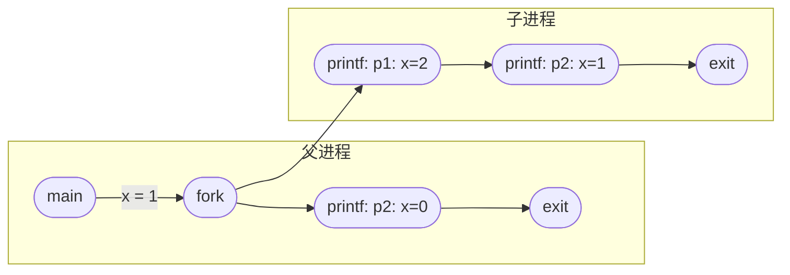
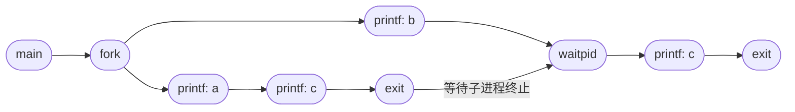
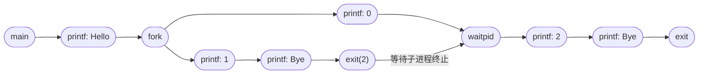

# 练习题答案

[返回章节目录](./%E7%AC%AC8%E7%AB%A0%20%E5%BC%82%E5%B8%B8%E6%8E%A7%E5%88%B6%E6%B5%81.md)

## 答案 8.1

进程 A 和 B 是互相并发的，就像 B 和 C 一样，因为它们各自的执行是重叠的，也就是一个进程在另一个进程结束前开始。进程 A 和 C 不是并发的，因为它们的执行没有重叠；A 在 C 开始之前就结束了。

## 答案 8.2

在[图 8-15](./8.4%20%E8%BF%9B%E7%A8%8B%E6%8E%A7%E5%88%B6.md#fig-8-15) 的示例程序中，父子进程执行无关的指令集合。然而，在这个程序中，父子进程执行的指令集合是相关的，这是有可能的，因为父子进程有相同的代码段。这会是一个概念上的障碍，所以请确认你理解了本题的答案。[图 8-47](#fig-8-47) 给出了进程图。

A. 这里的关键点是子进程执行了两个 `printf` 语句。在 `fork` 返回之后，它执行[第 4 行](./8.4%20%E8%BF%9B%E7%A8%8B%E6%8E%A7%E5%88%B6.md#%E7%BB%83%E4%B9%A0%E9%A2%98%208.2 "查看对应代码块")的 `printf`。然后它从 `if` 语句中出来，执行[第 5 行](./8.4%20%E8%BF%9B%E7%A8%8B%E6%8E%A7%E5%88%B6.md#%E7%BB%83%E4%B9%A0%E9%A2%98%208.2 "查看对应代码块")的 `printf` 语句。下面是子进程产生的输出：

```console
p1: x=2
p2: x=1
```

B. 父进程只执行[第 5 行](./8.4%20%E8%BF%9B%E7%A8%8B%E6%8E%A7%E5%88%B6.md#%E7%BB%83%E4%B9%A0%E9%A2%98%208.2 "查看对应代码块")的 `printf`：

```console
p2: x=0
```

<div id="fig-8-47" class="anchor-block"></div>



<div class="figure-caption">

图 8-47 [练习题 8.2](./8.4%20%E8%BF%9B%E7%A8%8B%E6%8E%A7%E5%88%B6.md#%E7%BB%83%E4%B9%A0%E9%A2%98%208.2)的进程图

</div>

## 答案 8.3

我们知道序列 `acbc`、`abcc` 和 `bacc` 是可能的，因为它们对应有进程图的拓扑排序（[图 8-48](#fig-8-48)）。而像 `bcac` 和 `cbca` 这样的序列不对应有任何拓扑排序，因此它们是不可行的。

<div id="fig-8-48" class="anchor-block"></div>



<div class="figure-caption">

图 8-48 [练习题 8.3](./8.4%20%E8%BF%9B%E7%A8%8B%E6%8E%A7%E5%88%B6.md#%E7%BB%83%E4%B9%A0%E9%A2%98%208.3)的进程图

</div>

## 答案 8.4

A. 只简单地计算进程图（[图 8-49](#fig-8-49)）中 `printf` 顶点的个数就能确定输出行数。在这里，有 6 个这样的顶点，因此程序会打印 6 行输出。

B. 任何对应有进程图的拓扑排序的输出序列都是可能的。例如：`Hello`、`1`、`0`、`Bye`、`2`、`Bye` 是可能的。

<div id="fig-8-49" class="anchor-block"></div>



原图将父进程在 `waitpid` 后打印的退出状态标为 1。根据[练习题 8.4](8.4%20%E8%BF%9B%E7%A8%8B%E6%8E%A7%E5%88%B6.md#%E7%BB%83%E4%B9%A0%E9%A2%98%208.4) 中的 `exit(2)`、`WEXITSTATUS(status)` 和答案 B 的示例，此处应为 2，图中已更正。

<div class="figure-caption">

图 8-49 [练习题 8.4](./8.4%20%E8%BF%9B%E7%A8%8B%E6%8E%A7%E5%88%B6.md#%E7%BB%83%E4%B9%A0%E9%A2%98%208.4)的进程图

</div>

## 答案 8.5

```c
unsigned int snooze(unsigned int secs) {
  unsigned int rc = sleep(secs);

  printf("Slept for %d of %d secs.\n", secs - rc, secs);
  return rc;
}
```

## 答案 8.6

```c
#include "csapp.h"
int main(int argc, char* argv[], char* envp[]) {
  int i;

  printf("Command-line arguments:\n");
  for (i = 0; argv[i] != NULL; i++) {
    printf("    argv[%2d]: %s\n", i, argv[i]);
  }
  printf("\n");
  printf("Environment variables:\n");
  for (i = 0; envp[i] != NULL; i++) {
    printf("    envp[%2d]: %s\n", i, envp[i]);
  }
  exit(0);
}
```

## 答案 8.7

只要休眠进程收到一个未被忽略的信号，`sleep` 函数就会提前返回。但是，因为收到一个 `SIGINT` 信号的默认行为就是终止进程（[图 8-26](./8.5%20%E4%BF%A1%E5%8F%B7.md#fig-8-26)），我们必须设置一个 `SIGINT` 处理程序来允许 `sleep` 函数返回。处理程序简单地捕获 SIGNAL，并将控制返回给 `sleep` 函数，该函数会立即返回。

```c
#include "csapp.h"

/* SIGINT handler */
void handler(int sig) {
  return; /* Catch the signal and return */
}

unsigned int snooze(unsigned int secs) {
  unsigned int rc = sleep(secs);

  printf("Slept for %d of %d secs.\n", secs - rc, secs);
  return rc;
}

int main(int argc, char** argv) {
  if (argc != 2) {
    fprintf(stderr, "usage: %s <secs>\n", argv[0]);
    exit(0);
  }

  if (signal(SIGINT, handler) == SIG_ERR) { /* Install SIGINT */
    unix_error("signal error\n");
  } /* handler     */
  (void)snooze(atoi(argv[1]));
  exit(0);
}
```

## 答案 8.8

这个程序打印字符串“213”，这是卡内基-梅隆大学 CS:APP 课程的缩写名。父进程开始时打印“2”，然后创建子进程，子进程会陷入一个无限循环。然后父进程向子进程发送一个信号，并等待它终止。子进程捕获这个信号（中断这个无限循环），对计数器值（从初始值 2）减一，打印“1”，然后终止。在父进程回收子进程之后，它对计数器值（从初始值 2）加一，打印“3”，并且终止。
