# 2.1 Information Storage

[Back to Chapter Contents](./Chapter%202%20Representing%20and%20Manipulating%20Information.md)

Rather than accessing individual bits in memory, most computers use blocks of 8 bits, or bytes, as the smallest addressable unit of memory. A machine-level program views memory as a very large array of bytes, referred to as virtual memory. Every byte of memory is identified by a unique number, known as its address, and the set of all possible addresses is known as the virtual address space. As indicated by its name, this virtual address space is just a conceptual image presented to the machine-level program. The actual implementation (presented in [Chapter 9](./../../03-part-ii-running-programs-on-a-system/ch09-virtual-memory/Chapter%209%20Virtual%20Memory.md#chapter-9-virtual-memory)) uses a combination of dynamic random access memory (DRAM), flash memory, disk storage, special hardware, and operating system software to provide the program with what appears to be a monolithic byte array.

In subsequent chapters, we will cover how the compiler and run-time system partitions this memory space into more manageable units to store the different program objects, that is, program data, instructions, and control information. Various mechanisms are used to allocate and manage the storage for different parts of the program. This management is all performed within the virtual address space. For example, the value of a pointer in C—whether it points to an integer, a structure, or some other program object—is the virtual address of the first byte of some block of storage. The C compiler also associates type information with each pointer, so that it can generate different machine-level code to access the value stored at the location designated by the pointer depending on the type of that value. Although the C compiler maintains this type information, the actual machine-level program it generates has no information about data types. It simply treats each program object as a block of bytes and the program itself as a sequence of bytes.

> [!NOTE] New to C? The role of pointers in C
>
> Pointers are a central feature of C. They provide the mechanism for referencing elements of data structures, including arrays. Just like a variable, a pointer has two aspects: its value and its type. The value indicates the location of some object, while its type indicates what kind of object (e.g., integer or floating-point number) is stored at that location.
>
> Truly understanding pointers requires examining their representation and implementation at the machine level. This will be a major focus in [Chapter 3](./../ch03-machine-level-representation-of-programs/Chapter%203%20Machine-Level%20Representation%20of%20Programs.md#chapter-3-machine-level-representation-of-programs), culminating in an in-depth presentation in [Section 3.10.1](./../ch03-machine-level-representation-of-programs/3.10%20Combining%20Control%20and%20Data%20in%20Machine-Level%20Programs.md#_3-10-1-understanding-pointers).

## 2.1.1 Hexadecimal Notation

A single byte consists of 8 bits. In binary notation, its value ranges from $00000000_2$ to $11111111_2$. When viewed as a decimal integer, its value ranges from $0_{10}$ to $255_{10}$. Neither notation is very convenient for describing bit patterns. Binary notation is too verbose, while with decimal notation it is tedious to convert to and from bit patterns. Instead, we write bit patterns as base-16, or hexadecimal numbers. Hexadecimal (or simply "hex") uses digits `'0'` through `'9'` along with characters `'A'` through `'F'` to represent 16 possible values. [Figure 2.2](#figure-2-2) shows the decimal and binary values associated with the 16 hexadecimal digits. Written in hexadecimal, the value of a single byte can range from $00_{16}$ to $\mathrm{FF}_{16}$.

In C, numeric constants starting with `0x` or `0X` are interpreted as being in hexadecimal. The characters `'A'` through `'F'` may be written in either upper- or lowercase. For example, we could write the number $FA1D37B_{16}$ as `0xFA1D37B`, as `0xfa1d37b`, or even mixing upper- and lowercase (e.g., `0xFa1D37b`). We will use the C notation for representing hexadecimal values in this book.

### Figure 2.2

| Hex digit | 0 | 1 | 2 | 3 | 4 | 5 | 6 | 7 |
| --- | --- | --- | --- | --- | --- | --- | --- | --- |
| Decimal value | 0 | 1 | 2 | 3 | 4 | 5 | 6 | 7 |
| Binary value | 0000 | 0001 | 0010 | 0011 | 0100 | 0101 | 0110 | 0111 |
| **Hex digit** | **8** | **9** | **A** | **B** | **C** | **D** | **E** | **F** |
| Decimal value | 8 | 9 | 10 | 11 | 12 | 13 | 14 | 15 |
| Binary value | 1000 | 1001 | 1010 | 1011 | 1100 | 1101 | 1110 | 1111 |

Figure 2.2 Hexadecimal notation. Each hex digit encodes one of 16 values.

A common task in working with machine-level programs is to manually convert between decimal, binary, and hexadecimal representations of bit patterns. Converting between binary and hexadecimal is straightforward, since it can be performed one hexadecimal digit at a time. Digits can be converted by referring to a chart such as that shown in [Figure 2.2](#figure-2-2). One simple trick for doing the conversion in your head is to memorize the decimal equivalents of hex digits `A`, `C`, and `F`. The hex values `B`, `D`, and `E` can be translated to decimal by computing their values relative to the first three.

For example, suppose you are given the number `0x173A4C`. You can convert this to binary format by expanding each hexadecimal digit, as follows:

| Hexadecimal | 1 | 7 | 3 | A | 4 | C |
| --- | --- | --- | --- | --- | --- | --- |
| Binary | 0001 | 0111 | 0011 | 1010 | 0100 | 1100 |

This gives the binary representation `000101110011101001001100`.

Conversely, given a binary number `1111001010110110110011`, you convert it to hexadecimal by first splitting it into groups of 4 bits each. Note, however, that if the total number of bits is not a multiple of 4, you should make the leftmost group be the one with fewer than 4 bits, effectively padding the number with leading zeros. Then you translate each group of bits into the corresponding hexadecimal digit:

| Binary | 11 | 1100 | 1010 | 1101 | 1011 | 0011 |
| --- | --- | --- | --- | --- | --- | --- |
| Hexadecimal | 3 | C | A | D | B | 3 |

### Practice Problem 2.1

> [!TIP] ✎ Practice Problem
>
> [View practice problem solution](./Solutions%20to%20Practice%20Problems.md#Solution%202.1)
>
> Perform the following number conversions:
>
> - A. `0x39A7F8` to binary
> - B. binary `1100100101111011` to hexadecimal
> - C. `0xD5E4C` to binary
> - D. binary `1001101110011110110101` to hexadecimal

When a value $x$ is a power of 2, that is, $x = 2^n$ for some nonnegative integer $n$, we can readily write $x$ in hexadecimal form by remembering that the binary representation of $x$ is simply 1 followed by $n$ zeros. The hexadecimal digit 0 represents 4 binary zeros. So, for $n$ written in the form $i + 4j$, where $0 \le i \le 3$, we can write $x$ with a leading hex digit of `1` ($i = 0$), `2` ($i = 1$), `4` ($i = 2$), or `8` ($i = 3$), followed by $j$ hexadecimal `0`s. As an example, for $x = 2,048 = 2^{11}$, we have $n = 11 = 3 + 4 \cdot 2$, giving hexadecimal representation `0x800`.

### Practice Problem 2.2

> [!TIP] ✎ Practice Problem
>
> [View practice problem solution](./Solutions%20to%20Practice%20Problems.md#Solution%202.2)
>
> Fill in the blank entries in the following table, giving the decimal and hexadecimal representations of different powers of 2:
>
> | $n$ | $2^n$ (decimal) | $2^n$ (hexadecimal) |
> | --- | --- | --- |
> | 9 | 512 | `0x200` |
> | 19 | | |
> | | 16,384 | |
> | | | `0x10000` |
> | 17 | | |
> | | 32 | |
> | | | `0x80` |

Converting between decimal and hexadecimal representations requires using multiplication or division to handle the general case. To convert a decimal number $x$ to hexadecimal, we can repeatedly divide $x$ by 16, giving a quotient $q$ and a remainder $r$, such that $x = q \cdot 16 + r$. We then use the hexadecimal digit representing $r$ as the least significant digit and generate the remaining digits by repeating the process on $q$. As an example, consider the conversion of decimal $314,156$:

$$
\begin{aligned}
314,156 &= 19,634 \cdot 16 + 12 \quad (\text{C}) \\
19,634 &= 1,227 \cdot 16 + 2 \quad (2) \\
1,227 &= 76 \cdot 16 + 11 \quad (\text{B}) \\
76 &= 4 \cdot 16 + 12 \quad (\text{C}) \\
4 &= 0 \cdot 16 + 4 \quad (4)
\end{aligned}
$$

From this we can read off the hexadecimal representation as `0x4CB2C`.

Conversely, to convert a hexadecimal number to decimal, we can multiply each of the hexadecimal digits by the appropriate power of 16. For example, given the number `0x7AF`, we compute its decimal equivalent as $7 \cdot 16^2 + 10 \cdot 16 + 15 = 7 \cdot 256 + 10 \cdot 16 + 15 = 1,792 + 160 + 15 = 1,967$.

### Practice Problem 2.3

> [!TIP] ✎ Practice Problem
>
> [View practice problem solution](./Solutions%20to%20Practice%20Problems.md#Solution%202.3)
>
> A single byte can be represented by 2 hexadecimal digits. Fill in the missing entries in the following table, giving the decimal, binary, and hexadecimal values of different byte patterns:
>
> | Decimal | Binary | Hexadecimal |
> | --- | --- | --- |
> | 0 | 0000 0000 | `0x00` |
> | 167 | | |
> | 62 | | |
> | 188 | | |
> | | 0011 0111 | |
> | | 1000 1000 | |
> | | 1111 0011 | |
> | | | `0x52` |
> | | | `0xAC` |
> | | | `0xE7` |

> [!NOTE] Converting between decimal and hexadecimal
>
> For converting larger values between decimal and hexadecimal, it is best to let a computer or calculator do the work. There are numerous tools that can do this. One simple way is to use any of the standard search engines, with queries such as
>
> `Convert 0xabcd to decimal` or `123 in hex`

### Practice Problem 2.4

> [!TIP] ✎ Practice Problem
>
> [View practice problem solution](./Solutions%20to%20Practice%20Problems.md#Solution%202.4)
>
> Without converting the numbers to decimal or binary, try to solve the following arithmetic problems, giving the answers in hexadecimal. Hint: Just modify the methods you use for performing decimal addition and subtraction to use base 16.
>
> - A. `0x503c + 0x8 =`
> - B. `0x503c - 0x40 =`
> - C. `0x503c + 64 =`
> - D. `0x50ea - 0x503c =`

## 2.1.2 Data Sizes

Every computer has a word size, indicating the nominal size of pointer data. Since a virtual address is encoded by such a word, the most important system parameter determined by the word size is the maximum size of the virtual address space. That is, for a machine with a $w$-bit word size, the virtual addresses can range from $0$ to $2^w - 1$, giving the program access to at most $2^w$ bytes.

In recent years, there has been a widespread shift from machines with 32-bit word sizes to those with word sizes of 64 bits. This occurred first for high-end machines designed for large-scale scientific and database applications, followed by desktop and laptop machines, and most recently for the processors found in smartphones. A 32-bit word size limits the virtual address space to 4 gigabytes (written 4 GB), that is, just over $4 \times 10^9$ bytes. Scaling up to a 64-bit word size leads to a virtual address space of 16 exabytes, or around $1.84 \times 10^{19}$ bytes.

Most 64-bit machines can also run programs compiled for use on 32-bit machines, a form of backward compatibility. So, for example, when a program `prog.c` is compiled with the directive

```bash
gcc -m32 prog.c
```

then this program will run correctly on either a 32-bit or a 64-bit machine. On the other hand, a program compiled with the directive

```bash
gcc -m64 prog.c
```

will only run on a 64-bit machine. We will therefore refer to programs as being either "32-bit programs" or "64-bit programs," since the distinction lies in how a program is compiled, rather than the type of machine on which it runs.

Computers and compilers support multiple data formats using different ways to encode data, such as integers and floating point, as well as different lengths. For example, many machines have instructions for manipulating single bytes, as well as integers represented as 2-, 4-, and 8-byte quantities. They also support floating-point numbers represented as 4- and 8-byte quantities.

The C language supports multiple data formats for both integer and floating-point data. [Figure 2.3](#figure-2-3) shows the number of bytes typically allocated for different C data types. (We discuss the relation between what is guaranteed by the C standard versus what is typical in [Section 2.2](./2.2%20Integer%20Representations.md#_2-2-integer-representations).) The exact numbers of bytes for some data types depends on how the program is compiled. We show sizes for typical 32-bit and 64-bit programs. Integer data can be either signed, able to represent negative, zero, and positive values, or unsigned, only allowing nonnegative values. Data type `char` represents a single byte. Although the name `char` derives from the fact that it is used to store a single character in a text string, it can also be used to store integer values. Data types `short`, `int`, and `long` are intended to provide a range of sizes. Even when compiled for 64-bit systems, data type `int` is usually just 4 bytes. Data type `long` commonly has 4 bytes in 32-bit programs and 8 bytes in 64-bit programs.

### Figure 2.3

| C declaration (Signed) | C declaration (Unsigned) | Bytes (32-bit) | Bytes (64-bit) |
| --- | --- | --- | --- |
| `[signed] char` | `unsigned char` | 1 | 1 |
| `short` | `unsigned short` | 2 | 2 |
| `int` | `unsigned` | 4 | 4 |
| `long` | `unsigned long` | 4 | 8 |
| `int32_t` | `uint32_t` | 4 | 4 |
| `int64_t` | `uint64_t` | 8 | 8 |
| `char *` | | 4 | 8 |
| `float` | | 4 | 4 |
| `double` | | 8 | 8 |

Figure 2.3 Typical sizes (in bytes) of basic C data types. The number of bytes allocated varies with how the program is compiled. This chart shows the values typical of 32-bit and 64-bit programs.

To avoid the vagaries of relying on "typical" sizes and different compiler settings, ISO C99 introduced a class of data types where the data sizes are fixed regardless of compiler and machine settings. Among these are data types `int32_t` and `int64_t`, having exactly 4 and 8 bytes, respectively. Using fixed-size integer types is the best way for programmers to have close control over data representations.

Most of the data types encode signed values, unless prefixed by the keyword `unsigned` or using the specific unsigned declaration for fixed-size data types. The exception to this is data type `char`. Although most compilers and machines treat these as signed data, the C standard does not guarantee this. Instead, as indicated by the square brackets, the programmer should use the declaration `signed char` to guarantee a 1-byte signed value. In many contexts, however, the program's behavior is insensitive to whether data type `char` is signed or unsigned.

The C language allows a variety of ways to order the keywords and to include or omit optional keywords. As examples, all of the following declarations have identical meaning:

```c
unsigned long
unsigned long int
long unsigned
long unsigned int
```

We will consistently use the forms found in [Figure 2.3](#figure-2-3).

> [!NOTE] New to C? Declaring pointers
>
> For any data type `T`, the declaration
>
> ```c
> T *p;
> ```
>
> indicates that `p` is a pointer variable, pointing to an object of type `T`. For example,
>
> ```c
> char *p;
> ```
>
> is the declaration of a pointer to an object of type `char`.

[Figure 2.3](#figure-2-3) also shows that a pointer (e.g., a variable declared as being of type `char *`) uses the full word size of the program. Most machines also support two different floating-point formats: single precision, declared in C as `float`, and double precision, declared in C as `double`. These formats use 4 and 8 bytes, respectively.

Programmers should strive to make their programs portable across different machines and compilers. One aspect of portability is to make the program insensitive to the exact sizes of the different data types. The C standards set lower bounds on the numeric ranges of the different data types, as will be covered later, but there are no upper bounds (except with the fixed-size types). With 32-bit machines and 32-bit programs being the dominant combination from around 1980 until around 2010, many programs have been written assuming the allocations listed for 32-bit programs in [Figure 2.3](#figure-2-3). With the transition to 64-bit machines, many hidden word size dependencies have arisen as bugs in migrating these programs to new machines. For example, many programmers historically assumed that an object declared as type `int` could be used to store a pointer. This works fine for most 32-bit programs, but it leads to problems for 64-bit programs.

## 2.1.3 Addressing and Byte Ordering

For program objects that span multiple bytes, we must establish two conventions: what the address of the object will be, and how we will order the bytes in memory. In virtually all machines, a multi-byte object is stored as a contiguous sequence of bytes, with the address of the object given by the smallest address of the bytes used. For example, suppose a variable `x` of type `int` has address `0x100`; that is, the value of the address expression `&x` is `0x100`. Then (assuming data type `int` has a 32-bit representation) the 4 bytes of `x` would be stored in memory locations `0x100`, `0x101`, `0x102`, and `0x103`.

For ordering the bytes representing an object, there are two common conventions. Consider a $w$-bit integer having a bit representation $[x_{w-1}, x_{w-2}, \dots, x_1, x_0]$, where $x_{w-1}$ is the most significant bit and $x_0$ is the least. Assuming $w$ is a multiple of 8, these bits can be grouped as bytes, with the most significant byte having bits $[x_{w-1}, x_{w-2}, \dots, x_{w-8}]$, the least significant byte having bits $[x_7, x_6, \dots, x_0]$, and the other bytes having bits from the middle. Some machines choose to store the object in memory ordered from least significant byte to most, while other machines store them from most to least. The former convention—where the least significant byte comes first—is referred to as little endian. The latter convention—where the most significant byte comes first—is referred to as big endian.

Suppose the variable `x` of type `int` and at address `0x100` has a hexadecimal value of `0x01234567`. The ordering of the bytes within the address range `0x100` through `0x103` depends on the type of machine:


Note that in the word `0x01234567` the high-order byte has hexadecimal value `0x01`, while the low-order byte has value `0x67`.

Most Intel-compatible machines operate exclusively in little-endian mode. On the other hand, most machines from IBM and Oracle (arising from their acquisition of Sun Microsystems in 2010) operate in big-endian mode. Note that we said "most." The conventions do not split precisely along corporate boundaries. For example, both IBM and Oracle manufacture machines that use Intel-compatible processors and hence are little endian. Many recent microprocessor chips are bi-endian, meaning that they can be configured to operate as either little- or big-endian machines. In practice, however, byte ordering becomes fixed once a particular operating system is chosen. For example, ARM microprocessors, used in many cell phones, have hardware that can operate in either little- or big-endian mode, but the two most common operating systems for these chips—Android (from Google) and iOS (from Apple)—operate only in little-endian mode.

> [!NOTE] Origin of "endian"
>
> Here is how Jonathan Swift, writing in 1726, described the history of the controversy between big and little endians:
>
> *...Lilliput and Blefuscu... have, as I was going to tell you, been engaged in a most obstinate war for six-and-thirty moons past. It began upon the following occasion. It is allowed on all hands, that the primitive way of breaking eggs, before we eat them, was upon the larger end; but his present majesty's grandfather, while he was a boy, going to eat an egg, and breaking it according to the ancient practice, happened to cut one of his fingers. Whereupon the emperor his father published an edict, commanding all his subjects, upon great penalties, to break the smaller end of their eggs. The people so highly resented this law, that our histories tell us, there have been six rebellions raised on that account; wherein one emperor lost his life, and another his crown. These civil commotions were constantly fomented by the monarchs of Blefuscu; and when they were quelled, the exiles always fled for refuge to that empire. It is computed that eleven thousand persons have at several times suffered death, rather than submit to break their eggs at the smaller end. Many hundred large volumes have been published upon this controversy: but the books of the Big-endians have been long forbidden, and the whole party rendered incapable by law of holding employments.*
>
> (Jonathan Swift. *Gulliver's Travels*, Benjamin Motte, 1726.)
>
> In his day, Swift was satirizing the continued conflicts between England (Lilliput) and France (Blefuscu). Danny Cohen, an early pioneer in networking protocols, first applied these terms to refer to byte ordering [\[24\]](./../../05-appendix-and-references/References.md#ref-24), and the terminology has been widely adopted.

People get surprisingly emotional about which byte ordering is the proper one. In fact, the terms "little endian" and "big endian" come from the book *Gulliver's Travels* by Jonathan Swift, where two warring factions could not agree as to how a soft-boiled egg should be opened—by the little end or by the big. Just like the egg issue, there is no technological reason to choose one byte ordering convention over the other, and hence the arguments degenerate into bickering about sociopolitical issues. As long as one of the conventions is selected and adhered to consistently, the choice is arbitrary.

For most application programmers, the byte orderings used by their machines are totally invisible; programs compiled for either class of machine give identical results. At times, however, byte ordering becomes an issue. The first is when binary data are communicated over a network between different machines. A common problem is for data produced by a little-endian machine to be sent to a big-endian machine, or vice versa, leading to the bytes within the words being in reverse order for the receiving program. To avoid such problems, code written for networking applications must follow established conventions for byte ordering to make sure the sending machine converts its internal representation to the network standard, while the receiving machine converts the network standard to its internal representation. We will see examples of these conversions in [Chapter 11](./../../04-part-iii-interaction-and-communication-between-programs/ch11-network-programming/Chapter%2011%20Network%20Programming.md#chapter-11-network-programming).

A second case where byte ordering becomes important is when looking at the byte sequences representing integer data. This occurs often when inspecting machine-level programs. As an example, the following line occurs in a file that gives a text representation of the machine-level code for an Intel x86-64 processor:

```asm
4004d3: 01 05 43 0b 20 00    add    %eax, 0x200b43(%rip)
```

This line was generated by a disassembler, a tool that determines the instruction sequence represented by an executable program file. We will learn more about disassemblers and how to interpret lines such as this in [Chapter 3](./../ch03-machine-level-representation-of-programs/Chapter%203%20Machine-Level%20Representation%20of%20Programs.md#chapter-3-machine-level-representation-of-programs). For now, we simply note that this line states that the hexadecimal byte sequence `01 05 43 0b 20 00` is the byte-level representation of an instruction that adds a word of data to the value stored at an address computed by adding `0x200b43` to the current value of the program counter, the address of the next instruction to be executed. If we take the final 4 bytes of the sequence `43 0b 20 00` and write them in reverse order, we have `00 20 0b 43`. Dropping the leading `0`, we have the value `0x200b43`, the numeric value written on the right. Having bytes appear in reverse order is a common occurrence when reading machine-level program representations generated for little-endian machines such as this one. The natural way to write a byte sequence is to have the lowest-numbered byte on the left and the highest on the right, but this is contrary to the normal way of writing numbers with the most significant digit on the left and the least on the right.

A third case where byte ordering becomes visible is when programs are written that circumvent the normal type system. In the C language, this can be done using a cast or a union to allow an object to be referenced according to a different data type from which it was created. Such coding tricks are strongly discouraged for most application programming, but they can be quite useful and even necessary for system-level programming.

[Figure 2.4](#figure-2-4) shows C code that uses casting to access and print the byte representations of different program objects. We use `typedef` to define data type `byte_pointer` as a pointer to an object of type `unsigned char`. Such a byte pointer references a sequence of bytes where each byte is considered to be a nonnegative integer. The first routine `show_bytes` is given the address of a sequence of bytes, indicated by a byte pointer, and a byte count. The byte count is specified as having data type `size_t`, the preferred data type for expressing the sizes of data structures. It prints the individual bytes in hexadecimal. The C formatting directive `%.2x` indicates that an integer should be printed in hexadecimal with at least 2 digits.

### Figure 2.4

```c
#include <stdio.h>

typedef unsigned char *byte_pointer;

void show_bytes(byte_pointer start, size_t len) {
    int i;
    for (i = 0; i < len; i++)
        printf(" %.2x", start[i]);
    printf("\n");
}

void show_int(int x) {
    show_bytes((byte_pointer) &x, sizeof(int));
}

void show_float(float x) {
    show_bytes((byte_pointer) &x, sizeof(float));
}

void show_pointer(void *x) {
    show_bytes((byte_pointer) &x, sizeof(void *));
}
```

Figure 2.4 Code to print the byte representation of program objects. This code uses casting to circumvent the type system. Similar functions are easily defined for other data types.

Procedures `show_int`, `show_float`, and `show_pointer` demonstrate how to use procedure `show_bytes` to print the byte representations of C program objects of type `int`, `float`, and `void *`, respectively. Observe that they simply pass `show_bytes` a pointer `&x` to their argument `x`, casting the pointer to be of type `unsigned char *`. This cast indicates to the compiler that the program should consider the pointer to be to a sequence of bytes rather than to an object of the original data type. This pointer will then be to the lowest byte address occupied by the object.

These procedures use the C `sizeof` operator to determine the number of bytes used by the object. In general, the expression `sizeof(T)` returns the number of bytes required to store an object of type `T`. Using `sizeof` rather than a fixed value is one step toward writing code that is portable across different machine types.

We ran the code shown in [Figure 2.5](#figure-2-5) on several different machines, giving the results shown in [Figure 2.6](#figure-2-6). The following machines were used:

- **Linux 32:** Intel IA32 processor running Linux.
- **Windows:** Intel IA32 processor running Windows.
- **Sun:** Sun Microsystems SPARC processor running Solaris. (These machines are now produced by Oracle.)
- **Linux 64:** Intel x86-64 processor running Linux.

### Figure 2.5

```c
void test_show_bytes(int val) {
    int ival = val;
    float fval = (float) ival;
    int *pval = &ival;
    show_int(ival);
    show_float(fval);
    show_pointer(pval);
}
```

Figure 2.5 Byte representation examples. This code prints the byte representations of sample data objects.

### Figure 2.6

| Machine | Value | Type | Bytes (hex) |
| --- | --- | --- | --- |
| Linux 32 | `12,345` | `int` | `39 30 00 00` |
| Windows | `12,345` | `int` | `39 30 00 00` |
| Sun | `12,345` | `int` | `00 00 30 39` |
| Linux 64 | `12,345` | `int` | `39 30 00 00` |
| Linux 32 | `12,345.0` | `float` | `00 e4 40 46` |
| Windows | `12,345.0` | `float` | `00 e4 40 46` |
| Sun | `12,345.0` | `float` | `46 40 e4 00` |
| Linux 64 | `12,345.0` | `float` | `00 e4 40 46` |
| Linux 32 | `&ival` | `int *` | `e4 f9 ff bf` |
| Windows | `&ival` | `int *` | `b4 cc 22 00` |
| Sun | `&ival` | `int *` | `ef ff fa 0c` |
| Linux 64 | `&ival` | `int *` | `b8 11 e5 ff ff 7f 00 00` |

Figure 2.6 Byte representations of different data values. Results for `int` and `float` are identical, except for byte ordering. Pointer values are machine dependent.

Our argument `12,345` has hexadecimal representation `0x00003039`. For the `int` data, we get identical results for all machines, except for the byte ordering. In particular, we can see that the least significant byte value of `0x39` is printed first for Linux 32, Windows, and Linux 64, indicating little-endian machines, and last for Sun, indicating a big-endian machine. Similarly, the bytes of the `float` data are identical, except for the byte ordering. On the other hand, the pointer values are completely different. The different machine/operating system configurations use different conventions for storage allocation. One feature to note is that the Linux 32, Windows, and Sun machines use 4-byte addresses, while the Linux 64 machine uses 8-byte addresses.

> [!NOTE] New to C? Naming data types with `typedef`
>
> The `typedef` declaration in C provides a way of giving a name to a data type. This can be a great help in improving code readability, since deeply nested type declarations can be difficult to decipher.
>
> The syntax for `typedef` is exactly like that of declaring a variable, except that it uses a type name rather than a variable name. Thus, the declaration of `byte_pointer` in [Figure 2.4](#figure-2-4) has the same form as the declaration of a variable of type `unsigned char *`.
>
> For example, the declaration
>
> ```c
> typedef int *int_pointer;
> int_pointer ip;
> ```
>
> defines type `int_pointer` to be a pointer to an `int`, and declares a variable `ip` of this type. Alternatively, we could declare this variable directly as
>
> ```c
> int *ip;
> ```

> [!NOTE] New to C? Formatted printing with `printf`
>
> The `printf` function (along with its cousins `fprintf` and `sprintf`) provides a way to print information with considerable control over the formatting details. The first argument is a format string, while any remaining arguments are values to be printed. Within the format string, each character sequence starting with `%` indicates how to format the next argument. Typical examples include `%d` to print a decimal integer, `%f` to print a floating-point number, and `%c` to print a character having the character code given by the argument.
>
> Specifying the formatting of fixed-size data types, such as `int32_t`, is a bit more involved, as is described in the aside in [Section 2.2.3](2.2%20Integer%20Representations.md#2.2.3%20Two%27s-Complement%20Encodings).

Observe that although the floating-point and the integer data both encode the numeric value `12,345`, they have very different byte patterns: `0x00003039` for the integer and `0x4640E400` for floating point. In general, these two formats use different encoding schemes. If we expand these hexadecimal patterns into binary form and shift them appropriately, we find a sequence of 13 matching bits, indicated by a sequence of asterisks, as follows:

```text
               00000000000000000011000000111001
                                 *************
01000110010000001110010000000000
```

This is not coincidental. We will return to this example when we study floating-point formats.

> [!NOTE] New to C? Pointers and arrays
>
> In function `show_bytes` ([Figure 2.4](#figure-2-4)), we see the close connection between pointers and arrays, as will be discussed in detail in [Section 3.8](./../ch03-machine-level-representation-of-programs/3.8%20Array%20Allocation%20and%20Access.md#_3-8-array-allocation-and-access). We see that this function has an argument `start` of type `byte_pointer` (which has been defined to be a pointer to `unsigned char`), but we see the array reference `start[i]` on [line 8](#Figure%202.4). In C, we can dereference a pointer with array notation, and we can reference array elements with pointer notation. In this example, the reference `start[i]` indicates that we want to read the byte that is `i` positions beyond the location pointed to by `start`.

> [!NOTE] New to C? Pointer creation and dereferencing
>
> In [lines 13, 17, and 21](#Figure%202.4) of [Figure 2.4](#figure-2-4) we see uses of two operations that give C (and therefore C++) its distinctive character. The C "address of" operator `&` creates a pointer. On all three lines, the expression `&x` creates a pointer to the location holding the object indicated by variable `x`. The type of this pointer depends on the type of `x`, and hence these three pointers are of type `int *`, `float *`, and `void **`, respectively. (Data type `void *` is a special kind of pointer with no associated type information.)
>
> The cast operator converts from one data type to another. Thus, the cast `(byte_pointer) &x` indicates that whatever type the pointer `&x` had before, the program will now reference a pointer to data of type `unsigned char`. The casts shown here do not change the actual pointer; they simply direct the compiler to refer to the data being pointed to according to the new data type.

> [!NOTE] Generating an ASCII table
>
> You can display a table showing the ASCII character code by executing the command `man ascii`.

### Practice Problem 2.5

> [!TIP] ✎ Practice Problem
>
> [View practice problem solution](./Solutions%20to%20Practice%20Problems.md#Solution%202.5)
>
> Consider the following three calls to `show_bytes`:
>
> ```c
> int val = 0x87654321;
> byte_pointer valp = (byte_pointer) &val;
> show_bytes(valp, 1); /* A. */
> show_bytes(valp, 2); /* B. */
> show_bytes(valp, 3); /* C. */
> ```
>
> Indicate the values that will be printed by each call on a little-endian machine and on a big-endian machine:
>
> - A. Little endian: \_\_\_\_\_\_\_\_\_\_ Big endian: \_\_\_\_\_\_\_\_\_\_
> - B. Little endian: \_\_\_\_\_\_\_\_\_\_ Big endian: \_\_\_\_\_\_\_\_\_\_
> - C. Little endian: \_\_\_\_\_\_\_\_\_\_ Big endian: \_\_\_\_\_\_\_\_\_\_

### Practice Problem 2.6

> [!TIP] ✎ Practice Problem
>
> [View practice problem solution](./Solutions%20to%20Practice%20Problems.md#Solution%202.6)
>
> Using `show_int` and `show_float`, we determine that the integer `3510593` has hexadecimal representation `0x00359141`, while the floating-point number `3510593.0` has hexadecimal representation `0x4A564504`.
>
> - A. Write the binary representations of these two hexadecimal values.
> - B. Shift these two strings relative to one another to maximize the number of matching bits. How many bits match?
> - C. What parts of the strings do not match?

## 2.1.4 Representing Strings

A string in C is encoded by an array of characters terminated by the null (having value 0) character. Each character is represented by some standard encoding, with the most common being the ASCII character code. Thus, if we run our routine `show_bytes` with arguments `"12345"` and `6` (to include the terminating character), we get the result `31 32 33 34 35 00`. Observe that the ASCII code for decimal digit $x$ happens to be `0x3x`, and that the terminating byte has the hex representation `0x00`. This same result would be obtained on any system using ASCII as its character code, independent of the byte ordering and word size conventions. As a consequence, text data are more platform independent than binary data.

### Practice Problem 2.7

> [!TIP] ✎ Practice Problem
>
> [View practice problem solution](./Solutions%20to%20Practice%20Problems.md#Solution%202.7)
>
> What would be printed as a result of the following call to `show_bytes`?
>
> ```c
> const char *s = "abcdef";
> show_bytes((byte_pointer) s, strlen(s));
> ```
>
> Note that letters `'a'` through `'z'` have ASCII codes `0x61` through `0x7A`.

> [!NOTE] The Unicode standard for text
>
> The ASCII character set is suitable for encoding English-language documents, but it does not have much in the way of special characters, such as the French `'ç'`. It is wholly unsuited for encoding documents in languages such as Greek, Russian, and Chinese. Over the years, a variety of methods have been developed to encode text for different languages. The Unicode Consortium has devised the most comprehensive and widely accepted standard for encoding text. The current Unicode standard (version 7.0) has a repertoire of over 100,000 characters supporting a wide range of languages, including the ancient languages of Egypt and Babylon. To their credit, the Unicode Technical Committee rejected a proposal to include a standard writing for Klingon, a fictional civilization from the television series *Star Trek*.
>
> The base encoding, known as the "Universal Character Set" of Unicode, uses a 32-bit representation of characters. This would seem to require every string of text to consist of 4 bytes per character. However, alternative codings are possible where common characters require just 1 or 2 bytes, while less common ones require more. In particular, the UTF-8 representation encodes each character as a sequence of bytes, such that the standard ASCII characters use the same single-byte encodings as they have in ASCII, implying that all ASCII byte sequences have the same meaning in UTF-8 as they do in ASCII.
>
> The Java programming language uses Unicode in its representations of strings. Program libraries are also available for C to support Unicode.

## 2.1.5 Representing Code

Consider the following C function:

```c
int sum(int x, int y) {
  return x + y;
}
```

When compiled on our sample machines, we generate machine code having the following byte representations:

```text
Linux 32:   55 89 e5 8b 45 0c 03 45 08 c9 c3
Windows:    55 89 e5 8b 45 0c 03 45 08 5d c3
Sun:        81 c3 e0 08 90 02 00 09
Linux 64:   55 48 89 e5 89 7d fc 89 75 f8 03 45 fc c9 c3
```

Here we find that the instruction codings are different. Different machine types use different and incompatible instructions and encodings. Even identical processors running different operating systems have differences in their coding conventions and hence are not binary compatible. Binary code is seldom portable across different combinations of machine and operating system.

A fundamental concept of computer systems is that a program, from the perspective of the machine, is simply a sequence of bytes. The machine has no information about the original source program, except perhaps some auxiliary tables maintained to aid in debugging. We will see this more clearly when we study machine-level programming in [Chapter 3](./../ch03-machine-level-representation-of-programs/Chapter%203%20Machine-Level%20Representation%20of%20Programs.md#chapter-3-machine-level-representation-of-programs).

## 2.1.6 Introduction to Boolean Algebra

Since binary values are at the core of how computers encode, store, and manipulate information, a rich body of mathematical knowledge has evolved around the study of the values 0 and 1. This started with the work of George Boole (1815–1864) around 1850 and thus is known as Boolean algebra. Boole observed that by encoding logic values `TRUE` and `FALSE` as binary values 1 and 0, he could formulate an algebra that captures the basic principles of logical reasoning.

The simplest Boolean algebra is defined over the two-element set $\{0, 1\}$. [Figure 2.7](#figure-2-7) defines several operations in this algebra. Our symbols for representing these operations are chosen to match those used by the C bit-level operations, as will be discussed later.

### Figure 2.7

| ~ | | & | 0 | 1 | \| | 0 | 1 | ^ | 0 | 1 |
| --- | --- | --- | --- | --- | --- | --- | --- | --- | --- | --- |
| 0 | 1 | **0** | 0 | 0 | **0** | 0 | 1 | **0** | 0 | 1 |
| 1 | 0 | **1** | 0 | 1 | **1** | 1 | 1 | **1** | 1 | 0 |

Figure 2.7 Operations of Boolean algebra. Binary values 1 and 0 encode logic values `TRUE` and `FALSE`, while operations `~`, `&`, `|`, and `^` encode logical operations `NOT`, `AND`, `OR`, and `EXCLUSIVE-OR`, respectively.

The Boolean operation `~` corresponds to the logical operation `NOT`, denoted by the symbol $\neg$. That is, we say that $\neg P$ is true when $P$ is not true, and vice versa. Correspondingly, `~p` equals 1 when `p` equals 0, and vice versa. Boolean operation `&` corresponds to the logical operation `AND`, denoted by the symbol $\land$. We say that $P \land Q$ holds when both $P$ is true and $Q$ is true. Correspondingly, `p & q` equals 1 only when `p = 1` and `q = 1`. Boolean operation `|` corresponds to the logical operation `OR`, denoted by the symbol $\lor$. We say that $P \lor Q$ holds when either $P$ is true or $Q$ is true. Correspondingly, `p | q` equals 1 when either `p = 1` or `q = 1`. Boolean operation `^` corresponds to the logical operation `EXCLUSIVE-OR`, denoted by the symbol $\oplus$. We say that $P \oplus Q$ holds when either $P$ is true or $Q$ is true, but not both. Correspondingly, `p ^ q` equals 1 when either `p = 1` and `q = 0`, or `p = 0` and `q = 1`.

Claude Shannon (1916–2001), who later founded the field of information theory, first made the connection between Boolean algebra and digital logic. In his 1937 master's thesis, he showed that Boolean algebra could be applied to the design and analysis of networks of electromechanical relays. Although computer technology has advanced considerably since, Boolean algebra still plays a central role in the design and analysis of digital systems.

We can extend the four Boolean operations to also operate on bit vectors, strings of zeros and ones of some fixed length $w$. We define the operations over bit vectors according to their applications to the matching elements of the arguments. Let $a$ and $b$ denote the bit vectors $[a_{w-1}, a_{w-2}, \dots, a_0]$ and $[b_{w-1}, b_{w-2}, \dots, b_0]$, respectively. We define `a & b` to also be a bit vector of length $w$, where the $i$th element equals $a_i \,\&\, b_i$, for $0 \le i < w$. The operations `|`, `^`, and `~` are extended to bit vectors in a similar fashion.

As examples, consider the case where $w = 4$, and with arguments `a = [0110]` and `b = [1100]`. Then the four operations `a & b`, `a | b`, `a ^ b`, and `~b` yield

```text
  0110      0110      0110
& 1100    | 1100    ^ 1100    ~ 1100
------    ------    ------    ------
  0100      1110      1010      0011
```

### Practice Problem 2.8

> [!TIP] ✎ Practice Problem
>
> [View practice problem solution](./Solutions%20to%20Practice%20Problems.md#Solution%202.8)
>
> Fill in the following table showing the results of evaluating Boolean operations on bit vectors.
>
> | Operation | Result |
> | --- | --- |
> | `a` | `[01101001]` |
> | `b` | `[01010101]` |
> | `~a` | \_\_\_\_\_\_\_\_\_\_ |
> | `~b` | \_\_\_\_\_\_\_\_\_\_ |
> | `a & b` | \_\_\_\_\_\_\_\_\_\_ |
> | `a \| b` | \_\_\_\_\_\_\_\_\_\_ |
> | `a ^ b` | \_\_\_\_\_\_\_\_\_\_ |

> [!NOTE] Web Aside DATA:BOOL More on Boolean algebra and Boolean rings
>
> The Boolean operations `&` and `|` operating on bit vectors of length $w$ form a Boolean algebra, for any integer $w > 0$. The simplest is the case where $w = 1$ and there are just two elements, but for the more general case there are $2^w$ bit vectors of length $w$. Boolean algebra has many of the same properties as arithmetic over integers. For example, just as multiplication distributes over addition, written $a \cdot (b + c) = (a \cdot b) + (a \cdot c)$, Boolean operation `&` distributes over `|`, written `a & (b | c) = (a & b) | (a & c)`. In addition, however, Boolean operation `|` distributes over `&`, and so we can write `a | (b & c) = (a | b) & (a | c)`, whereas we cannot say that $a + (b \cdot c) = (a + b) \cdot (a + c)$ holds for all integers.
>
> When we consider operations `^`, `&`, and `~` operating on bit vectors of length $w$, we get a different mathematical form, known as a Boolean ring. Boolean rings have many properties in common with integer arithmetic. For example, one property of integer arithmetic is that every value $x$ has an additive inverse $-x$, such that $x + (-x) = 0$. A similar property holds for Boolean rings, where `^` is the "addition" operation, but in this case each element is its own additive inverse. That is, `a ^ a = 0` for any value `a`, where we use `0` here to represent a bit vector of all zeros. We can see this holds for single bits, since `0 ^ 0 = 1 ^ 1 = 0`, and it extends to bit vectors as well. This property holds even when we rearrange terms and combine them in a different order, and so `(a ^ b) ^ a = b`. This property leads to some interesting results and clever tricks, as we will explore in [Problem 2.10](#Practice%20Problem%202.10).

One useful application of bit vectors is to represent finite sets. We can encode any subset $A \subseteq \{0, 1, \dots, w - 1\}$ with a bit vector $[a_{w-1}, \dots, a_1, a_0]$, where $a_i = 1$ if and only if $i \in A$. For example, recalling that we write $a_{w-1}$ on the left and $a_0$ on the right, bit vector $a = [01101001]$ encodes the set $A = \{0, 3, 5, 6\}$, while bit vector $b = [01010101]$ encodes the set $B = \{0, 2, 4, 6\}$. With this way of encoding sets, Boolean operations `|` and `&` correspond to set union and intersection, respectively, and `~` corresponds to set complement. Continuing our earlier example, the operation `a & b` yields bit vector `[01000001]`, while $A \cap B = \{0, 6\}$.

We will see the encoding of sets by bit vectors in a number of practical applications. For example, in [Chapter 8](./../../03-part-ii-running-programs-on-a-system/ch08-exceptional-control-flow/Chapter%208%20Exceptional%20Control%20Flow.md#chapter-8-exceptional-control-flow), we will see that there are a number of different signals that can interrupt the execution of a program. We can selectively enable or disable different signals by specifying a bit-vector mask, where a 1 in bit position $i$ indicates that signal $i$ is enabled and a 0 indicates that it is disabled. Thus, the mask represents the set of enabled signals.

### Practice Problem 2.9

> [!TIP] ✎ Practice Problem
>
> [View practice problem solution](./Solutions%20to%20Practice%20Problems.md#Solution%202.9)
>
> Computers generate color pictures on a video screen or liquid crystal display by mixing three different colors of light: red, green, and blue. Imagine a simple scheme, with three different lights, each of which can be turned on or off, projecting onto a glass screen:
>
> 
>
> We can then create eight different colors based on the absence (0) or presence (1) of light sources R, G, and B:
>
> | R | G | B | Color |
> | --- | --- | --- | --- |
> | 0 | 0 | 0 | Black |
> | 0 | 0 | 1 | Blue |
> | 0 | 1 | 0 | Green |
> | 0 | 1 | 1 | Cyan |
> | 1 | 0 | 0 | Red |
> | 1 | 0 | 1 | Magenta |
> | 1 | 1 | 0 | Yellow |
> | 1 | 1 | 1 | White |
>
> Each of these colors can be represented as a bit vector of length 3, and we can apply Boolean operations to them.
>
> - A. The complement of a color is formed by turning off the lights that are on and turning on the lights that are off. What would be the complement of each of the eight colors listed above?
> - B. Describe the effect of applying Boolean operations on the following colors:
>   - `Blue | Green =` \_\_\_\_\_\_\_\_\_\_
>   - `Yellow & Cyan =` \_\_\_\_\_\_\_\_\_\_
>   - `Red ^ Magenta =` \_\_\_\_\_\_\_\_\_\_

## 2.1.7 Bit-Level Operations in C

One useful feature of C is that it supports bitwise Boolean operations. In fact, the symbols we have used for the Boolean operations are exactly those used by C: `|` for `OR`, `&` for `AND`, `~` for `NOT`, and `^` for `EXCLUSIVE-OR`. These can be applied to any "integral" data type, including all of those listed in [Figure 2.3](#figure-2-3). Here are some examples of expression evaluation for data type `char`:

| C expression | Binary expression | Binary result | Hexadecimal result |
| --- | --- | --- | --- |
| `~0x41` | `~[0100 0001]` | `[1011 1110]` | `0xBE` |
| `~0x00` | `~[0000 0000]` | `[1111 1111]` | `0xFF` |
| `0x69 & 0x55` | `[0110 1001] & [0101 0101]` | `[0100 0001]` | `0x41` |
| `0x69 \| 0x55` | `[0110 1001] \| [0101 0101]` | `[0111 1101]` | `0x7D` |

As our examples show, the best way to determine the effect of a bit-level expression is to expand the hexadecimal arguments to their binary representations, perform the operations in binary, and then convert back to hexadecimal.

### Practice Problem 2.10

> [!TIP] ✎ Practice Problem
>
> [View practice problem solution](./Solutions%20to%20Practice%20Problems.md#Solution%202.10)
>
> As an application of the property that `a ^ a = 0` for any bit vector `a`, consider the following program:
>
> ```c
> void inplace_swap(int *x, int *y) {
>     *y = *x ^ *y; /* Step 1 */
>     *x = *x ^ *y; /* Step 2 */
>     *y = *x ^ *y; /* Step 3 */
> }
> ```
>
> As the name implies, we claim that the effect of this procedure is to swap the values stored at the locations denoted by pointer variables `x` and `y`. Note that unlike the usual technique for swapping two values, we do not need a third location to temporarily store one value while we are moving the other. There is no performance advantage to this way of swapping; it is merely an intellectual amusement.
>
> Starting with values `a` and `b` in the locations pointed to by `x` and `y`, respectively, fill in the table that follows, giving the values stored at the two locations after each step of the procedure. Use the properties of `^` to show that the desired effect is achieved. Recall that every element is its own additive inverse (that is, `a ^ a = 0`).
>
> | Step | `*x` | `*y` |
> | --- | --- | --- |
> | Initially | $a$ | $b$ |
> | Step 1 | \_\_\_\_\_\_\_\_\_\_ | \_\_\_\_\_\_\_\_\_\_ |
> | Step 2 | \_\_\_\_\_\_\_\_\_\_ | \_\_\_\_\_\_\_\_\_\_ |
> | Step 3 | \_\_\_\_\_\_\_\_\_\_ | \_\_\_\_\_\_\_\_\_\_ |

### Practice Problem 2.11

> [!TIP] ✎ Practice Problem
>
> [View practice problem solution](./Solutions%20to%20Practice%20Problems.md#Solution%202.11)
>
> Armed with the function `inplace_swap` from [Problem 2.10](#Practice%20Problem%202.10), you decide to write code that will reverse the elements of an array by swapping elements from opposite ends of the array, working toward the middle. You arrive at the following function:
>
> ```c
> void reverse_array(int a[], int cnt) {
>     int first, last;
>     for (first = 0, last = cnt-1;
>          first <= last;
>          first++, last--)
>         inplace_swap(&a[first], &a[last]);
> }
> ```
>
> When you apply your function to an array containing elements 1, 2, 3, and 4, you find the array now has, as expected, elements 4, 3, 2, and 1. When you try it on an array with elements 1, 2, 3, 4, and 5, however, you are surprised to see that the array now has elements 5, 4, 0, 2, and 1. In fact, you discover that the code always works correctly on arrays of even length, but it sets the middle element to 0 whenever the array has odd length.
>
> - A. For an array of odd length `cnt = 2k + 1`, what are the values of variables `first` and `last` in the final iteration of function `reverse_array`?
> - B. Why does this call to function `inplace_swap` set the array element to 0?
> - C. What simple modification to the code for `reverse_array` would eliminate this problem?

One common use of bit-level operations is to implement masking operations, where a mask is a bit pattern that indicates a selected set of bits within a word. As an example, the mask `0xFF` (having ones for the least significant 8 bits) indicates the low-order byte of a word. The bit-level operation `x & 0xFF` yields a value consisting of the least significant byte of `x`, but with all other bytes set to 0. For example, with `x = 0x89ABCDEF`, the expression would yield `0x000000EF`. The expression `~0` will yield a mask of all ones, regardless of the size of the data representation. The same mask can be written `0xFFFFFFFF` when data type `int` is 32 bits, but it would not be as portable.

### Practice Problem 2.12

> [!TIP] ✎ Practice Problem
>
> [View practice problem solution](./Solutions%20to%20Practice%20Problems.md#Solution%202.12)
>
> Write C expressions, in terms of variable `x`, for the following values. Your code should work for any word size $w \ge 8$. For reference, we show the result of evaluating the expressions for `x = 0x87654321`, with $w = 32$.
>
> - A. The least significant byte of `x`, with all other bits set to 0. [`0x00000021`]
> - B. All but the least significant byte of `x` complemented, with the least significant byte left unchanged. [`0x789ABC21`]
> - C. The least significant byte set to all ones, and all other bytes of `x` left unchanged. [`0x876543FF`]

### Practice Problem 2.13

> [!TIP] ✎ Practice Problem
>
> [View practice problem solution](./Solutions%20to%20Practice%20Problems.md#Solution%202.13)
>
> The Digital Equipment VAX computer was a very popular machine from the late 1970s until the late 1980s. Rather than instructions for Boolean operations `AND` and `OR`, it had instructions `bis` (bit set) and `bic` (bit clear). Both instructions take a data word `x` and a mask word `m`. They generate a result `z` consisting of the bits of `x` modified according to the bits of `m`. With `bis`, the modification involves setting `z` to 1 at each bit position where `m` is 1. With `bic`, the modification involves setting `z` to 0 at each bit position where `m` is 1.
>
> To see how these operations relate to the C bit-level operations, assume we have functions `bis` and `bic` implementing the bit set and bit clear operations, and that we want to use these to implement functions computing bitwise operations `|` and `^`, without using any other C operations. Fill in the missing code below. Hint: Write C expressions for the operations `bis` and `bic`.
>
> ```c
> /* Declarations of functions implementing operations bis and bic */
> int bis(int x, int m);
> int bic(int x, int m);
>
> /* Compute x|y using only calls to functions bis and bic */
> int bool_or(int x, int y) {
>   int result = ________;
>   return result;
> }
>
> /* Compute x^y using only calls to functions bis and bic */
> int bool_xor(int x, int y) {
>   int result = ________;
>   return result;
> }
> ```

## 2.1.8 Logical Operations in C

C also provides a set of logical operators `||`, `&&`, and `!`, which correspond to the `OR`, `AND`, and `NOT` operations of logic. These can easily be confused with the bit-level operations, but their behavior is quite different. The logical operations treat any nonzero argument as representing `TRUE` and argument `0` as representing `FALSE`. They return either `1` or `0`, indicating a result of either `TRUE` or `FALSE`, respectively. Here are some examples of expression evaluation:

| Expression | Result |
| --- | --- |
| `!0x41` | `0x00` |
| `!0x00` | `0x01` |
| `!!0x41` | `0x01` |
| `0x69 && 0x55` | `0x01` |
| `0x69 \|\| 0x55` | `0x01` |

Observe that a bitwise operation will have behavior matching that of its logical counterpart only in the special case in which the arguments are restricted to `0` or `1`.

A second important distinction between the logical operators `&&` and `||` versus their bit-level counterparts `&` and `|` is that the logical operators do not evaluate their second argument if the result of the expression can be determined by evaluating the first argument. Thus, for example, the expression `a && 5/a` will never cause a division by zero, and the expression `p && *p++` will never cause the dereferencing of a null pointer.

### Practice Problem 2.14

> [!TIP] ✎ Practice Problem
>
> [View practice problem solution](./Solutions%20to%20Practice%20Problems.md#Solution%202.14)
>
> Suppose that `x` and `y` have byte values `0x66` and `0x39`, respectively. Fill in the following table indicating the byte values of the different C expressions:
>
> | Expression | Value | Expression | Value |
> | --- | --- | --- | --- |
> | `x & y` | \_\_\_\_\_\_\_\_\_\_ | `x && y` | \_\_\_\_\_\_\_\_\_\_ |
> | `x \| y` | \_\_\_\_\_\_\_\_\_\_ | `x \|\| y` | \_\_\_\_\_\_\_\_\_\_ |
> | `~x \| ~y` | \_\_\_\_\_\_\_\_\_\_ | `!x \|\| !y` | \_\_\_\_\_\_\_\_\_\_ |
> | `x & !y` | \_\_\_\_\_\_\_\_\_\_ | `x && ~y` | \_\_\_\_\_\_\_\_\_\_ |

### Practice Problem 2.15

> [!TIP] ✎ Practice Problem
>
> [View practice problem solution](./Solutions%20to%20Practice%20Problems.md#Solution%202.15)
>
> Using only bit-level and logical operations, write a C expression that is equivalent to `x == y`. In other words, it will return `1` when `x` and `y` are equal and `0` otherwise.

## 2.1.9 Shift Operations in C

C also provides a set of shift operations for shifting bit patterns to the left and to the right. For an operand $x$ having bit representation $[x_{w-1}, x_{w-2}, \dots, x_0]$, the C expression `x << k` yields a value with bit representation $[x_{w-k-1}, x_{w-k-2}, \dots, x_0, 0, \dots, 0]$. That is, $x$ is shifted $k$ bits to the left, dropping off the $k$ most significant bits and filling the right end with $k$ zeros. The shift amount should be a value between $0$ and $w - 1$. Shift operations associate from left to right, so `x << j << k` is equivalent to `(x << j) << k`.

There is a corresponding right shift operation, written in C as `x >> k`, but it has a slightly subtle behavior. Generally, machines support two forms of right shift:

- **Logical.** A logical right shift fills the left end with $k$ zeros, giving a result $[0, \dots, 0, x_{w-1}, x_{w-2}, \dots, x_k]$.
- **Arithmetic.** An arithmetic right shift fills the left end with $k$ repetitions of the most significant bit, giving a result $[x_{w-1}, \dots, x_{w-1}, x_{w-1}, x_{w-2}, \dots, x_k]$. This convention might seem peculiar, but as we will see, it is useful for operating on signed integer data.

As examples, the following table shows the effect of applying the different shift operations to two different values of an 8-bit argument $x$:

| Operation | Value 1 | Value 2 |
| --- | --- | --- |
| Argument `x` | [01100011] | [10010101] |
| `x << 4` | [0011<em>0000</em>] | [0101<em>0000</em>] |
| `x >> 4` (logical) | [<em>0000</em>0110] | [<em>0000</em>1001] |
| `x >> 4` (arithmetic) | [<em>0000</em>0110] | [<em>1111</em>1001] |

The italicized digits indicate the values that fill the right (left shift) or left (right shift) ends. Observe that all but one entry involves filling with zeros. The exception is the case of shifting `[10010101]` right arithmetically. Since its most significant bit is 1, this will be used as the fill value.

The C standards do not precisely define which type of right shift should be used with signed numbers—either arithmetic or logical shifts may be used. This unfortunately means that any code assuming one form or the other will potentially encounter portability problems. In practice, however, almost all compiler/machine combinations use arithmetic right shifts for signed data, and many programmers assume this to be the case. For unsigned data, on the other hand, right shifts must be logical.

In contrast to C, Java has a precise definition of how right shifts should be performed. The expression `x >> k` shifts `x` arithmetically by `k` positions, while `x >>> k` shifts it logically.

> [!NOTE] Shifting by k, for large values of k
>
> For a data type consisting of $w$ bits, what should be the effect of shifting by some value $k \ge w$? For example, what should be the effect of computing the following expressions, assuming data type `int` has $w = 32$:
>
> ```c
> int      lval = 0xFEDCBA98 << 32;
> int      aval = 0xFEDCBA98 >> 36;
> unsigned uval = 0xFEDCBA98u >> 40;
> ```
>
> The C standards carefully avoid stating what should be done in such a case. On many machines, the shift instructions consider only the lower $\log_2 w$ bits of the shift amount when shifting a $w$-bit value, and so the shift amount is computed as $k \bmod w$. For example, with $w = 32$, the above three shifts would be computed as if they were by amounts 0, 4, and 8, respectively, giving results
>
> ```text
> lval      0xFEDCBA98
> aval      0xFFEDCBA9
> uval      0x00FEDCBA
> ```
>
> This behavior is not guaranteed for C programs, however, and so shift amounts should be kept less than the word size.
>
> Java, on the other hand, specifically requires that shift amounts should be computed in the modular fashion we have shown.

> [!NOTE] Operator precedence issues with shift operations
>
> It might be tempting to write the expression `1<<2 + 3<<4` intending it to mean `(1<<2) + (3<<4)`. However, in C the former expression is equivalent to `1 << (2+3) << 4`, since addition (and subtraction) have higher precedence than shifts. The left-to-right associativity rule then causes this to be parenthesized as `(1 << (2+3)) << 4`, giving value 512, rather than the intended 52.
>
> Getting the precedence wrong in C expressions is a common source of program errors, and often these are difficult to spot by inspection. When in doubt, put in parentheses!

### Practice Problem 2.16

> [!TIP] ✎ Practice Problem
>
> [View practice problem solution](./Solutions%20to%20Practice%20Problems.md#Solution%202.16)
>
> Fill in the table below showing the effects of the different shift operations on single-byte quantities. The best way to think about shift operations is to work with binary representations. Convert the initial values to binary, perform the shifts, and then convert back to hexadecimal. Each of the answers should be 8 binary digits or 2 hexadecimal digits.
>
> | $x$ (Hex) | $x$ (Binary) | `x << 3` (Binary) | `x << 3` (Hex) | Logical `x >> 2` (Binary) | Logical `x >> 2` (Hex) | Arithmetic `x >> 2` (Binary) | Arithmetic `x >> 2` (Hex) |
> | --- | --- | --- | --- | --- | --- | --- | --- |
> | `0xC3` | | | | | | | |
> | `0x75` | | | | | | | |
> | `0x87` | | | | | | | |
> | `0x66` | | | | | | | |
