# 6.1 Storage Technologies

[Back to Chapter Contents](./Chapter%206%20The%20Memory%20Hierarchy.md)

Much of the success of computer technology stems from the tremendous progress in storage technology. Early computers had a few kilobytes of random access memory. The earliest IBM PCs didn't even have a hard disk. That changed with the introduction of the IBM PC-XT in 1982, with its 10-megabyte disk. By the year 2015, typical machines had 300,000 times as much disk storage, and the amount of storage was increasing by a factor of 2 every couple of years.

## 6.1.1 Random Access Memory

Random access memory (RAM) comes in two varieties—static and dynamic. Static RAM (SRAM) is faster and significantly more expensive than dynamic RAM (DRAM). SRAM is used for cache memories, both on and off the CPU chip. DRAM is used for the main memory plus the frame buffer of a graphics system. Typically, a desktop system will have no more than a few tens of megabytes of SRAM, but hundreds or thousands of megabytes of DRAM.

### 1. Static RAM

SRAM stores each bit in a bistable memory cell. Each cell is implemented with a six-transistor circuit. This circuit has the property that it can stay indefinitely in either of two different voltage configurations, or states. Any other state will be unstable—starting from there, the circuit will quickly move toward one of the stable states. Such a memory cell is analogous to the inverted pendulum illustrated in [Figure 6.1](#figure-6-1).

#### Figure 6.1


Figure 6.1 Inverted pendulum. Like an SRAM cell, the pendulum has only two stable configurations, or states.

The pendulum is stable when it is tilted either all the way to the left or all the way to the right. From any other position, the pendulum will fall to one side or the other. In principle, the pendulum could also remain balanced in a vertical position indefinitely, but this state is metastable—the smallest disturbance would make it start to fall, and once it fell it would never return to the vertical position.

Due to its bistable nature, an SRAM memory cell will retain its value indefinitely, as long as it is kept powered. Even when a disturbance, such as electrical noise, perturbs the voltages, the circuit will return to the stable value when the disturbance is removed.

### 2. Dynamic RAM

DRAM stores each bit as charge on a capacitor. This capacitor is very small—typically around 30 femtofarads—that is, $30 \times 10^{-15}$ farads. Recall, however, that a farad is a very large unit of measure. DRAM storage can be made very dense—each cell consists of a capacitor and a single access transistor. Unlike SRAM, however, a DRAM memory cell is very sensitive to any disturbance. When the capacitor voltage is disturbed, it will never recover. Exposure to light rays will cause the capacitor voltages to change. In fact, the sensors in digital cameras and camcorders are essentially arrays of DRAM cells.

Various sources of leakage current cause a DRAM cell to lose its charge within a time period of around 10 to 100 milliseconds. Fortunately, for computers operating with clock cycle times measured in nanoseconds, this retention time is quite long. The memory system must periodically refresh every bit of memory by reading it out and then rewriting it. Some systems also use error-correcting codes, where the computer words are encoded using a few more bits (e.g., a 64-bit word might be encoded using 72 bits), such that circuitry can detect and correct any single erroneous bit within a word.

[Figure 6.2](#figure-6-2) summarizes the characteristics of SRAM and DRAM memory. SRAM is persistent as long as power is applied. Unlike DRAM, no refresh is necessary. SRAM can be accessed faster than DRAM. SRAM is not sensitive to disturbances such as light and electrical noise. The trade-off is that SRAM cells use more transistors than DRAM cells and thus have lower densities, are more expensive, and consume more power.

#### Figure 6.2

|  | Transistors per bit | Relative access time | Persistent? | Sensitive? | Relative cost | Applications |
| --- | --- | --- | --- | --- | --- | --- |
| SRAM | 6 | 1× | Yes | No | 1,000× | Cache memory |
| DRAM | 1 | 10× | No | Yes | 1× | Main memory, frame buffers |

Figure 6.2 Characteristics of DRAM and SRAM memories.

### 3. Conventional DRAMs

The cells (bits) in a DRAM chip are partitioned into $d$ supercells, each consisting of $w$ DRAM cells. A $d \times w$ DRAM stores a total of $dw$ bits of information. The supercells are organized as a rectangular array with $r$ rows and $c$ columns, where $rc = d$. Each supercell has an address of the form $(i, j)$, where $i$ denotes the row and $j$ denotes the column.

For example, [Figure 6.3](#figure-6-3) shows the organization of a $16 \times 8$ DRAM chip with $d = 16$ supercells, $w = 8$ bits per supercell, $r = 4$ rows, and $c = 4$ columns. The shaded box denotes the supercell at address $(2, 1)$. Information flows in and out of the chip via external connectors called pins. Each pin carries a 1-bit signal. [Figure 6.3](#figure-6-3) shows two of these sets of pins: eight `data` pins that can transfer 1 byte in or out of the chip, and two `addr` pins that carry two-bit row and column supercell addresses. Other pins that carry control information are not shown.

#### Figure 6.3


Figure 6.3 High-level view of a 128-bit $16 \times 8$ DRAM chip.

> [!NOTE] Aside: A note on terminology
>
> The storage community has never settled on a standard name for a DRAM array element. Computer architects tend to refer to it as a "cell," overloading the term with the DRAM storage cell. Circuit designers tend to refer to it as a "word," overloading the term with a word of main memory. To avoid confusion, we have adopted the unambiguous term "supercell."

Each DRAM chip is connected to some circuitry, known as the memory controller, that can transfer $w$ bits at a time to and from each DRAM chip. To read the contents of supercell $(i, j)$, the memory controller sends the row address $i$ to the DRAM, followed by the column address $j$. The DRAM responds by sending the contents of supercell $(i, j)$ back to the controller. The row address $i$ is called a RAS (row access strobe) request. The column address $j$ is called a CAS (column access strobe) request. Notice that the RAS and CAS requests share the same DRAM address pins.

For example, to read supercell $(2, 1)$ from the $16 \times 8$ DRAM in [Figure 6.3](#figure-6-3), the memory controller sends row address 2, as shown in [Figure 6.4a](#figure-6-4). The DRAM responds by copying the entire contents of row 2 into an internal row buffer. Next, the memory controller sends column address 1, as shown in [Figure 6.4b](#figure-6-4). The DRAM responds by copying the 8 bits in supercell $(2, 1)$ from the row buffer and sending them to the memory controller.

#### Figure 6.4

##### a) Select row 2 (RAS request)


##### b) Select column 1 (CAS request)


Figure 6.4 Reading the contents of a DRAM supercell.

One reason circuit designers organize DRAMs as two-dimensional arrays instead of linear arrays is to reduce the number of address pins on the chip. For example, if our example 128-bit DRAM were organized as a linear array of 16 supercells with addresses 0 to 15, then the chip would need four address pins instead of two. The disadvantage of the two-dimensional array organization is that addresses must be sent in two distinct steps, which increases the access time.

### 4. Memory Modules

DRAM chips are packaged in memory modules that plug into expansion slots on the main system board (motherboard). Core i7 systems use the 240-pin dual inline memory module (DIMM), which transfers data to and from the memory controller in 64-bit chunks.

[Figure 6.5](#figure-6-5) shows the basic idea of a memory module. The example module stores a total of 64 MB (megabytes) using eight 64-Mbit $8\text{M} \times 8$ DRAM chips, numbered 0 to 7. Each supercell stores 1 byte of main memory, and each 64-bit word at byte address $A$ in main memory is represented by the eight supercells whose corresponding supercell address is $(i, j)$. In the example in [Figure 6.5](#figure-6-5), DRAM 0 stores the first (lower-order) byte, DRAM 1 stores the next byte, and so on.

To retrieve the word at memory address $A$, the memory controller converts $A$ to a supercell address $(i, j)$ and sends it to the memory module, which then broadcasts $i$ and $j$ to each DRAM. In response, each DRAM outputs the 8-bit contents of its $(i, j)$ supercell. Circuitry in the module collects these outputs and forms them into a 64-bit word, which it returns to the memory controller.

Main memory can be aggregated by connecting multiple memory modules to the memory controller. In this case, when the controller receives an address $A$, the controller selects the module $k$ that contains $A$, converts $A$ to its $(i, j)$ form, and sends $(i, j)$ to module $k$.

### Practice Problem 6.1

> [!TIP] ✎ Practice Problem
>
> In the following, let $r$ be the number of rows in a DRAM array, $c$ the number of columns, $b_r$ the number of bits needed to address the rows, and $b_c$ the number of bits needed to address the columns. For each of the following DRAMs, determine the power-of-2 array dimensions that minimize $\max(b_r, b_c)$, the maximum number of bits needed to address the rows or columns of the array.
>
> | Organization | $r$ | $c$ | $b_r$ | $b_c$ | $\max(b_r, b_c)$ |
> | --- | --- | --- | --- | --- | --- |
> | $16 \times 1$ | | | | | |
> | $16 \times 4$ | | | | | |
> | $128 \times 8$ | | | | | |
> | $512 \times 4$ | | | | | |
> | $1,024 \times 4$ | | | | | |

#### Figure 6.5



Figure 6.5 Reading the contents of a memory module.

### 5. Enhanced DRAMs

There are many kinds of DRAM memories, and new kinds appear on the market with regularity as manufacturers attempt to keep up with rapidly increasing processor speeds. Each is based on the conventional DRAM cell, with optimizations that improve the speed with which the basic DRAM cells can be accessed.

- **Fast page mode DRAM (FPM DRAM).** A conventional DRAM copies an entire row of supercells into its internal row buffer, uses one, and then discards the rest. FPM DRAM improves on this by allowing consecutive accesses to the same row to be served directly from the row buffer. For example, to read four supercells from row $i$ of a conventional DRAM, the memory controller must send four RAS/CAS requests, even though the row address $i$ is identical in each case. To read supercells from the same row of an FPM DRAM, the memory controller sends an initial RAS/CAS request, followed by three CAS requests. The initial RAS/CAS request copies row $i$ into the row buffer and returns the supercell addressed by the CAS. The next three supercells are served directly from the row buffer, and thus are returned more quickly than the initial supercell.

- **Extended data out DRAM (EDO DRAM).** An enhanced form of FPM DRAM that allows the individual CAS signals to be spaced closer together in time.

- **Synchronous DRAM (SDRAM).** Conventional, FPM, and EDO DRAMs are asynchronous in the sense that they communicate with the memory controller using a set of explicit control signals. SDRAM replaces many of these control signals with the rising edges of the same external clock signal that drives the memory controller. Without going into detail, the net effect is that an SDRAM can output the contents of its supercells at a faster rate than its asynchronous counterparts.

- **Double Data-Rate Synchronous DRAM (DDR SDRAM).** DDR SDRAM is an enhancement of SDRAM that doubles the speed of the DRAM by using both clock edges as control signals. Different types of DDR SDRAMs are characterized by the size of a small prefetch buffer that increases the effective bandwidth: DDR (2 bits), DDR2 (4 bits), and DDR3 (8 bits).

- **Video RAM (VRAM).** Used in the frame buffers of graphics systems. VRAM is similar in spirit to FPM DRAM. Two major differences are that (1) VRAM output is produced by shifting the entire contents of the internal buffer in sequence and (2) VRAM allows concurrent reads and writes to the memory. Thus, the system can be painting the screen with the pixels in the frame buffer (reads) while concurrently writing new values for the next update (writes).

> [!NOTE] Aside: Historical popularity of DRAM technologies
>
> Until 1995, most PCs were built with FPM DRAMs. From 1996 to 1999, EDO DRAMs dominated the market, while FPM DRAMs all but disappeared. SDRAMs first appeared in 1995 in high-end systems, and by 2002 most PCs were built with SDRAMs and DDR SDRAMs. By 2010, most server and desktop systems were built with DDR3 SDRAMs. In fact, the Intel Core i7 supports only DDR3 SDRAM.

### 6. Nonvolatile Memory

DRAMs and SRAMs are volatile in the sense that they lose their information if the supply voltage is turned off. Nonvolatile memories, on the other hand, retain their information even when they are powered off. There are a variety of nonvolatile memories. For historical reasons, they are referred to collectively as read-only memories (ROMs), even though some types of ROMs can be written to as well as read. ROMs are distinguished by the number of times they can be reprogrammed (written to) and by the mechanism for reprogramming them.

A programmable ROM (PROM) can be programmed exactly once. PROMs include a sort of fuse with each memory cell that can be blown once by zapping it with a high current.

An erasable programmable ROM (EPROM) has a transparent quartz window that permits light to reach the storage cells. The EPROM cells are cleared to zeros by shining ultraviolet light through the window. Programming an EPROM is done by using a special device to write ones into the EPROM. An EPROM can be erased and reprogrammed on the order of 1,000 times. An electrically erasable PROM (EEPROM) is akin to an EPROM, but it does not require a physically separate programming device, and thus can be reprogrammed in place on printed circuit cards. An EEPROM can be reprogrammed on the order of $10^{5}$ times before it wears out.

Flash memory is a type of nonvolatile memory, based on EEPROMs, that has become an important storage technology. Flash memories are everywhere, providing fast and durable nonvolatile storage for a slew of electronic devices, including digital cameras, cell phones, and music players, as well as laptop, desktop, and server computer systems. In [Section 6.1.3](#6.1.3%20Solid%20State%20Disks), we will look in detail at a new form of flash-based disk drive, known as a solid state disk (SSD), that provides a faster, sturdier, and less power-hungry alternative to conventional rotating disks.

Programs stored in ROM devices are often referred to as firmware. When a computer system is powered up, it runs firmware stored in a ROM. Some systems provide a small set of primitive input and output functions in firmware—for example, a PC's BIOS (basic input/output system) routines. Complicated devices such as graphics cards and disk drive controllers also rely on firmware to translate I/O (input/output) requests from the CPU.

### 7. Accessing Main Memory

Data flows back and forth between the processor and the DRAM main memory over shared electrical conduits called buses. Each transfer of data between the CPU and memory is accomplished with a series of steps called a bus transaction. A read transaction transfers data from the main memory to the CPU. A write transaction transfers data from the CPU to the main memory.

A bus is a collection of parallel wires that carry address, data, and control signals. Depending on the particular bus design, data and address signals can share the same set of wires or can use different sets. Also, more than two devices can share the same bus. The control wires carry signals that synchronize the transaction and identify what kind of transaction is currently being performed. For example, is this transaction of interest to the main memory, or to some other I/O device such as a disk controller? Is the transaction a read or a write? Is the information on the bus an address or a data item?

[Figure 6.6](#figure-6-6) shows the configuration of an example computer system. The main components are the CPU chip, a chipset that we will call an I/O bridge (which includes the memory controller), and the DRAM memory modules that make up main memory. These components are connected by a pair of buses: a system bus that connects the CPU to the I/O bridge, and a memory bus that connects the I/O bridge to the main memory. The I/O bridge translates the electrical signals of the system bus into the electrical signals of the memory bus. As we will see, the I/O bridge also connects the system bus and memory bus to an I/O bus that is shared by I/O devices such as disks and graphics cards. For now, though, we will focus on the memory bus.

#### Figure 6.6


Figure 6.6 Example bus structure that connects the CPU and main memory.

> [!NOTE] Aside: A note on bus designs
>
> Bus design is a complex and rapidly changing aspect of computer systems. Different vendors develop different bus architectures as a way to differentiate their products. For example, some Intel systems use chipsets known as the northbridge and the southbridge to connect the CPU to memory and I/O devices, respectively. In older Pentium and Core 2 systems, a front side bus (FSB) connects the CPU to the northbridge. Systems from AMD replace the FSB with the HyperTransport interconnect, while newer Intel Core i7 systems use the QuickPath interconnect. The details of these different bus architectures are beyond the scope of this text. Instead, we will use the high-level bus architecture from [Figure 6.6](#figure-6-6) as a running example throughout. It is a simple but useful abstraction that allows us to be concrete. It captures the main ideas without being tied too closely to the detail of any proprietary designs.

Consider what happens when the CPU performs a load operation such as

```asm
movq    A, %rax
```

where the contents of address `A` are loaded into register `%rax`. Circuitry on the CPU chip called the bus interface initiates a read transaction on the bus. The read transaction consists of three steps. First, the CPU places the address `A` on the system bus. The I/O bridge passes the signal along to the memory bus ([Figure 6.7a](#figure-6-7)). Next, the main memory senses the address signal on the memory bus, reads the address from the memory bus, fetches the data from the DRAM, and writes the data to the memory bus. The I/O bridge translates the memory bus signal into a system bus signal and passes it along to the system bus ([Figure 6.7b](#figure-6-7)). Finally, the CPU senses the data on the system bus, reads the data from the bus, and copies the data to register `%rax` ([Figure 6.7c](#figure-6-7)).

#### Figure 6.7

##### c) CPU reads word $x$ from the bus, and copies it into register `%rax`


Figure 6.7 Memory read transaction for a load operation: `movq A, %rax`.

Conversely, when the CPU performs a store operation such as

```asm
movq    %rax, A
```

where the contents of register `%rax` are written to address `A`, the CPU initiates a write transaction. Again, there are three basic steps. First, the CPU places the address on the system bus. The memory reads the address from the memory bus and waits for the data to arrive ([Figure 6.8a](#figure-6-8)). Next, the CPU copies the data in `%rax` to the system bus ([Figure 6.8b](#figure-6-8)). Finally, the main memory reads the data from the memory bus and stores the bits in the DRAM ([Figure 6.8c](#figure-6-8)).

## 6.1.2 Disk Storage

Disks are workhorse storage devices that hold enormous amounts of data, on the order of hundreds to thousands of gigabytes, as opposed to the hundreds or thousands of megabytes in a RAM-based memory. However, it takes on the order of milliseconds to read information from a disk, a hundred thousand times longer than from DRAM and a million times longer than from SRAM.

### Figure 6.8

#### a) CPU places address `A` on the memory bus. Main memory reads it and waits for the data word


#### b) CPU places data word $y$ on the bus


#### c) Main memory reads data word $y$ from the bus and stores it at address `A`


Figure 6.8 Memory write transaction for a store operation: `movq %rax, A`.

### 1. Disk Geometry

Disks are constructed from platters. Each platter consists of two sides, or surfaces, that are coated with magnetic recording material. A rotating spindle in the center of the platter spins the platter at a fixed rotational rate, typically between 5,400 and 15,000 revolutions per minute (RPM). A disk will typically contain one or more of these platters encased in a sealed container.

[Figure 6.9a](#figure-6-9) shows the geometry of a typical disk surface. Each surface consists of a collection of concentric rings called tracks. Each track is partitioned into a collection of sectors. Each sector contains an equal number of data bits (typically 512 bytes) encoded in the magnetic material on the sector. Sectors are separated by gaps where no data bits are stored. Gaps store formatting bits that identify sectors.

A disk consists of one or more platters stacked on top of each other and encased in a sealed package, as shown in [Figure 6.9b](#figure-6-9). The entire assembly is often referred to as a disk drive, although we will usually refer to it as simply a disk. We will sometimes refer to disks as rotating disks to distinguish them from flash-based solid state disks (SSDs), which have no moving parts.

Disk manufacturers describe the geometry of multiple-platter drives in terms of cylinders, where a cylinder is the collection of tracks on all the surfaces that are equidistant from the center of the spindle. For example, if a drive has three platters and six surfaces, and the tracks on each surface are numbered consistently, then cylinder $k$ is the collection of the six instances of track $k$.

#### Figure 6.9


##### b) Multiple-platter view


Figure 6.9 Disk geometry.

### 2. Disk Capacity

The maximum number of bits that can be recorded by a disk is known as its maximum capacity, or simply capacity. Disk capacity is determined by the following technology factors:

- **Recording density (bits/in).** The number of bits that can be squeezed into a 1-inch segment of a track.
- **Track density (tracks/in).** The number of tracks that can be squeezed into a 1-inch segment of the radius extending from the center of the platter.
- **Areal density (bits/in²).** The product of the recording density and the track density.

Disk manufacturers work tirelessly to increase areal density (and thus capacity), and this is doubling every couple of years. The original disks, designed in an age of low areal density, partitioned every track into the same number of sectors, which was determined by the number of sectors that could be recorded on the innermost track. To maintain a fixed number of sectors per track, the sectors were spaced farther apart on the outer tracks. This was a reasonable approach when areal densities were relatively low. However, as areal densities increased, the gaps between sectors (where no data bits were stored) became unacceptably large. Thus, modern high-capacity disks use a technique known as multiple zone recording, where the set of cylinders is partitioned into disjoint subsets known as recording zones. Each zone consists of a contiguous collection of cylinders. Each track in each cylinder in a zone has the same number of sectors, which is determined by the number of sectors that can be packed into the innermost track of the zone.

The capacity of a disk is given by the following formula:

$$
\text{Capacity} = \frac{\text{bytes}}{\text{sector}} \times \frac{\text{average sectors}}{\text{track}} \times \frac{\text{tracks}}{\text{surface}} \times \frac{\text{surfaces}}{\text{platter}} \times \frac{\text{platters}}{\text{disk}}
$$

For example, suppose we have a disk with five platters, 512 bytes per sector, 20,000 tracks per surface, and an average of 300 sectors per track. Then the capacity of the disk is

$$
\begin{aligned}
\text{Capacity} &= \frac{512\ \text{bytes}}{\text{sector}} \times \frac{300\ \text{sectors}}{\text{track}} \times \frac{20,000\ \text{tracks}}{\text{surface}} \times \frac{2\ \text{surfaces}}{\text{platter}} \times \frac{5\ \text{platters}}{\text{disk}} \\
&= 30,720,000,000\ \text{bytes} \\
&= 30.72\ \mathrm{GB}
\end{aligned}
$$

Notice that manufacturers express disk capacity in units of gigabytes (GB) or terabytes (TB), where $1\ \mathrm{GB} = 10^{9}$ bytes and $1\ \mathrm{TB} = 10^{12}$ bytes.

> [!NOTE] Aside: How much is a gigabyte?
>
> Unfortunately, the meanings of prefixes such as kilo (K), mega (M), giga (G), and tera (T) depend on the context. For measures that relate to the capacity of DRAMs and SRAMs, typically $K = 2^{10}$, $M = 2^{20}$, $G = 2^{30}$, and $T = 2^{40}$. For measures related to the capacity of I/O devices such as disks and networks, typically $K = 10^{3}$, $M = 10^{6}$, $G = 10^{9}$, and $T = 10^{12}$. Rates and throughputs usually use these prefix values as well.
>
> Fortunately, for the back-of-the-envelope estimates that we typically rely on, either assumption works fine in practice. For example, the relative difference between $2^{30}$ and $10^{9}$ is not that large: $(2^{30} - 10^{9}) / 10^{9} \approx 7\%$. Similarly, $(2^{40} - 10^{12}) / 10^{12} \approx 10\%$.

### Practice Problem 6.2

> [!TIP] ✎ Practice Problem
>
> What is the capacity of a disk with 2 platters, 10,000 cylinders, an average of 400 sectors per track, and 512 bytes per sector?

### 3. Disk Operation

Disks read and write bits stored on the magnetic surface using a read/write head connected to the end of an actuator arm, as shown in [Figure 6.10a](#figure-6-10). By moving the arm back and forth along its radial axis, the drive can position the head over any track on the surface. This mechanical motion is known as a seek. Once the head is positioned over the desired track, then, as each bit on the track passes underneath, the head can either sense the value of the bit (read the bit) or alter the value of the bit (write the bit). Disks with multiple platters have a separate read/write head for each surface, as shown in [Figure 6.10b](#figure-6-10). The heads are lined up vertically and move in unison. At any point in time, all heads are positioned on the same cylinder.

#### Figure 6.10


##### b) Multiple-platter view


Figure 6.10 Disk dynamics.

The read/write head at the end of the arm flies (literally) on a thin cushion of air over the disk surface at a height of about 0.1 microns and a speed of about $80\ \mathrm{km/h}$. This is analogous to placing a skyscraper on its side and flying it around the world at a height of $2.5\ \mathrm{cm}$ (1 inch) above the ground, with each orbit of the earth taking only 8 seconds! At these tolerances, a tiny piece of dust on the surface is like a huge boulder. If the head were to strike one of these boulders, the head would cease flying and crash into the surface (a so-called head crash). For this reason, disks are always sealed in airtight packages.

Disks read and write data in sector-size blocks. The access time for a sector has three main components: seek time, rotational latency, and transfer time:

- **Seek time.** To read the contents of some target sector, the arm first positions the head over the track that contains the target sector. The time required to move the arm is called the seek time. The seek time, $T_{\text{seek}}$, depends on the previous position of the head and the speed that the arm moves across the surface. The average seek time in modern drives, $T_{\text{avg seek}}$, measured by taking the mean of several thousand seeks to random sectors, is typically on the order of 3 to 9 ms. The maximum time for a single seek, $T_{\text{max seek}}$, can be as high as 20 ms.

- **Rotational latency.** Once the head is in position over the track, the drive waits for the first bit of the target sector to pass under the head. The performance of this step depends on both the position of the surface when the head arrives at the target track and the rotational speed of the disk. In the worst case, the head just misses the target sector and waits for the disk to make a full rotation. Thus, the maximum rotational latency, in seconds, is given by

$$
T_{\text{max rotation}} = \frac{1}{\text{RPM}} \times \frac{60\ \mathrm{s}}{1\ \mathrm{min}}
$$

The average rotational latency, $T_{\text{avg rotation}}$, is simply half of $T_{\text{max rotation}}$.

- **Transfer time.** When the first bit of the target sector is under the head, the drive can begin to read or write the contents of the sector. The transfer time for one sector depends on the rotational speed and the number of sectors per track. Thus, we can roughly estimate the average transfer time for one sector in seconds as

$$
T_{\text{avg transfer}} = \frac{1}{\text{RPM}} \times \frac{1}{(\text{average sectors/track})} \times \frac{60\ \mathrm{s}}{1\ \mathrm{min}}
$$

We can estimate the average time to access the contents of a disk sector as the sum of the average seek time, the average rotational latency, and the average transfer time. For example, consider a disk with the following parameters:

| Parameter | Value |
| --- | --- |
| Rotational rate | 7,200 RPM |
| $T_{\text{avg seek}}$ | 9 ms |
| Average number of sectors/track | 400 |

For this disk, the average rotational latency (in ms) is

$$
T_{\text{avg rotation}} = 1/2 \times T_{\text{max rotation}} = 1/2 \times (60\ \mathrm{s} / 7,200\ \mathrm{RPM}) \times 1,000\ \mathrm{ms/s} \approx 4\ \mathrm{ms}
$$

The average transfer time is

$$
T_{\text{avg transfer}} = 60 / 7,200\ \mathrm{RPM} \times 1/400\ \text{sectors/track} \times 1,000\ \mathrm{ms/s} \approx 0.02\ \mathrm{ms}
$$

Putting it all together, the total estimated access time is

$$
T_{\text{access}} = T_{\text{avg seek}} + T_{\text{avg rotation}} + T_{\text{avg transfer}} = 9\ \mathrm{ms} + 4\ \mathrm{ms} + 0.02\ \mathrm{ms} = 13.02\ \mathrm{ms}
$$

This example illustrates some important points:

- The time to access the 512 bytes in a disk sector is dominated by the seek time and the rotational latency. Accessing the first byte in the sector takes a long time, but the remaining bytes are essentially free.

- Since the seek time and rotational latency are roughly the same, twice the seek time is a simple and reasonable rule for estimating disk access time.

- The access time for a 64-bit word stored in SRAM is roughly 4 ns, and 60 ns for DRAM. Thus, the time to read a 512-byte sector-size block from memory is roughly 256 ns for SRAM and 4,000 ns for DRAM. The disk access time, roughly 10 ms, is about 40,000 times greater than SRAM, and about 2,500 times greater than DRAM.

### Practice Problem 6.3

> [!TIP] ✎ Practice Problem
>
> Estimate the average time (in ms) to access a sector on the following disk:
>
> | Parameter | Value |
> | --- | --- |
> | Rotational rate | 15,000 RPM |
> | $T_{\text{avg seek}}$ | 8 ms |
> | Average number of sectors/track | 500 |

### 4. Logical Disk Blocks

As we have seen, modern disks have complex geometries, with multiple surfaces and different recording zones on those surfaces. To hide this complexity from the operating system, modern disks present a simpler view of their geometry as a sequence of $B$ sector-size logical blocks, numbered $0, 1, \dots, B - 1$. A small hardware/firmware device in the disk package, called the disk controller, maintains the mapping between logical block numbers and actual (physical) disk sectors.

When the operating system wants to perform an I/O operation such as reading a disk sector into main memory, it sends a command to the disk controller asking it to read a particular logical block number. Firmware on the controller performs a fast table lookup that translates the logical block number into a $(\text{surface}, \text{track}, \text{sector})$ triple that uniquely identifies the corresponding physical sector. Hardware on the controller interprets this triple to move the heads to the appropriate cylinder, waits for the sector to pass under the head, gathers up the bits sensed by the head into a small memory buffer on the controller, and copies them into main memory.

> [!NOTE] Aside: Formatted disk capacity
>
> Before a disk can be used to store data, it must be formatted by the disk controller. This involves filling in the gaps between sectors with information that identifies the sectors, identifying any cylinders with surface defects and taking them out of action, and setting aside a set of cylinders in each zone as spares that can be called into action if one or more cylinders in the zone goes bad during the lifetime of the disk. The formatted capacity quoted by disk manufacturers is less than the maximum capacity because of the existence of these spare cylinders.

### Practice Problem 6.4

> [!TIP] ✎ Practice Problem
>
> Suppose that a 1 MB file consisting of 512-byte logical blocks is stored on a disk drive with the following characteristics:
>
> | Parameter | Value |
> | --- | --- |
> | Rotational rate | 10,000 RPM |
> | $T_{\text{avg seek}}$ | 5 ms |
> | Average number of sectors/track | 1,000 |
> | Surfaces | 4 |
> | Sector size | 512 bytes |
>
> For each case below, suppose that a program reads the logical blocks of the file sequentially, one after the other, and that the time to position the head over the first block is $T_{\text{avg seek}} + T_{\text{avg rotation}}$.
>
> A. **Best case:** Estimate the optimal time (in ms) required to read the file given the best possible mapping of logical blocks to disk sectors (i.e., sequential).
>
> B. **Random case:** Estimate the time (in ms) required to read the file if blocks are mapped randomly to disk sectors.

### 5. Connecting I/O Devices

Input/output (I/O) devices such as graphics cards, monitors, mice, keyboards, and disks are connected to the CPU and main memory using an I/O bus. Unlike the system bus and memory buses, which are CPU-specific, I/O buses are designed to be independent of the underlying CPU. [Figure 6.11](#figure-6-11) shows a representative I/O bus structure that connects the CPU, main memory, and I/O devices.

Although the I/O bus is slower than the system and memory buses, it can accommodate a wide variety of third-party I/O devices. For example, the bus in [Figure 6.11](#figure-6-11) has three different types of devices attached to it:

- A Universal Serial Bus (USB) controller is a conduit for devices attached to a USB bus, which is a wildly popular standard for connecting a variety of peripheral I/O devices, including keyboards, mice, modems, digital cameras, game controllers, printers, external disk drives, and solid state disks. USB 3.0 buses have a maximum bandwidth of 625 MB/s. USB 3.1 buses have a maximum bandwidth of 1,250 MB/s.

- A graphics card (or adapter) contains hardware and software logic that is responsible for painting the pixels on the display monitor on behalf of the CPU.

- A host bus adapter connects one or more disks to the I/O bus using a communication protocol defined by a particular host bus interface. The two most popular such interfaces for disks are SCSI (pronounced "scuzzy") and SATA (pronounced "sat-uh"). SCSI disks are typically faster and more expensive than SATA drives. A SCSI host bus adapter (often called a SCSI controller) can support multiple disk drives, as opposed to SATA adapters, which can only support one drive.

#### Figure 6.11


Figure 6.11 Example bus structure that connects the CPU, main memory, and I/O devices.

Additional devices such as network adapters can be attached to the I/O bus by plugging the adapter into empty expansion slots on the motherboard that provide a direct electrical connection to the bus.

### 6. Accessing Disks

While a detailed description of how I/O devices work and how they are programmed is outside our scope here, we can give you a general idea. For example, [Figure 6.12](#figure-6-12) summarizes the steps that take place when a CPU reads data from a disk.

> [!NOTE] Aside: Advances in I/O bus designs
>
> The I/O bus in [Figure 6.11](#figure-6-11) is a simple abstraction that allows us to be concrete, without being tied too closely to the details of any specific system. It is based on the peripheral component interconnect (PCI) bus, which was popular until around 2010. In the PCI model, each device in the system shares the bus, and only one device at a time can access these wires. In modern systems, the shared PCI bus has been replaced by a PCI express (PCIe) bus, which is a set of high-speed serial, point-to-point links connected by switches, akin to the switched Ethernets that you will learn about in [Chapter 11](./../../04-part-iii-interaction-and-communication-between-programs/ch11-network-programming/Chapter%2011%20Network%20Programming.md#chapter-11-network-programming). A PCIe bus, with a maximum throughput of 16 GB/s, is an order of magnitude faster than a PCI bus, which has a maximum throughput of 533 MB/s. Except for measured I/O performance, the differences between the different bus designs are not visible to application programs, so we will use the simple shared bus abstraction throughout the text.

The CPU issues commands to I/O devices using a technique called memory-mapped I/O ([Figure 6.12a](#figure-6-12)). In a system with memory-mapped I/O, a block of addresses in the address space is reserved for communicating with I/O devices. Each of these addresses is known as an I/O port. Each device is associated with (or mapped to) one or more ports when it is attached to the bus.

#### Figure 6.12

##### a) The CPU initiates a disk read by writing a command, logical block number, and destination memory address to the memory-mapped address associated with the disk


##### b) The disk controller reads the sector and performs a DMA transfer into main memory


##### c) When the DMA transfer is complete, the disk controller notifies the CPU with an interrupt

Figure 6.12 Reading a disk sector.

As a simple example, suppose that the disk controller is mapped to port `0xa0`. Then the CPU might initiate a disk read by executing three store instructions to address `0xa0`: The first of these instructions sends a command word that tells the disk to initiate a read, along with other parameters such as whether to interrupt the CPU when the read is finished. (We will discuss interrupts in [Section 8.1](./../../03-part-ii-running-programs-on-a-system/ch08-exceptional-control-flow/8.1%20Exceptions.md#_8-1-exceptions).) The second instruction indicates the logical block number that should be read. The third instruction indicates the main memory address where the contents of the disk sector should be stored.

After it issues the request, the CPU will typically do other work while the disk is performing the read. Recall that a 1 GHz processor with a 1 ns clock cycle can potentially execute 16 million instructions in the 16 ms it takes to read the disk. Simply waiting and doing nothing while the transfer is taking place would be enormously wasteful.

After the disk controller receives the read command from the CPU, it translates the logical block number to a sector address, reads the contents of the sector, and transfers the contents directly to main memory, without any intervention from the CPU ([Figure 6.12b](#figure-6-12)). This process, whereby a device performs a read or write bus transaction on its own, without any involvement of the CPU, is known as direct memory access (DMA). The transfer of data is known as a DMA transfer.

After the DMA transfer is complete and the contents of the disk sector are safely stored in main memory, the disk controller notifies the CPU by sending an interrupt signal to the CPU ([Figure 6.12c](#figure-6-12)). The basic idea is that an interrupt signals an external pin on the CPU chip. This causes the CPU to stop what it is currently working on and jump to an operating system routine. The routine records the fact that the I/O has finished and then returns control to the point where the CPU was interrupted.

> [!NOTE] Aside: Characteristics of a commercial disk drive
>
> Disk manufacturers publish a lot of useful high-level technical information on their Web sites. For example, the Seagate Web site contains the following information (and much more!) about one of their popular drives, the Barracuda 7400. (**Seagate.com**)
>
> | Geometry characteristic | Value | Geometry characteristic | Value |
> | --- | --- | --- | --- |
> | Surface diameter | 3.5 in | Rotational rate | 7,200 RPM |
> | Formatted capacity | 3 TB | Average rotational latency | 4.16 ms |
> | Platters | 3 | Average seek time | 8.5 ms |
> | Surfaces | 6 | Track-to-track seek time | 1.0 ms |
> | Logical blocks | 5,860,533,168 | Average transfer rate | 156 MB/s |
> | Logical block size | 512 bytes | Maximum sustained transfer rate | 210 MB/s |

## 6.1.3 Solid State Disks

A solid state disk (SSD) is a storage technology, based on flash memory ([Section 6.1.1](#6.1.1%20Random%20Access%20Memory)), that in some situations is an attractive alternative to the conventional rotating disk. [Figure 6.13](#figure-6-13) shows the basic idea. An SSD package plugs into a standard disk slot on the I/O bus (typically USB or SATA) and behaves like any other disk, processing requests from the CPU to read and write logical disk blocks. An SSD package consists of one or more flash memory chips, which replace the mechanical drive in a conventional rotating disk, and a flash translation layer, which is a hardware/firmware device that plays the same role as a disk controller, translating requests for logical blocks into accesses of the underlying physical device.

### Figure 6.13


Figure 6.13 Solid state disk (SSD).

[Figure 6.14](#figure-6-14) shows the performance characteristics of a typical SSD. Notice that reading from SSDs is faster than writing. The difference between random reading and writing performance is caused by a fundamental property of the underlying flash memory. As shown in [Figure 6.13](#figure-6-13), a flash memory consists of a sequence of $B$ blocks, where each block consists of $P$ pages. Typically, pages are 512 bytes to 4 KB in size, and a block consists of 32–128 pages, with total block sizes ranging from 16 KB to 512 KB. Data are read and written in units of pages. A page can be written only after the entire block to which it belongs has been erased (typically, this means that all bits in the block are set to 1). However, once a block is erased, each page in the block can be written once with no further erasing. A block wears out after roughly 100,000 repeated writes. Once a block wears out, it can no longer be used.

### Figure 6.14

<table>
  <tr>
    <td colspan="2">Reads</td>
    <td colspan="2">Writes</td>
  </tr>
  <tr>
    <td>Sequential read throughput</td>
    <td>550 MB/s</td>
    <td>Sequential write throughput</td>
    <td>470 MB/s</td>
  </tr>
  <tr>
    <td>Random read throughput (IOPS)</td>
    <td>89,000 IOPS</td>
    <td>Random write throughput (IOPS)</td>
    <td>74,000 IOPS</td>
  </tr>
  <tr>
    <td>Random read throughput (MB/s)</td>
    <td>365 MB/s</td>
    <td>Random write throughput (MB/s)</td>
    <td>303 MB/s</td>
  </tr>
  <tr>
    <td>Avg. sequential read access time</td>
    <td>50 μs</td>
    <td>Avg. random write access time</td>
    <td>60 μs</td>
  </tr>
</table>

Figure 6.14 Performance characteristics of a commercial solid state disk.

Source: Intel SSD 730 product specification [\[53\]](./../../05-appendix-and-references/References.md#ref-53). IOPS is I/O operations per second. Throughput numbers are based on reads and writes of 4 KB blocks.

Random writes are slower for two reasons. First, erasing a block takes a relatively long time, on the order of 1 ms, which is more than an order of magnitude longer than it takes to access a page. Second, if a write operation attempts to modify a page $p$ that contains existing data (i.e., not all ones), then any pages in the same block with useful data must be copied to a new (erased) block before the write to page $p$ can occur. Manufacturers have developed sophisticated logic in the flash translation layer that attempts to amortize the high cost of erasing blocks and to minimize the number of internal copies on writes, but it is unlikely that random writing will ever perform as well as reading.

SSDs have a number of advantages over rotating disks. They are built of semiconductor memory, with no moving parts, and thus have much faster random access times than rotating disks, use less power, and are more rugged. However, there are some disadvantages. First, because flash blocks wear out after repeated writes, SSDs have the potential to wear out as well. Wear-leveling logic in the flash translation layer attempts to maximize the lifetime of each block by spreading erasures evenly across all blocks. In practice, the wear-leveling logic is so good that it takes many years for SSDs to wear out (see [Practice Problem 6.5](#practice-problem-6-5)). Second, SSDs are about 30 times more expensive per byte than rotating disks, and thus the typical storage capacities are significantly less than rotating disks. However, SSD prices are decreasing rapidly as they become more popular, and the gap between the two is decreasing.

SSDs have completely replaced rotating disks in portable music devices, are popular as disk replacements in laptops, and have even begun to appear in desktops and servers. While rotating disks are here to stay, it is clear that SSDs are an important alternative.

### Practice Problem 6.5

> [!TIP] ✎ Practice Problem
>
> As we have seen, a potential drawback of SSDs is that the underlying flash memory can wear out. For example, for the SSD in [Figure 6.14](#figure-6-14), Intel guarantees about 128 petabytes ($128 \times 10^{15}$ bytes) of writes before the drive wears out. Given this assumption, estimate the lifetime (in years) of this SSD for the following workloads:
>
> A. **Worst case for sequential writes:** The SSD is written to continuously at a rate of 470 MB/s (the average sequential write throughput of the device).
>
> B. **Worst case for random writes:** The SSD is written to continuously at a rate of 303 MB/s (the average random write throughput of the device).
>
> C. **Average case:** The SSD is written to at a rate of 20 GB/day (the average daily write rate assumed by some computer manufacturers in their mobile computer workload simulations).

## 6.1.4 Storage Technology Trends

There are several important concepts to take away from our discussion of storage technologies.

Different storage technologies have different price and performance trade-offs. SRAM is somewhat faster than DRAM, and DRAM is much faster than disk. On the other hand, fast storage is always more expensive than slower storage. SRAM costs more per byte than DRAM. DRAM costs much more than disk. SSDs split the difference between DRAM and rotating disk.

The price and performance properties of different storage technologies are changing at dramatically different rates. [Figure 6.15](#figure-6-15) summarizes the price and performance properties of storage technologies since 1985, shortly after the first PCs were introduced. The numbers were culled from back issues of trade magazines and the Web. Although they were collected in an informal survey, the numbers reveal some interesting trends.

Since 1985, both the cost and performance of SRAM technology have improved at roughly the same rate. Access times and cost per megabyte have decreased by a factor of about 100 ([Figure 6.15a](#figure-6-15)). However, the trends for DRAM and disk are much more dramatic and divergent. While the cost per megabyte of DRAM has decreased by a factor of 44,000 (more than four orders of magnitude!), DRAM access times have decreased by only a factor of 10 ([Figure 6.15b](#figure-6-15)). Disk technology has followed the same trend as DRAM and in even more dramatic fashion. While the cost of a megabyte of disk storage has plummeted by a factor of more than 3,000,000 (more than six orders of magnitude!) since 1980, access times have improved much more slowly, by only a factor of 25 ([Figure 6.15c](#figure-6-15)). These startling long-term trends highlight a basic truth of memory and disk technology: it is much easier to increase density (and thereby reduce cost) than to decrease access time.

DRAM and disk performance are lagging behind CPU performance. As we see in [Figure 6.15d](#figure-6-15), CPU cycle times improved by a factor of 500 between 1985 and 2010. If we look at the effective cycle time—which we define to be the cycle time of an individual CPU (processor) divided by the number of its processor cores—then the improvement between 1985 and 2010 is even greater, a factor of 2,000. The split in the CPU performance curve around 2003 reflects the introduction of multi-core processors (see aside in [Section 6.2](./6.2%20Locality.md#_6-2-locality)). After this split, cycle times of individual cores actually increased a bit before starting to decrease again, albeit at a slower rate than before.

### Figure 6.15

#### a) SRAM trends

| Metric | 1985 | 1990 | 1995 | 2000 | 2005 | 2010 | 2015 | 2015:1985 |
| --- | --- | --- | --- | --- | --- | --- | --- | --- |
| \$/MB | 2,900 | 320 | 256 | 100 | 75 | 60 | 25 | 116 |
| Access (ns) | 150 | 35 | 15 | 3 | 2 | 1.5 | 1.3 | 115 |

#### b) DRAM trends

| Metric | 1985 | 1990 | 1995 | 2000 | 2005 | 2010 | 2015 | 2015:1985 |
| --- | --- | --- | --- | --- | --- | --- | --- | --- |
| \$/MB | 880 | 100 | 30 | 1 | 0.1 | 0.06 | 0.02 | 44,000 |
| Access (ns) | 200 | 100 | 70 | 60 | 50 | 40 | 20 | 10 |
| Typical size (MB) | 0.256 | 4 | 16 | 64 | 2,000 | 8,000 | 16,000 | 62,500 |

#### c) Rotating disk trends

| Metric | 1985 | 1990 | 1995 | 2000 | 2005 | 2010 | 2015 | 2015:1985 |
| --- | --- | --- | --- | --- | --- | --- | --- | --- |
| \$/GB | 100,000 | 8,000 | 300 | 10 | 5 | 0.3 | 0.03 | 3,333,333 |
| Min. seek time (ms) | 75 | 28 | 10 | 8 | 5 | 3 | 3 | 25 |
| Typical size (GB) | 0.01 | 0.16 | 1 | 20 | 160 | 1,500 | 3,000 | 300,000 |

#### d) CPU trends

| Metric | 1985 | 1990 | 1995 | 2000 | 2003 | 2005 | 2010 | 2015 | 2015:1985 |
| --- | --- | --- | --- | --- | --- | --- | --- | --- | --- |
| Intel CPU | 80286 | 80386 | Pent. | P-III | Pent. 4 | Core 2 | Core i7 (n) | Core i7 (h) | — |
| Clock rate (MHz) | 6 | 20 | 150 | 600 | 3,300 | 2,000 | 2,500 | 3,000 | 500 |
| Cycle time (ns) | 166 | 50 | 6 | 1.6 | 0.3 | 0.5 | 0.4 | 0.33 | 500 |
| Cores | 1 | 1 | 1 | 1 | 1 | 2 | 4 | 4 | 4 |
| Effective cycle time (ns) | 166 | 50 | 6 | 1.6 | 0.30 | 0.25 | 0.10 | 0.08 | 2,075 |

Figure 6.15 Storage and processor technology trends. The 2010 Core i7 uses a Nehalem processor, and the 2015 Core i7 uses a Haswell core.

Note that while SRAM performance lags, it is roughly keeping up. However, the gap between DRAM and disk performance and CPU performance is actually widening. Until the advent of multi-core processors around 2003, this performance gap was a function of latency, with DRAM and disk access times decreasing more slowly than the cycle time of an individual processor. However, with the introduction of multiple cores, this performance gap is increasingly a function of throughput, with multiple processor cores issuing requests to the DRAM and disk in parallel.

The various trends are shown quite clearly in [Figure 6.16](#figure-6-16), which plots the access and cycle times from [Figure 6.15](#figure-6-15) on a semi-log scale.

### Figure 6.16


Figure 6.16 The gap between disk, DRAM, and CPU speeds.

As we will see in [Section 6.4](./6.4%20Cache%20Memories.md), modern computers make heavy use of SRAM-based caches to try to bridge the processor-memory gap. This approach works because of a fundamental property of application programs known as locality, which we discuss next.

### Practice Problem 6.6

> [!TIP] ✎ Practice Problem
>
> Using the data from the years 2005 to 2015 in [Figure 6.15c](#figure-6-15), estimate the year when you will be able to buy a petabyte ($10^{15}$ bytes) of rotating disk storage for \$500. Assume actual dollars (no inflation).

> [!NOTE] Aside: When cycle time stood still: The advent of multi-core processors
>
> The history of computers is marked by some singular events that caused profound changes in the industry and the world. Interestingly, these inflection points tend to occur about once per decade: the development of Fortran in the 1950s, the introduction of the IBM 360 in the early 1960s, the dawn of the Internet (then called ARPANET) in the early 1970s, the introduction of the IBM PC in the early 1980s, and the creation of the World Wide Web in the early 1990s.
>
> The most recent such event occurred early in the 21st century, when computer manufacturers ran headlong into the so-called power wall, discovering that they could no longer increase CPU clock frequencies as quickly because the chips would then consume too much power. The solution was to improve performance by replacing a single large processor with multiple smaller processor cores, each a complete processor capable of executing programs independently and in parallel with the other cores. This multi-core approach works in part because the power consumed by a processor is proportional to $P = f C V^2$, where $f$ is the clock frequency, $C$ is the capacitance, and $V$ is the voltage. The capacitance $C$ is roughly proportional to the area, so the power drawn by multiple cores can be held constant as long as the total area of the cores is constant. As long as feature sizes continue to shrink at the exponential Moore's Law rate, the number of cores in each processor, and thus its effective performance, will continue to increase.
>
> From this point forward, computers will get faster not because the clock frequency increases but because the number of cores in each processor increases, and because architectural innovations increase the efficiency of programs running on those cores. We can see this trend clearly in [Figure 6.16](./6.1%20Storage%20Technologies.md#figure-6-16). CPU cycle time reached its lowest point in 2003 and then actually started to rise before leveling off and starting to decline again at a slower rate than before. However, because of the advent of multi-core processors (dual-core in 2004 and quad-core in 2007), the effective cycle time continues to decrease at close to its previous rate.
