# 6.6 Putting It Together: The Impact of Caches on Program Performance

[Back to Chapter Contents](./Chapter%206%20The%20Memory%20Hierarchy.md)

This section wraps up our discussion of the memory hierarchy by studying the impact that caches have on the performance of programs running on real machines.

## 6.6.1 The Memory Mountain

The rate that a program reads data from the memory system is called the read throughput, or sometimes the read bandwidth. If a program reads $n$ bytes over a period of $s$ seconds, then the read throughput over that period is $n/s$, typically expressed in units of megabytes per second (MB/s).

If we were to write a program that issued a sequence of read requests from a tight program loop, then the measured read throughput would give us some insight into the performance of the memory system for that particular sequence of reads. [Figure 6.40](#fig-6-40) shows a pair of functions that measure the read throughput for a particular read sequence.

<div id="fig-6-40" class="anchor-block"></div>

```c
long data[MAXELEMS]; /* The global array we'll be traversing */

/* test - Iterate over first "elems" elements of array "data" with
 *       stride of "stride", using 4 x 4 loop unrolling.
 */
int test(int elems, int stride) {
  long i, sx2 = stride * 2, sx3 = stride * 3, sx4 = stride * 4;
  long acc0 = 0, acc1 = 0, acc2 = 0, acc3 = 0;
  long length = elems;
  long limit  = length - sx4;

  /* Combine 4 elements at a time */
  for (i = 0; i < limit; i += sx4) {
    acc0 = acc0 + data[i];
    acc1 = acc1 + data[i + stride];
    acc2 = acc2 + data[i + sx2];
    acc3 = acc3 + data[i + sx3];
  }

  /* Finish any remaining elements */
  for (; i < length; i += stride) {
    acc0 = acc0 + data[i];
  }
  return ((acc0 + acc1) + (acc2 + acc3));
}

/* run - Run test(elems, stride) and return read throughput (MB/s).
 *       "size" is in bytes, "stride" is in array elements, and Mhz is
 *       CPU clock frequency in Mhz.
 */
double run(int size, int stride, double Mhz) {
  double cycles;
  int    elems = size / sizeof(double);

  test(elems, stride);                     /* Warm up the cache */
  cycles = fcyc2(test, elems, stride, 0);  /* Call test(elems,stride) */
  return (size / stride) / (cycles / Mhz); /* Convert cycles to MB/s */
}
```

<div class="figure-caption">

Figure 6.40 Functions that measure and compute read throughput (`code/mem/mountain/mountain.c`). We can generate a memory mountain for a particular computer by calling the `run` function with different values of `size` (which corresponds to temporal locality) and `stride` (which corresponds to spatial locality).

</div>

The `test` function generates the read sequence by scanning the first `elems` elements of an array with a stride of `stride`. To increase the available parallelism in the inner loop, it uses $4 \times 4$ unrolling ([Section 5.9](./../ch05-optimizing-program-performance/5.9%20Enhancing%20Parallelism.md#_5-9-enhancing-parallelism)). The `run` function is a wrapper that calls the `test` function and returns the measured read throughput. The call to the `test` function in line 37 warms the cache. The `fcyc2` function in line 38 calls the `test` function with arguments `elems` and estimates the running time of the `test` function in CPU cycles. Notice that the `size` argument to the `run` function is in units of bytes, while the corresponding `elems` argument to the `test` function is in units of array elements. Also, notice that line 39 computes MB/s as $10^{6}$ bytes/s, as opposed to $2^{20}$ bytes/s.

The `size` and `stride` arguments to the `run` function allow us to control the degree of temporal and spatial locality in the resulting read sequence. Smaller values of `size` result in a smaller working set size, and thus better temporal locality. Smaller values of `stride` result in better spatial locality. If we call the `run` function repeatedly with different values of `size` and `stride`, then we can recover a fascinating two-dimensional function of read throughput versus temporal and spatial locality. This function is called a memory mountain [\[112\]](./Bibliographic%20Notes.md#ref-112).

Every computer has a unique memory mountain that characterizes the capabilities of its memory system. For example, [Figure 6.41](#fig-6-41) shows the memory mountain for an Intel Core i7 Haswell system. In this example, the `size` varies from 16 KB to 128 MB, and the `stride` varies from 1 to 12 elements, where each element is an 8-byte `long int`.

<div id="fig-6-41" class="anchor-block"></div>



<div class="figure-caption">

Figure 6.41 A memory mountain. Shows read throughput as a function of temporal and spatial locality.

</div>

The geography of the Core i7 mountain reveals a rich structure. Perpendicular to the size axis are four ridges that correspond to the regions of temporal locality where the working set fits entirely in the L1 cache, L2 cache, L3 cache, and main memory, respectively. Notice that there is more than an order of magnitude difference between the highest peak of the L1 ridge, where the CPU reads at a rate of over 14 GB/s, and the lowest point of the main memory ridge, where the CPU reads at a rate of 900 MB/s.

On each of the L2, L3, and main memory ridges, there is a slope of spatial locality that falls downhill as the stride increases and spatial locality decreases. Notice that even when the working set is too large to fit in any of the caches, the highest point on the main memory ridge is a factor of 8 higher than its lowest point. So even when a program has poor temporal locality, spatial locality can still come to the rescue and make a significant difference.

There is a particularly interesting flat ridge line that extends perpendicular to the stride axis for a stride of 1, where the read throughput is a relatively flat 12 GB/s, even though the working set exceeds the capacities of L1 and L2. This is apparently due to a hardware prefetching mechanism in the Core i7 memory system that automatically identifies sequential stride-1 reference patterns and attempts to fetch those blocks into the cache before they are accessed. While the details of the particular prefetching algorithm are not documented, it is clear from the memory mountain that the algorithm works best for small strides—yet another reason to favor sequential stride-1 accesses in your code.

If we take a slice through the mountain, holding the stride constant as in [Figure 6.42](#fig-6-42), we can see the impact of cache size and temporal locality on performance. For sizes up to 32 KB, the working set fits entirely in the L1 d-cache, and thus reads are served from L1 at throughput of about 12 GB/s. For sizes up to 256 KB, the working set fits entirely in the unified L2 cache, and for sizes up to 8 MB, the working set fits entirely in the unified L3 cache. Larger working set sizes are served primarily from main memory.

<div id="fig-6-42" class="anchor-block"></div>


<div class="figure-caption">

Figure 6.42 Ridges of temporal locality in the memory mountain. The graph shows a slice through [Figure 6.41](#fig-6-41) with `stride = 8`.

</div>

The dips in read throughputs at the leftmost edges of the L2 and L3 cache regions—where the working set sizes of 256 KB and 8 MB are equal to their respective cache sizes—are interesting. It is not entirely clear why these dips occur. The only way to be sure is to perform a detailed cache simulation, but it is likely that the drops are caused by conflicts with other code and data lines.

Slicing through the memory mountain in the opposite direction, holding the working set size constant, gives us some insight into the impact of spatial locality on the read throughput. For example, [Figure 6.43](#fig-6-43) shows the slice for a fixed working set size of 4 MB. This slice cuts along the L3 ridge in [Figure 6.41](#fig-6-41), where the working set fits entirely in the L3 cache but is too large for the L2 cache.

Notice how the read throughput decreases steadily as the stride increases from one to eight words. In this region of the mountain, a read miss in L2 causes a block to be transferred from L3 to L2. This is followed by some number of hits on the block in L2, depending on the stride. As the stride increases, the ratio of L2 misses to L2 hits increases. Since misses are served more slowly than hits, the read throughput decreases. Once the stride reaches eight 8-byte words, which on this system equals the block size of 64 bytes, every read request misses in L2 and must be served from L3. Thus, the read throughput for strides of at least eight is a constant rate determined by the rate that cache blocks can be transferred from L3 into L2.

<div id="fig-6-43" class="anchor-block"></div>


<div class="figure-caption">

Figure 6.43 A slope of spatial locality. The graph shows a slice through [Figure 6.41](#fig-6-41) with `size = 4 MB`.

</div>

To summarize our discussion of the memory mountain, the performance of the memory system is not characterized by a single number. Instead, it is a mountain of temporal and spatial locality whose elevations can vary by over an order of magnitude. Wise programmers try to structure their programs so that they run in the peaks instead of the valleys. The aim is to exploit temporal locality so that heavily used words are fetched from the L1 cache, and to exploit spatial locality so that as many words as possible are accessed from a single L1 cache line.

### Practice Problem 6.21

> [!TIP] ✎ Practice Problem
>
> Use the memory mountain in [Figure 6.41](#fig-6-41) to estimate the time, in CPU cycles, to read an 8-byte word from the L1 d-cache.

## 6.6.2 Rearranging Loops to Increase Spatial Locality

Consider the problem of multiplying a pair of $n \times n$ matrices: $C = AB$. For example, if $n = 2$, then

$$
\begin{bmatrix} c_{11} & c_{12} \\ c_{21} & c_{22} \end{bmatrix} = \begin{bmatrix} a_{11} & a_{12} \\ a_{21} & a_{22} \end{bmatrix} \begin{bmatrix} b_{11} & b_{12} \\ b_{21} & b_{22} \end{bmatrix}
$$

where

$$
\begin{aligned}
c_{11} &= a_{11}b_{11} + a_{12}b_{21} \\
c_{12} &= a_{11}b_{12} + a_{12}b_{22} \\
c_{21} &= a_{21}b_{11} + a_{22}b_{21} \\
c_{22} &= a_{21}b_{12} + a_{22}b_{22}
\end{aligned}
$$

A matrix multiply function is usually implemented using three nested loops, which are identified by their indices $i$, $j$, and $k$. If we permute the loops and make some other minor code changes, we can create the six functionally equivalent versions of matrix multiply shown in [Figure 6.44](#fig-6-44). Each version is uniquely identified by the ordering of its loops.

At a high level, the six versions are quite similar. If addition is associative, then each version computes an identical result[^ch6-assoc]. Each version performs $O(n^{3})$ total operations and an identical number of adds and multiplies. Each of the $n^{2}$ elements of $A$ and $B$ is read $n$ times. Each of the $n^{2}$ elements of $C$ is computed by summing $n$ values. However, if we analyze the behavior of the innermost loop iterations, we find that there are differences in the number of accesses and the locality. For the purposes of this analysis, we make the following assumptions:

[^ch6-assoc]: As we learned in [Chapter 2](./../ch02-representing-and-manipulating-information/Chapter%202%20Representing%20and%20Manipulating%20Information.md#chapter-2-representing-and-manipulating-information), floating-point addition is commutative, but in general not associative. In practice, if the matrices do not mix extremely large values with extremely small ones, as often is true when the matrices store physical properties, then the assumption of associativity is reasonable.

- Each array is an $n \times n$ array of `double`, with `sizeof(double) == 8`.
- There is a single cache with a 32-byte block size ($B = 32$).
- The array size $n$ is so large that a single matrix row does not fit in the L1 cache.
- The compiler stores local variables in registers, and thus references to local variables inside loops do not require any load or store instructions.

<div id="fig-6-44" class="anchor-block"></div>

#### a) Version `ijk` (`code/mem/matmult/mm.c`)

```c
for (i = 0; i < n; i++) {
  for (j = 0; j < n; j++) {
    sum = 0.0;
    for (k = 0; k < n; k++) { sum += A[i][k] * B[k][j]; }
    C[i][j] += sum;
  }
}
```

#### b) Version `jik`

```c
for (j = 0; j < n; j++) {
  for (i = 0; i < n; i++) {
    sum = 0.0;
    for (k = 0; k < n; k++) { sum += A[i][k] * B[k][j]; }
    C[i][j] += sum;
  }
}
```

#### c) Version `jki`

```c
for (j = 0; j < n; j++) {
  for (k = 0; k < n; k++) {
    r = B[k][j];
    for (i = 0; i < n; i++) { C[i][j] += A[i][k] * r; }
  }
}
```

#### d) Version `kji`

```c
for (k = 0; k < n; k++) {
  for (j = 0; j < n; j++) {
    r = B[k][j];
    for (i = 0; i < n; i++) { C[i][j] += A[i][k] * r; }
  }
}
```

#### e) Version `kij`

```c
for (k = 0; k < n; k++) {
  for (i = 0; i < n; i++) {
    r = A[i][k];
    for (j = 0; j < n; j++) { C[i][j] += r * B[k][j]; }
  }
}
```

#### f) Version `ikj`

```c
for (i = 0; i < n; i++) {
  for (k = 0; k < n; k++) {
    r = A[i][k];
    for (j = 0; j < n; j++) { C[i][j] += r * B[k][j]; }
  }
}
```

<div class="figure-caption">

Figure 6.44 Six versions of matrix multiply. Each version is uniquely identified by the ordering of its loops.

</div>

[Figure 6.45](#fig-6-45) summarizes the results of our inner-loop analysis. Notice that the six versions pair up into three equivalence classes, which we denote by the pair of matrices that are accessed in the inner loop. For example, versions `ijk` and `jik` are members of class $AB$ because they reference arrays $A$ and $B$ (but not $C$) in their innermost loop. For each class, we have counted the number of loads (reads) and stores (writes) in each inner-loop iteration, the number of references to $A$, $B$, and $C$ that will miss in the cache in each loop iteration, and the total number of cache misses per iteration.

The inner loops of the class $AB$ routines ([Figure 6.44a](#fig-6-44) and [b](#fig-6-44)) scan a row of array $A$ with a stride of 1. Since each cache block holds four 8-byte words, the miss rate for $A$ is 0.25 misses per iteration. On the other hand, the inner loop scans a column of $B$ with a stride of $n$. Since $n$ is large, each access of array $B$ results in a miss, for a total of 1.25 misses per iteration.

<div id="fig-6-45" class="anchor-block"></div>

<table>
  <tr>
    <td rowspan="2">Matrix multiply version (class)</td>
    <td colspan="6">Per iteration</td>
  </tr>
  <tr>
    <td>Loads</td>
    <td>Stores</td>
    <td>A misses</td>
    <td>B misses</td>
    <td>C misses</td>
    <td>Total misses</td>
  </tr>
  <tr>
    <td>ijk &amp; jik (AB)</td>
    <td>2</td>
    <td>0</td>
    <td>0.25</td>
    <td>1.00</td>
    <td>0.00</td>
    <td>1.25</td>
  </tr>
  <tr>
    <td>jki &amp; kji (AC)</td>
    <td>2</td>
    <td>1</td>
    <td>1.00</td>
    <td>0.00</td>
    <td>1.00</td>
    <td>2.00</td>
  </tr>
  <tr>
    <td>kij &amp; ikj (BC)</td>
    <td>2</td>
    <td>1</td>
    <td>0.00</td>
    <td>0.25</td>
    <td>0.25</td>
    <td>0.50</td>
  </tr>
</table>

<div class="figure-caption">

Figure 6.45 Analysis of matrix multiply inner loops. The six versions partition into three equivalence classes, denoted by the pair of arrays that are accessed in the inner loop.

</div>

The inner loops in the class $AC$ routines ([Figure 6.44c](#fig-6-44) and [d](#fig-6-44)) have some problems. Each iteration performs two loads and a store (as opposed to the class $AB$ routines, which perform two loads and no stores). Second, the inner loop scans the columns of $A$ and $C$ with a stride of $n$. The result is a miss on each load, for a total of two misses per iteration. Notice that interchanging the loops has decreased the amount of spatial locality compared to the class $AB$ routines.

The $BC$ routines ([Figure 6.44e](#fig-6-44) and [f](#fig-6-44)) present an interesting trade-off: With two loads and a store, they require one more memory operation than the $AB$ routines. On the other hand, since the inner loop scans both $B$ and $C$ row-wise with a stride-1 access pattern, the miss rate on each array is only 0.25 misses per iteration, for a total of 0.50 misses per iteration.

[Figure 6.46](#fig-6-46) summarizes the performance of different versions of matrix multiply on a Core i7 system. The graph plots the measured number of CPU cycles per inner-loop iteration as a function of array size ($n$).

<div id="fig-6-46" class="anchor-block"></div>


<div class="figure-caption">

Figure 6.46 Core i7 matrix multiply performance.

</div>

There are a number of interesting points to notice about this graph:

- For large values of $n$, the fastest version runs almost 40 times faster than the slowest version, even though each performs the same number of floating-point arithmetic operations.
- Pairs of versions with the same number of memory references and misses per iteration have almost identical measured performance.
- The two versions with the worst memory behavior, in terms of the number of accesses and misses per iteration, run significantly slower than the other four versions, which have fewer misses or fewer accesses, or both.
- Miss rate, in this case, is a better predictor of performance than the total number of memory accesses. For example, the class $BC$ routines, with 0.5 misses per iteration, perform much better than the class $AB$ routines, with 1.25 misses per iteration, even though the class $BC$ routines perform more memory references in the inner loop (two loads and one store) than the class $AB$ routines (two loads).
- For large values of $n$, the performance of the fastest pair of versions (`kij` and `ikj`) is constant. Even though the array is much larger than any of the SRAM cache memories, the prefetching hardware is smart enough to recognize the stride-1 access pattern, and fast enough to keep up with memory accesses in the tight inner loop. This is a stunning accomplishment by the Intel engineers who designed this memory system, providing even more incentive for programmers to develop programs with good spatial locality.

> [!NOTE] Web Aside MEM:BLOCKING: Using blocking to increase temporal locality
>
> There is an interesting technique called blocking that can improve the temporal locality of inner loops. The general idea of blocking is to organize the data structures in a program into large chunks called blocks. (In this context, "block" refers to an application-level chunk of data, not to a cache block.) The program is structured so that it loads a chunk into the L1 cache, does all the reads and writes that it needs to on that chunk, then discards the chunk, loads in the next chunk, and so on.
>
> Unlike the simple loop transformations for improving spatial locality, blocking makes the code harder to read and understand. For this reason, it is best suited for optimizing compilers or frequently executed library routines. Blocking does not improve the performance of matrix multiply on the Core i7, because of its sophisticated prefetching hardware. Still, the technique is interesting to study and understand because it is a general concept that can produce big performance gains on systems that don't prefetch.

## 6.6.3 Exploiting Locality in Your Programs

As we have seen, the memory system is organized as a hierarchy of storage devices, with smaller, faster devices toward the top and larger, slower devices toward the bottom. Because of this hierarchy, the effective rate that a program can access memory locations is not characterized by a single number. Rather, it is a wildly varying function of program locality (what we have dubbed the memory mountain) that can vary by orders of magnitude. Programs with good locality access most of their data from fast cache memories. Programs with poor locality access most of their data from the relatively slow DRAM main memory.

Programmers who understand the nature of the memory hierarchy can exploit this understanding to write more efficient programs, regardless of the specific memory system organization. In particular, we recommend the following techniques:

- Focus your attention on the inner loops, where the bulk of the computations and memory accesses occur.
- Try to maximize the spatial locality in your programs by reading data objects sequentially, with stride 1, in the order they are stored in memory.
- Try to maximize the temporal locality in your programs by using a data object as often as possible once it has been read from memory.
