# 8.1 Exceptions

[Back to Chapter Contents](./Chapter%208%20Exceptional%20Control%20Flow.md)

Exceptions are a form of exceptional control flow that are implemented partly by the hardware and partly by the operating system. Because they are partly implemented in hardware, the details vary from system to system. However, the basic ideas are the same for every system. Our aim in this section is to give you a general understanding of exceptions and exception handling and to help demystify what is often a confusing aspect of modern computer systems.

An *exception* is an abrupt change in the control flow in response to some change in the processor's state. [Figure 8.1](#fig-8-1) shows the basic idea.

In the figure, the processor is executing some current instruction $I_{\mathrm{curr}}$ when a significant change in the processor's state occurs. The state is encoded in various bits and signals inside the processor. The change in state is known as an *event*. The event might be directly related to the execution of the current instruction. For example, a virtual memory page fault occurs, an arithmetic overflow occurs, or an instruction attempts a divide by zero. On the other hand, the event might be unrelated to the execution of the current instruction. For example, a system timer goes off or an I/O request completes.

<div id="fig-8-1" class="anchor-block"></div>


<div class="figure-caption">

Figure 8.1 Anatomy of an exception. A change in the processor's state (an event) triggers an abrupt control transfer (an exception) from the application program to an exception handler. After it finishes processing, the handler either returns control to the interrupted program or aborts.

</div>

In any case, when the processor detects that the event has occurred, it makes an indirect procedure call (the exception), through a jump table called an *exception table*, to an operating system subroutine (the *exception handler*) that is specifically designed to process this particular kind of event. When the exception handler finishes processing, one of three things happens, depending on the type of event that caused the exception:

1. The handler returns control to the current instruction $I_{\mathrm{curr}}$, the instruction that was executing when the event occurred.

2. The handler returns control to $I_{\mathrm{next}}$, the instruction that would have executed next had the exception not occurred.

3. The handler aborts the interrupted program.

[Section 8.1.2](#8.1.2%20Classes%20of%20Exceptions) says more about these possibilities.

> [!NOTE] Hardware versus software
>
> C++ and Java programmers will have noticed that the term "exception" is also used to describe the application-level ECF mechanism provided by C++ and Java in the form of `catch`, `throw`, and `try` statements. If we wanted to be perfectly clear, we might distinguish between "hardware" and "software" exceptions, but this is usually unnecessary because the meaning is clear from the context.

## 8.1.1 Exception Handling

Exceptions can be difficult to understand because handling them involves close cooperation between hardware and software. It is easy to get confused about which component performs which task. Let's look at the division of labor between hardware and software in more detail.

Each type of possible exception in a system is assigned a unique nonnegative integer *exception number*. Some of these numbers are assigned by the designers of the processor. Other numbers are assigned by the designers of the operating system kernel (the memory-resident part of the operating system). Examples of the former include divide by zero, page faults, memory access violations, breakpoints, and arithmetic overflows. Examples of the latter include system calls and signals from external I/O devices.

At system boot time (when the computer is reset or powered on), the operating system allocates and initializes a jump table called an *exception table*, so that entry $k$ contains the address of the handler for exception $k$. [Figure 8.2](#fig-8-2) shows the format of an exception table.

<div id="fig-8-2" class="anchor-block"></div>



<div class="figure-caption">

Figure 8.2 Exception table. The exception table is a jump table where entry $k$ contains the address of the handler code for exception $k$.

</div>

At run time (when the system is executing some program), the processor detects that an event has occurred and determines the corresponding exception number $k$. The processor then triggers the exception by making an indirect procedure call, through entry $k$ of the exception table, to the corresponding handler. [Figure 8.3](#fig-8-3) shows how the processor uses the exception table to form the address of the appropriate exception handler. The exception number is an index into the exception table, whose starting address is contained in a special CPU register called the *exception table base register*.

<div id="fig-8-3" class="anchor-block"></div>


<div class="figure-caption">

Figure 8.3 Generating the address of an exception handler. The exception number is an index into the exception table.

</div>

An exception is akin to a procedure call, but with some important differences:

- As with a procedure call, the processor pushes a return address on the stack before branching to the handler. However, depending on the class of exception, the return address is either the current instruction (the instruction that was executing when the event occurred) or the next instruction (the instruction that would have executed after the current instruction had the event not occurred).

- The processor also pushes some additional processor state onto the stack that will be necessary to restart the interrupted program when the handler returns. For example, an x86-64 system pushes the `EFLAGS` register containing the current condition codes, among other things, onto the stack.

- When control is being transferred from a user program to the kernel, all of these items are pushed onto the kernel's stack rather than onto the user's stack.

- Exception handlers run in *kernel mode* ([Section 8.2.4](./8.2%20Processes.md#8.2.4%20User%20and%20Kernel%20Modes)), which means they have complete access to all system resources.

Once the hardware triggers the exception, the rest of the work is done in software by the exception handler. After the handler has processed the event, it optionally returns to the interrupted program by executing a special "return from interrupt" instruction, which pops the appropriate state back into the processor's control and data registers, restores the state to user mode ([Section 8.2.4](./8.2%20Processes.md#8.2.4%20User%20and%20Kernel%20Modes)) if the exception interrupted a user program, and then returns control to the interrupted program.

## 8.1.2 Classes of Exceptions

Exceptions can be divided into four classes: *interrupts*, *traps*, *faults*, and *aborts*. The table in [Figure 8.4](#fig-8-4) summarizes the attributes of these classes.

<div id="fig-8-4" class="anchor-block"></div>

| Class | Cause | Async/sync | Return behavior |
| --- | --- | --- | --- |
| Interrupt | Signal from I/O device | Async | Always returns to next instruction |
| Trap | Intentional exception | Sync | Always returns to next instruction |
| Fault | Potentially recoverable error | Sync | Might return to current instruction |
| Abort | Nonrecoverable error | Sync | Never returns |

<div class="figure-caption">

Figure 8.4 Classes of exceptions. Asynchronous exceptions occur as a result of events in I/O devices that are external to the processor. Synchronous exceptions occur as a direct result of executing an instruction.

</div>

### 1. Interrupts

Interrupts occur *asynchronously* as a result of signals from I/O devices that are external to the processor. Hardware interrupts are asynchronous in the sense that they are not caused by the execution of any particular instruction. Exception handlers for hardware interrupts are often called *interrupt handlers*.

[Figure 8.5](#fig-8-5) summarizes the processing for an interrupt. I/O devices such as network adapters, disk controllers, and timer chips trigger interrupts by signaling a pin on the processor chip and placing onto the system bus the exception number that identifies the device that caused the interrupt.

<div id="fig-8-5" class="anchor-block"></div>


<div class="figure-caption">

Figure 8.5 Interrupt handling. The interrupt handler returns control to the next instruction in the application program's control flow.

</div>

After the current instruction finishes executing, the processor notices that the interrupt pin has gone high, reads the exception number from the system bus, and then calls the appropriate interrupt handler. When the handler returns, it returns control to the next instruction (i.e., the instruction that would have followed the current instruction in the control flow had the interrupt not occurred). The effect is that the program continues executing as though the interrupt had never happened.

The remaining classes of exceptions (traps, faults, and aborts) occur *synchronously* as a result of executing the current instruction. We refer to this instruction as the *faulting instruction*.

### 2. Traps and System Calls

Traps are intentional exceptions that occur as a result of executing an instruction. Like interrupt handlers, trap handlers return control to the next instruction. The most important use of traps is to provide a procedure-like interface between user programs and the kernel, known as a *system call*.

User programs often need to request services from the kernel such as reading a file (`read`), creating a new process (`fork`), loading a new program (`execve`), and terminating the current process (`exit`). To allow controlled access to such kernel services, processors provide a special `syscall n` instruction that user programs can execute when they want to request service $n$. Executing the `syscall` instruction causes a trap to an exception handler that decodes the argument and calls the appropriate kernel routine. [Figure 8.6](#fig-8-6) summarizes the processing for a system call.

<div id="fig-8-6" class="anchor-block"></div>


<div class="figure-caption">

Figure 8.6 Trap handling. The trap handler returns control to the next instruction in the application program's control flow.

</div>

From a programmer's perspective, a system call is identical to a regular function call. However, their implementations are quite different. Regular functions run in user mode, which restricts the types of instructions they can execute, and they access the same stack as the calling function. A system call runs in kernel mode, which allows it to execute privileged instructions and access a stack defined in the kernel. [Section 8.2.4](./8.2%20Processes.md#8.2.4%20User%20and%20Kernel%20Modes) discusses user and kernel modes in more detail.

### 3. Faults

Faults result from error conditions that a handler might be able to correct. When a fault occurs, the processor transfers control to the fault handler. If the handler is able to correct the error condition, it returns control to the faulting instruction, thereby re-executing it. Otherwise, the handler returns to an `abort` routine in the kernel that terminates the application program that caused the fault. [Figure 8.7](#fig-8-7) summarizes the processing for a fault.

<div id="fig-8-7" class="anchor-block"></div>


<div class="figure-caption">

Figure 8.7 Fault handling. Depending on whether the fault can be repaired or not, the fault handler either re-executes the faulting instruction or aborts.

</div>

A classic example of a fault is the page fault exception, which occurs when an instruction references a virtual address whose corresponding page is not resident in memory and must therefore be retrieved from disk. As we will see in [Chapter 9](../ch09-virtual-memory/Chapter%209%20Virtual%20Memory.md), a page is a contiguous block (typically 4 KB) of virtual memory. The page fault handler loads the appropriate page from disk and then returns control to the instruction that caused the fault. When the instruction executes again, the appropriate page is now resident in memory and the instruction is able to run to completion without faulting.

### 4. Aborts

Aborts result from unrecoverable fatal errors, typically hardware errors such as parity errors that occur when DRAM or SRAM bits are corrupted. Abort handlers never return control to the application program. As shown in [Figure 8.8](#fig-8-8), the handler returns control to an `abort` routine that terminates the application program.

<div id="fig-8-8" class="anchor-block"></div>


<div class="figure-caption">

Figure 8.8 Abort handling. The abort handler passes control to a kernel `abort` routine that terminates the application program.

</div>

## 8.1.3 Exceptions in Linux/x86-64 Systems

To help make things more concrete, let's look at some of the exceptions defined for x86-64 systems. There are up to 256 different exception types [\[50\]](./Bibliographic%20Notes.md#ref-50). Numbers in the range from 0 to 31 correspond to exceptions that are defined by the Intel architects and thus are identical for any x86-64 system. Numbers in the range from 32 to 255 correspond to interrupts and traps that are defined by the operating system. [Figure 8.9](#fig-8-9) shows a few examples.

<div id="fig-8-9" class="anchor-block"></div>

| Exception number | Description | Exception class |
| --- | --- | --- |
| 0 | Divide error | Fault |
| 13 | General protection fault | Fault |
| 14 | Page fault | Fault |
| 18 | Machine check | Abort |
| 32-255 | OS-defined exceptions | Interrupt or trap |

<div class="figure-caption">

Figure 8.9 Examples of exceptions in x86-64 systems.

</div>

### 1. Linux/x86-64 Faults and Aborts

**Divide error.** A divide error (exception 0) occurs when an application attempts to divide by zero or when the result of a divide instruction is too big for the destination operand. Unix does not attempt to recover from divide errors, opting instead to abort the program. Linux shells typically report divide errors as "Floating exceptions."

**General protection fault.** The infamous general protection fault (exception 13) occurs for many reasons, usually because a program references an undefined area of virtual memory or because the program attempts to write to a read-only text segment. Linux does not attempt to recover from this fault. Linux shells typically report general protection faults as "Segmentation faults."

**Page fault.** A page fault (exception 14) is an example of an exception where the faulting instruction is restarted. The handler maps the appropriate page of virtual memory on disk into a page of physical memory and then restarts the faulting instruction. We will see how page faults work in detail in [Chapter 9](../ch09-virtual-memory/Chapter%209%20Virtual%20Memory.md).

**Machine check.** A machine check (exception 18) occurs as a result of a fatal hardware error that is detected during the execution of the faulting instruction. Machine check handlers never return control to the application program.

### 2. Linux/x86-64 System Calls

Linux provides hundreds of system calls that application programs use when they want to request services from the kernel, such as reading a file, writing a file, and creating a new process. [Figure 8.10](#fig-8-10) lists some popular Linux system calls. Each system call has a unique integer number that corresponds to an offset in a jump table in the kernel. (Notice that this jump table is not the same as the exception table.)

C programs can invoke any system call directly by using the `syscall` function. However, this is rarely necessary in practice. The C standard library provides a set of convenient wrapper functions for most system calls. The wrapper functions package up the arguments, trap to the kernel with the appropriate system call instruction, and then pass the return status of the system call back to the calling program. Throughout this text, we will refer to system calls and their associated wrapper functions interchangeably as *system-level functions*.

System calls are provided on x86-64 systems via a trapping instruction called `syscall`. It is quite interesting to study how programs can use this instruction to invoke Linux system calls directly. All arguments to Linux system calls are passed through general-purpose registers rather than the stack. By convention, register `%rax` contains the syscall number, with up to six arguments in `%rdi`, `%rsi`, `%rdx`, `%r10`, `%r8`, and `%r9`. The first argument is in `%rdi`, the second in `%rsi`, and so on. On return from the system call, registers `%rcx` and `%r11` are destroyed, and `%rax` contains the return value. A negative return value between -4,095 and -1 indicates an error corresponding to negative `errno`.

<div id="fig-8-10" class="anchor-block"></div>

| Number | Name | Description | Number | Name | Description |
| --- | --- | --- | --- | --- | --- |
| 0 | `read` | Read file | 33 | `pause` | Suspend process until signal arrives |
| 1 | `write` | Write file | 37 | `alarm` | Schedule delivery of alarm signal |
| 2 | `open` | Open file | 39 | `getpid` | Get process ID |
| 3 | `close` | Close file | 57 | `fork` | Create process |
| 4 | `stat` | Get info about file | 59 | `execve` | Execute a program |
| 9 | `mmap` | Map memory page to file | 60 | `_exit` | Terminate process |
| 12 | `brk` | Reset the top of the heap | 61 | `wait4` | Wait for a process to terminate |
| 32 | `dup2` | Copy file descriptor | 62 | `kill` | Send signal to a process |

<div class="figure-caption">

Figure 8.10 Examples of popular system calls in Linux x86-64 systems.

</div>

For example, consider the following version of the familiar hello program, written using the `write` system-level function ([Section 10.4](../../04-part-iii-interaction-and-communication-between-programs/ch10-system-level-io/10.4%20Reading%20and%20Writing%20Files.md)) instead of `printf`:

```c
int main()
{
    write(1, "hello, world\n", 13);
    _exit(0);
}
```

The first argument to `write` sends the output to `stdout`. The second argument is the sequence of bytes to write, and the third argument gives the number of bytes to write.

<div id="fig-8-11" class="anchor-block"></div>

[Figure 8.11](#fig-8-11) shows an assembly-language version of hello that uses the `syscall` instruction to invoke the `write` and `_exit` system calls directly. [Lines 9-13](#fig-8-11) invoke the `write` function. First, [line 9](#fig-8-11) stores the number of the `write` system call in `%rax` and [lines 10-12](#fig-8-11) set up the argument list. Then, [line 13](#fig-8-11) uses the `syscall` instruction to invoke the system call. Similarly, [lines 14-16](#fig-8-11) invoke the `_exit` system call.

```asm
    .section  .data
string:
    .ascii    "hello, world\n"
string_end:
    .equ      len, string_end - string
    .section  .text
    .globl    main
main:                                   # First, call write(1, "hello, world\n", 13)
    movq      $1,       %rax            # write is system call 1
    movq      $1,       %rdi            # Arg1: stdout has descriptor 1
    movq      $string,  %rsi            # Arg2: hello world string
    movq      $len,     %rdx            # Arg3: string length
    syscall                             # Make the system call
    movq      $60,      %rax            # Next, call _exit(0); _exit is system call 60
    movq      $0,       %rdi            # Arg1: exit status is 0
    syscall                             # Make the system call
```

<div class="figure-caption">

Figure 8.11 Implementing the hello program directly with Linux system calls.

</div>

> [!NOTE] A note on terminology
>
> The terminology for the various classes of exceptions varies from system to system. Processor ISA specifications often distinguish between asynchronous "interrupts" and synchronous "exceptions" yet provide no umbrella term to refer to these very similar concepts. To avoid having to constantly refer to "exceptions and interrupts" and "exceptions or interrupts," we use the word "exception" as the general term and distinguish between asynchronous exceptions (interrupts) and synchronous exceptions (traps, faults, and aborts) only when it is appropriate. As we have noted, the basic ideas are the same for every system, but you should be aware that some manufacturers' manuals use the word "exception" to refer only to those changes in control flow caused by synchronous events.
