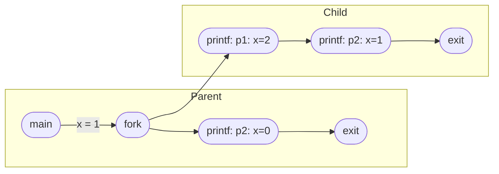
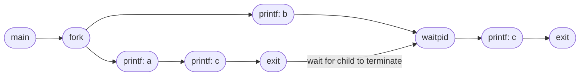
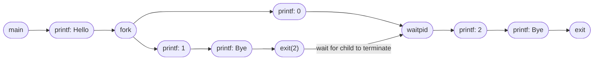

# Solutions to Practice Problems

[Back to Chapter Contents](./Chapter%208%20Exceptional%20Control%20Flow.md)

## Solution 8.1

Processes A and B are concurrent with respect to each other, as are B and C, because their respective executions overlap—that is, one process starts before the other finishes. Processes A and C are not concurrent because their executions do not overlap; A finishes before C begins.

## Solution 8.2

In our example program in [Figure 8.15](./8.4%20Process%20Control.md#fig-8-15), the parent and child execute disjoint sets of instructions. However, in this program, the parent and child execute nondisjoint sets of instructions, which is possible because the parent and child have identical code segments. This can be a difficult conceptual hurdle, so be sure you understand the solution to this problem. [Figure 8.47](#fig-8-47) shows the process graph.

A. The key idea here is that the child executes both `printf` statements. After the `fork` returns, it executes the `printf` in [line 6](8.4%20Process%20Control.md#Practice%20Problem%208.2). Then it falls out of the `if` statement and executes the `printf` in [line 7](8.4%20Process%20Control.md#Practice%20Problem%208.2). Here is the output produced by the child:

```console
p1: x=2
p2: x=1
```

B. The parent executes only the `printf` in [line 7](8.4%20Process%20Control.md#Practice%20Problem%208.2):

```console
p2: x=0
```

<div id="fig-8-47" class="anchor-block"></div>



<div class="figure-caption">

Figure 8.47 Process graph for [Practice Problem 8.2](./8.4%20Process%20Control.md#Practice%20Problem%208.2).

</div>

## Solution 8.3

We know that the sequences `acbc`, `abcc`, and `bacc` are possible because they correspond to topological sorts of the process graph ([Figure 8.48](#fig-8-48)). However, sequences such as `bcac` and `cbca` do not correspond to any topological sort and thus are not feasible.

<div id="fig-8-48" class="anchor-block"></div>



<div class="figure-caption">

Figure 8.48 Process graph for [Practice Problem 8.3](./8.4%20Process%20Control.md#Practice%20Problem%208.3).

</div>

## Solution 8.4

A. We can determine the number of lines of output by simply counting the number of `printf` vertices in the process graph ([Figure 8.49](#fig-8-49)). In this case, there are six such vertices, and thus the program will print six lines of output.

B. Any output sequence corresponding to a topological sort of the graph is possible. For example: `Hello`, `1`, `0`, `Bye`, `2`, `Bye` is possible.

<div id="fig-8-49" class="anchor-block"></div>



<div class="figure-caption">

Figure 8.49 Process graph for [Practice Problem 8.4](./8.4%20Process%20Control.md#Practice%20Problem%208.4).

</div>

## Solution 8.5

```c
unsigned int snooze(unsigned int secs)
{
    unsigned int rc = sleep(secs);

    printf("Slept for %d of %d secs.\n", secs - rc, secs);
    return rc;
}
```

## Solution 8.6

```c
#include "csapp.h"

int main(int argc, char *argv[], char *envp[])
{
    int i;

    printf("Command-line arguments:\n");
    for (i = 0; argv[i] != NULL; i++)
        printf("    argv[%2d]: %s\n", i, argv[i]);
    printf("\n");
    printf("Environment variables:\n");
    for (i = 0; envp[i] != NULL; i++)
        printf("    envp[%2d]: %s\n", i, envp[i]);
    exit(0);
}
```

## Solution 8.7

The `sleep` function returns prematurely whenever the sleeping process receives a signal that is not ignored. But since the default action upon receipt of a `SIGINT` is to terminate the process ([Figure 8.26](./8.5%20Signals.md#fig-8-26)), we must install a `SIGINT` handler to allow the `sleep` function to return. The handler simply catches the signal and returns control to the `sleep` function, which returns immediately.

```c
#include "csapp.h"

/* SIGINT handler */
void handler(int sig)
{
    return; /* Catch the signal and return */
}

unsigned int snooze(unsigned int secs)
{
    unsigned int rc = sleep(secs);

    printf("Slept for %d of %d secs.\n", secs - rc, secs);
    return rc;
}

int main(int argc, char **argv)
{
    if (argc != 2) {
        fprintf(stderr, "usage: %s <secs>\n", argv[0]);
        exit(0);
    }

    if (signal(SIGINT, handler) == SIG_ERR) /* Install SIGINT */
        unix_error("signal error\n");       /* handler        */
    (void)snooze(atoi(argv[1]));
    exit(0);
}
```

## Solution 8.8

This program prints the string `213`, which is the shorthand name of the CS:APP course at Carnegie Mellon. The parent starts by printing `2`, then forks the child, which spins in an infinite loop. The parent then sends a signal to the child and waits for it to terminate. The child catches the signal (interrupting the infinite loop), decrements the counter (from an initial value of 2), prints `1`, and then terminates. After the parent reaps the child, it increments the counter (from an initial value of 2), prints `3`, and terminates.
